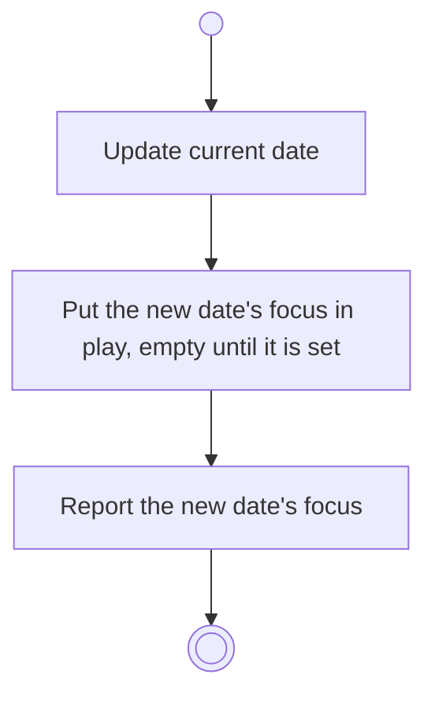

# BP14.01 — Roll the day over

> GENERATED by `bpmn-dsl si-export` — do not edit; the source is the `call` block in the
> `.bpd` (#1182/ADR-068, keyed by call site per ADR-069).
>
> hash: `sha256:0ab5151a4270fef301c0216e4fa646e86e3edef1cd61fc9c72cbd98624194b2b`

## BP14_RollTheDayOver — Activity diagram

### Bound rules

| Where | Rule |
|---|---|
| Update current date | `BR-44` |
| Put the new date's focus in play, empty until it is set | `BR-41` |
| Report the new date's focus | `BR-44` |

### Messages

| Where | Message | To | Payload |
|---|---|---|---|
| Roll the day over | The day rolled over | User | — |

### Notes

- **Roll the day over**: Rollover creates nothing and destroys nothing: no task is spawned, nothing is archived, nothing is closed and nothing is settled, and the date that just ended keeps the focus record it already had. That date joins the span the next check-out settles. Chores follows the new date on its own while it carries work that is not done.
