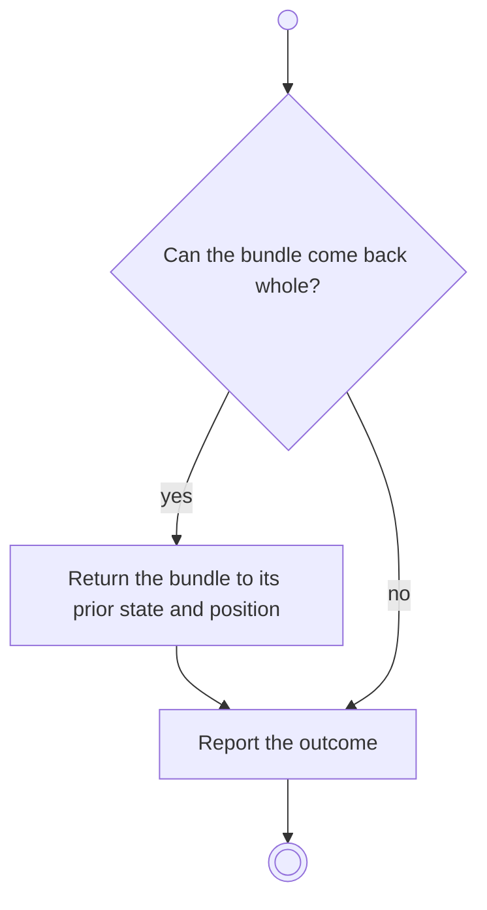

# BP15.03 — Unarchive an item

> GENERATED by `bpmn-dsl si-export` — do not edit; the source is the `call` block in the
> `.bpd` (#1182/ADR-068, keyed by call site per ADR-069).
>
> hash: `sha256:4f9c7a2d082e7e7c70e8188845aed5843903cabb50ebc97317a86037fbf6a793`

## BP15_ReviewArchivedMaterial — Activity diagram

### Bound rules

| Where | Rule |
|---|---|
| "Can the bundle come back whole?" | `BR-25` |
| Return the bundle to its prior state and position | `BR-25` |

### Messages

| Where | Message | To | Payload |
|---|---|---|---|
| Unarchive an item | What came back, or why it cannot | User | — |

### Notes

- **Unarchive an item**: A project brings its activities and their tasks; a goal brings its measures and their check-in history; a measure brings its own, and a goal's check-out record is untouched. An archived item's position is never occupied while it is away, so the bundle comes back to it. One answer carries both outcomes.
