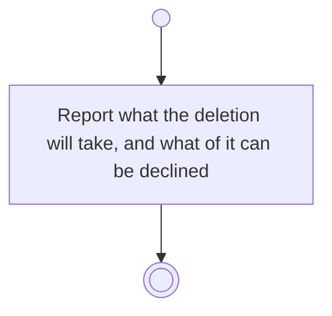

# BP15.04 — See what deleting the archived item takes

> GENERATED by `bpmn-dsl si-export` — do not edit; the source is the `call` block in the
> `.bpd` (#1182/ADR-068, keyed by call site per ADR-069).
>
> hash: `sha256:be423484c1a41f95dfb996bb073049d0d9c65b1df45b233330c28915f43981fd`

## BP15_ReviewArchivedMaterial — Activity diagram

### Bound rules

| Where | Rule |
|---|---|
| Report what the deletion will take, and what of it can be declined | `BR-12` |
| Report what the deletion will take, and what of it can be declined | `BR-19` |
| Report what the deletion will take, and what of it can be declined | `BR-117` |

### Messages

| Where | Message | To | Payload |
|---|---|---|---|
| See what deleting the archived item takes | What the deletion will take | User | — |

### Notes

- **See what deleting the archived item takes**: The item's own rule governs what the deletion reaches, as it does for a live one. Where the item owns nothing the answer is empty.
