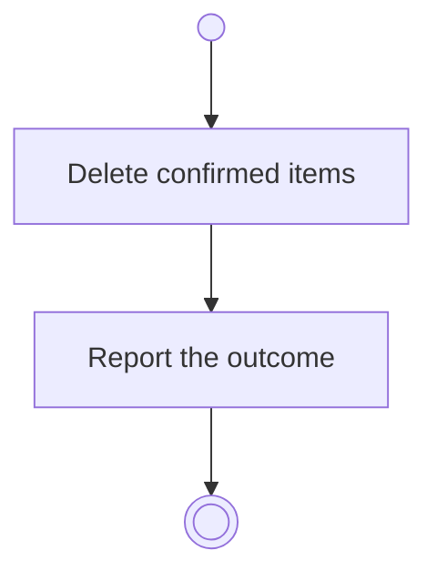

# BP15.05 — Delete an archived item

> GENERATED by `bpmn-dsl si-export` — do not edit; the source is the `call` block in the
> `.bpd` (#1182/ADR-068, keyed by call site per ADR-069).
>
> hash: `sha256:c9fca8417bfe62033bfd83f1539719e6f2e4c50c487d4d2f2b50757a406afc89`

## BP15_ReviewArchivedMaterial — Activity diagram

### Bound rules

| Where | Rule |
|---|---|
| Delete confirmed items | `BR-12` |
| Delete confirmed items | `BR-117` |

### Messages

| Where | Message | To | Payload |
|---|---|---|---|
| Delete an archived item | The deletion outcome | User | — |

### Notes

- **Delete an archived item**: Whatever bundle needed the deleted item can no longer be reassembled, so an unarchive that wanted it is refused afterwards and that item stays archived.
