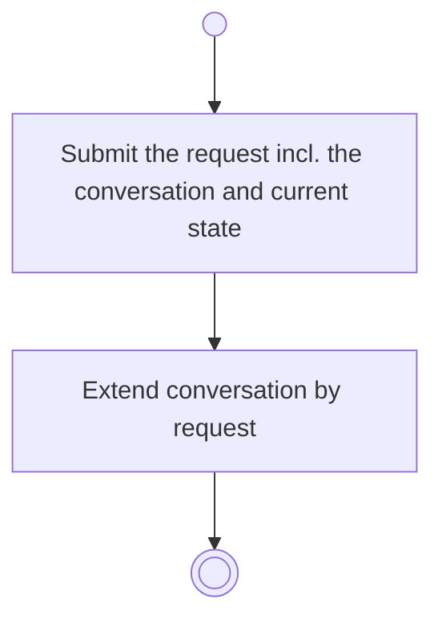

# BP16.02 — Ask the advisor

> GENERATED by `bpmn-dsl si-export` — do not edit; the source is the `call` block in the
> `.bpd` (#1182/ADR-068, keyed by call site per ADR-069).
>
> hash: `sha256:efbba2e7aace9833b6739574edd18aa9570da53aaf2d6a43d7fe1a0f4b7a1153`

## BP16_ConsultTheAdvisor — Activity diagram

### Bound rules

| Where | Rule |
|---|---|
| Submit the request incl. the conversation and current state | `BR-67` |
| Extend conversation by request | `BR-66` |

### Messages

| Where | Message | To | Payload |
|---|---|---|---|
| Ask the advisor | Advice requested | Advisor | — |

### Notes

- **Ask the advisor**: The whole funnel goes with the request: themes, ideas, goals, routines, focus history, tasks and progress check-ins.
