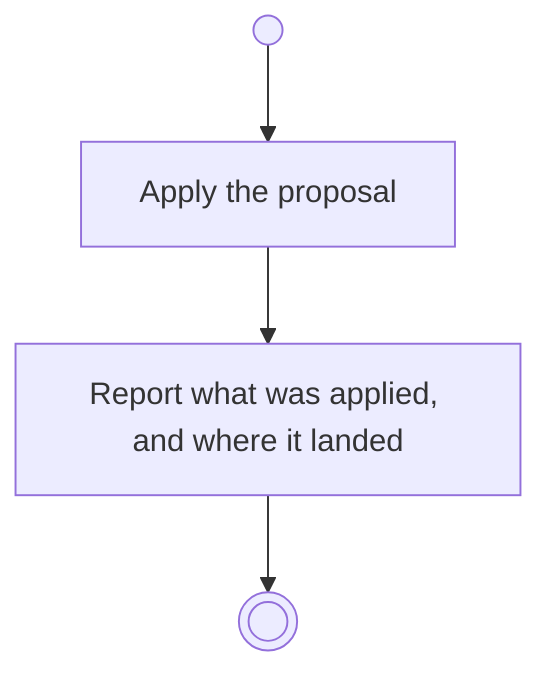

# BP16.04 — Apply the proposal

> GENERATED by `bpmn-dsl si-export` — do not edit; the source is the `call` block in the
> `.bpd` (#1182/ADR-068, keyed by call site per ADR-069).
>
> hash: `sha256:8909d2d1636be0ac124b9ab4a184ee79ff9cc3abd5ba23a9f74a81cedfed74ee`

## BP16_ConsultTheAdvisor — Activity diagram

### Bound rules

| Where | Rule |
|---|---|
| Apply the proposal | `BR-72` |
| Apply the proposal | `BR-69` |
| Apply the proposal | `BR-70` |
| Report what was applied, and where it landed | `BR-74` |

### Messages

| Where | Message | To | Payload |
|---|---|---|---|
| Apply the proposal | What was applied, and where | User | — |

### Notes

- **Apply the proposal**: A proposal to create something carries everything that thing needs.
