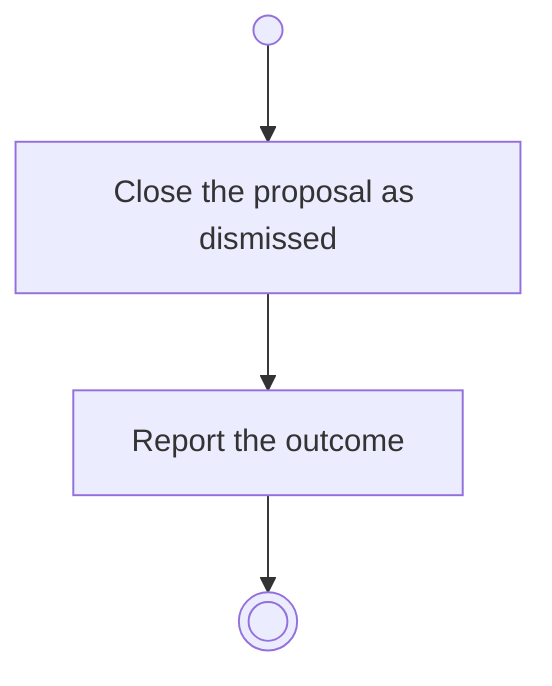

# BP16.05 — Dismiss the proposal

> GENERATED by `bpmn-dsl si-export` — do not edit; the source is the `call` block in the
> `.bpd` (#1182/ADR-068, keyed by call site per ADR-069).
>
> hash: `sha256:87224ef3a5af0148c473139b0a1eb86aa8f59b901cad2081ed7be4a6b48f666f`

## BP16_ConsultTheAdvisor — Activity diagram

### Bound rules

| Where | Rule |
|---|---|
| Close the proposal as dismissed | `BR-70` |

### Messages

| Where | Message | To | Payload |
|---|---|---|---|
| Dismiss the proposal | What was dismissed | User | — |

### Notes

- **Dismiss the proposal**: A proposal already applied or dismissed is closed, and nothing reopens it (BR-70).
