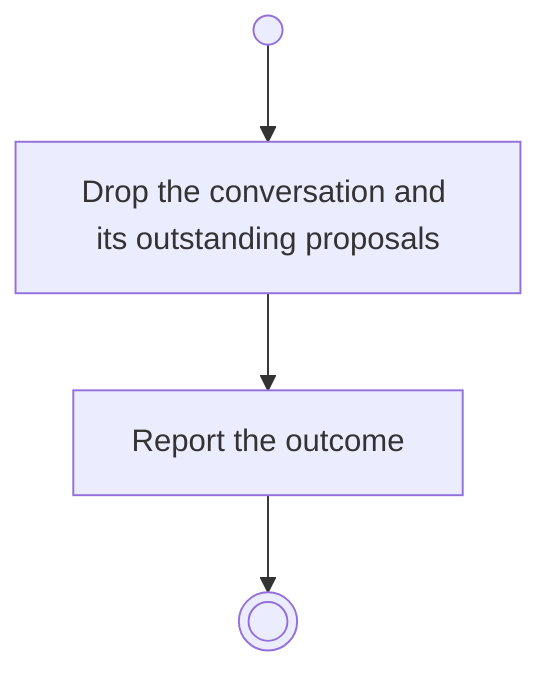

# BP16.06 — Clear the conversation

> GENERATED by `bpmn-dsl si-export` — do not edit; the source is the `call` block in the
> `.bpd` (#1182/ADR-068, keyed by call site per ADR-069).
>
> hash: `sha256:ca3ed75029e444af1844c0113d83764dd605bd88dcff30a4be9d25a28e7e5b75`

## BP16_ConsultTheAdvisor — Activity diagram

### Bound rules

| Where | Rule |
|---|---|
| Drop the conversation and its outstanding proposals | `BR-66` |

### Messages

| Where | Message | To | Payload |
|---|---|---|---|
| Clear the conversation | What was cleared | User | — |

### Notes

- **Clear the conversation**: Applied and dismissed proposals are closed already and are unaffected by clearing.
