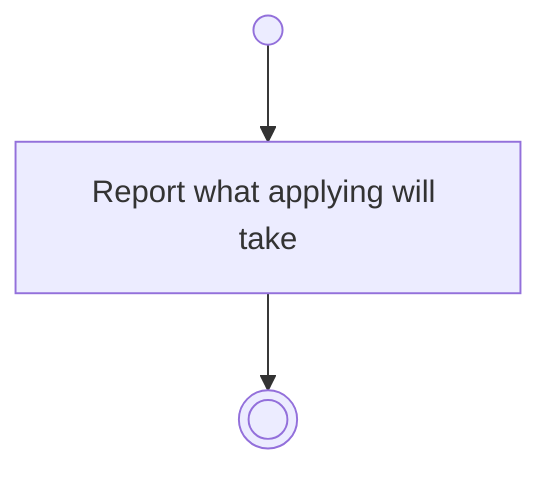

# BP16.07 — See what applying will take

> GENERATED by `bpmn-dsl si-export` — do not edit; the source is the `call` block in the
> `.bpd` (#1182/ADR-068, keyed by call site per ADR-069).
>
> hash: `sha256:51536ee1ad68729a3ed4bf67885a925841c90449b89ea214bf6b14c03a66bd2e`

## BP16_ConsultTheAdvisor — Activity diagram

### Bound rules

| Where | Rule |
|---|---|
| Report what applying will take | `BR-72` |
| Report what applying will take | `BR-117` |
| Report what applying will take | `BR-74` |

### Messages

| Where | Message | To | Payload |
|---|---|---|---|
| See what applying will take | What applying will take, and where it lands | User | — |

### Notes

- **See what applying will take**: A proposal that takes nothing has nothing to disclose. One that deletes or archives discloses exactly what the user's own gesture would, because it is that gesture.
