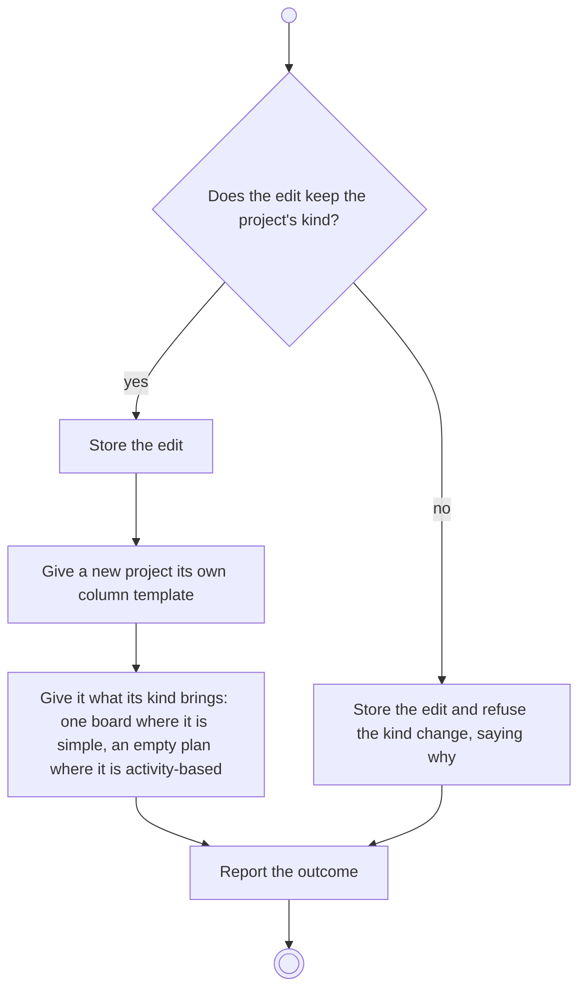

# BP17.02 — Edit a project

> GENERATED by `bpmn-dsl si-export` — do not edit; the source is the `call` block in the
> `.bpd` (#1182/ADR-068, keyed by call site per ADR-069).
>
> hash: `sha256:668374ac9407bf1c01537b6445a13997ae948331c85d801280da852f0e6ebb33`

## BP17_MaintainAProject — Activity diagram

### Bound rules

| Where | Rule |
|---|---|
| "Does the edit keep the project's kind?" | `BR-97` |
| Store the edit | `BR-96` |
| Give a new project its own column template | `BR-108` |
| Give it what its kind brings: one board where it is simple, an empty plan where it is activity-based | `BR-101` |
| Give it what its kind brings: one board where it is simple, an empty plan where it is activity-based | `BR-111` |
| Store the edit and refuse the kind change, saying why | `BR-97` |

### Messages

| Where | Message | To | Payload |
|---|---|---|---|
| Edit a project | The editing outcome | User | — |

### Notes

- **Edit a project**: The new template starts from four columns, one per role. The kind is declared once and never migrates, and the parent is single-valued. A plan orders and tracks; it carries no duration, no float and no critical path.
