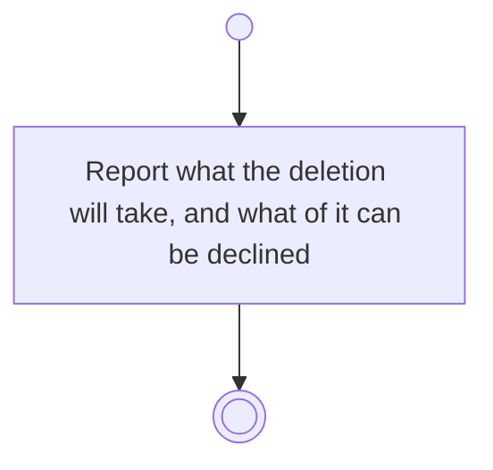

# BP17.04 — See what deleting a project takes

> GENERATED by `bpmn-dsl si-export` — do not edit; the source is the `call` block in the
> `.bpd` (#1182/ADR-068, keyed by call site per ADR-069).
>
> hash: `sha256:4d8da016db536616fc156df61895e3de1d3bb0ebc1d2b9e62e1f408cd00c35df`

## BP17_MaintainAProject — Activity diagram

### Bound rules

| Where | Rule |
|---|---|
| Report what the deletion will take, and what of it can be declined | `BR-12` |
| Report what the deletion will take, and what of it can be declined | `BR-19` |
| Report what the deletion will take, and what of it can be declined | `BR-113` |
| Report what the deletion will take, and what of it can be declined | `BR-114` |
| Report what the deletion will take, and what of it can be declined | `BR-101` |
| Report what the deletion will take, and what of it can be declined | `BR-117` |

### Messages

| Where | Message | To | Payload |
|---|---|---|---|
| See what deleting a project takes | What the project deletion will take | User | — |

### Notes

- **See what deleting a project takes**: Everything the project is goes with it. Keeping anything below it is not offered, because nothing below a project can be detached.
