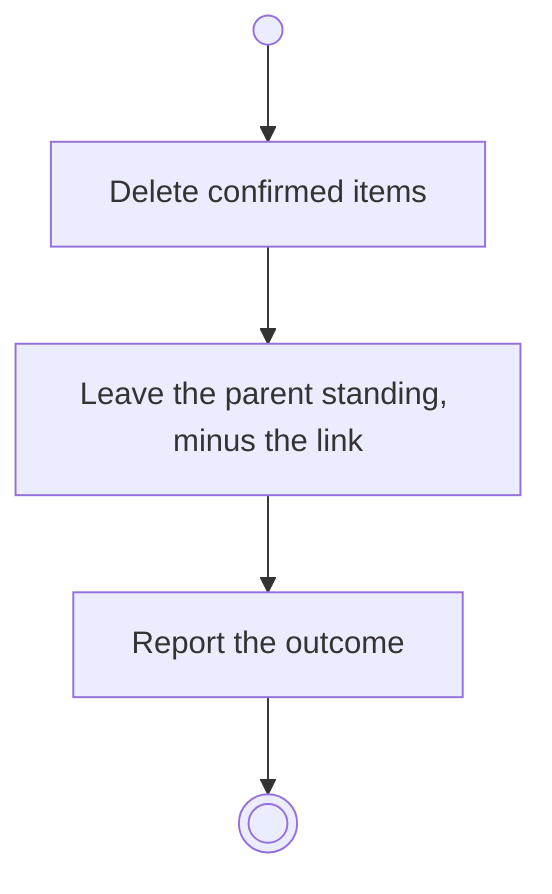

# BP17.05 — Delete a project

> GENERATED by `bpmn-dsl si-export` — do not edit; the source is the `call` block in the
> `.bpd` (#1182/ADR-068, keyed by call site per ADR-069).
>
> hash: `sha256:240bd58e29da01e44fc78e88b40543698ff5fca8c74656aa976beccf3f46bcd5`

## BP17_MaintainAProject — Activity diagram

### Bound rules

| Where | Rule |
|---|---|
| Delete confirmed items | `BR-108` |
| Delete confirmed items | `BR-114` |
| Leave the parent standing, minus the link | `BR-96` |

### Messages

| Where | Message | To | Payload |
|---|---|---|---|
| Delete a project | The deletion outcome | User | — |

### Notes

- **Delete a project**: The parent survives a project's deletion. A goal left with no linked idea is flagged on its current state.
