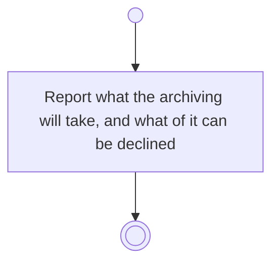

# BP17.14 — See what archiving a project takes

> GENERATED by `bpmn-dsl si-export` — do not edit; the source is the `call` block in the
> `.bpd` (#1182/ADR-068, keyed by call site per ADR-069).
>
> hash: `sha256:6b19ea659414a5407e5465bd2eba7729ea9cce60c22adb9a791ba174d1432880`

## BP17_MaintainAProject — Activity diagram

### Bound rules

| Where | Rule |
|---|---|
| Report what the archiving will take, and what of it can be declined | `BR-19` |
| Report what the archiving will take, and what of it can be declined | `BR-113` |
| Report what the archiving will take, and what of it can be declined | `BR-112` |
| Report what the archiving will take, and what of it can be declined | `BR-101` |

### Messages

| Where | Message | To | Payload |
|---|---|---|---|
| See what archiving a project takes | What the archiving will take | User | — |

### Notes

- **See what archiving a project takes**: Archiving a project is the only way an activity is archived at all, and it is approved whole or rejected whole.
