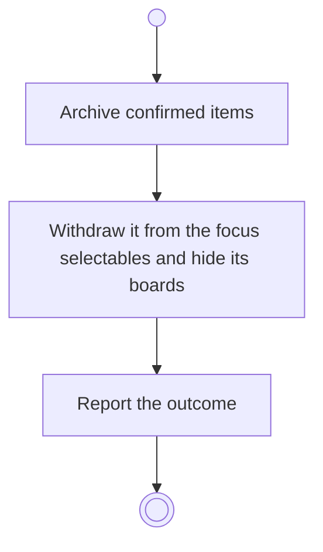

# BP17.15 — Archive a project

> GENERATED by `bpmn-dsl si-export` — do not edit; the source is the `call` block in the
> `.bpd` (#1182/ADR-068, keyed by call site per ADR-069).
>
> hash: `sha256:ea0d8e46ad25b8087214f3ec27000d78eb1c1a4341e580d2be37d1d1a87644e0`

## BP17_MaintainAProject — Activity diagram

### Bound rules

| Where | Rule |
|---|---|
| Archive confirmed items | `BR-23` |
| Archive confirmed items | `BR-112` |
| Withdraw it from the focus selectables and hide its boards | `BR-43` |

### Messages

| Where | Message | To | Payload |
|---|---|---|---|
| Archive a project | The archiving outcome | User | — |

### Notes

- **Archive a project**: An archived project is frozen until it is brought back, and it comes back as the whole bundle it went as.
