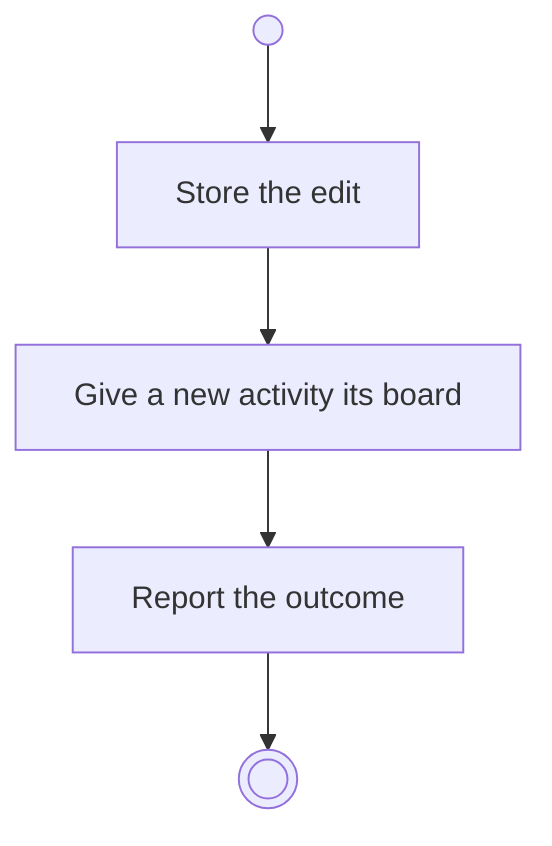

# BP18.02 — Edit an activity

> GENERATED by `bpmn-dsl si-export` — do not edit; the source is the `call` block in the
> `.bpd` (#1182/ADR-068, keyed by call site per ADR-069).
>
> hash: `sha256:8c4f2fe6e78dabb62a4124c2f3aaf45cdd4ebfb8ed7e7852d10abc79c453b43c`

## BP18_PlanAProjectsCourse — Activity diagram

### Bound rules

| Where | Rule |
|---|---|
| Store the edit | `BR-98` |
| Store the edit | `BR-105` |
| Give a new activity its board | `BR-101` |
| Give a new activity its board | `BR-65` |

### Messages

| Where | Message | To | Payload |
|---|---|---|---|
| Edit an activity | The editing outcome | User | — |

### Notes

- **Edit an activity**: Activities are flat: finer granularity means more activities, never sub-activities. A board exists because its owner exists.
