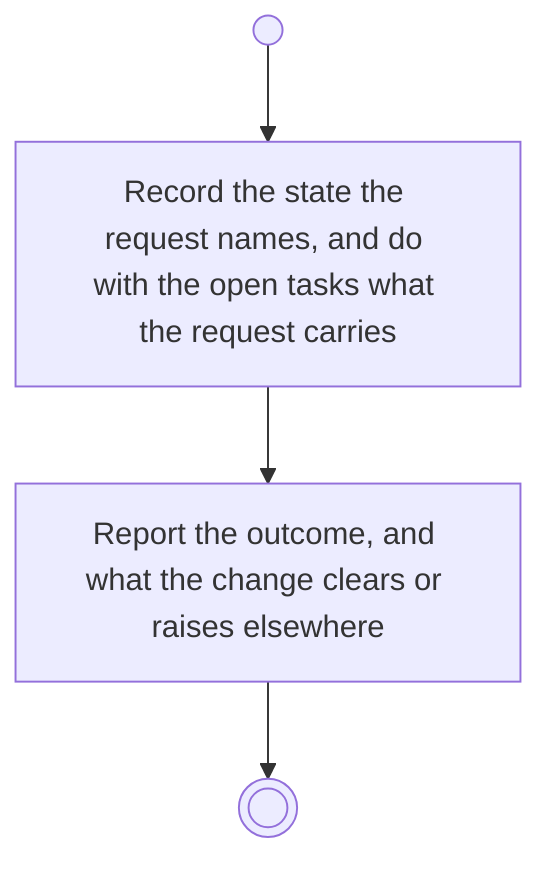

# BP18.04 — Set an activity's state

> GENERATED by `bpmn-dsl si-export` — do not edit; the source is the `call` block in the
> `.bpd` (#1182/ADR-068, keyed by call site per ADR-069).
>
> hash: `sha256:9809f16f83f0c8cca23d074583859e4e9fc2c8e0e9de5d960f1568df35b830d7`

## BP18_PlanAProjectsCourse — Activity diagram

### Bound rules

| Where | Rule |
|---|---|
| Record the state the request names, and do with the open tasks what the request carries | `BR-109` |
| Record the state the request names, and do with the open tasks what the request carries | `BR-127` |
| Record the state the request names, and do with the open tasks what the request carries | `BR-23` |
| Report the outcome, and what the change clears or raises elsewhere | `BR-110` |

### Messages

| Where | Message | To | Payload |
|---|---|---|---|
| Set an activity's state | The state-change outcome | User | — |

### Notes

- **Set an activity's state**: This is also where the board's completion offer lands.
