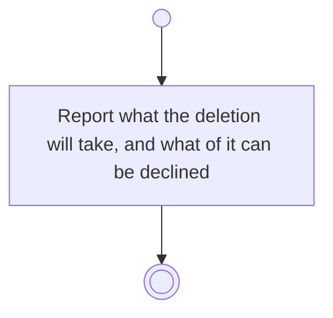

# BP18.05 — See what deleting an activity takes

> GENERATED by `bpmn-dsl si-export` — do not edit; the source is the `call` block in the
> `.bpd` (#1182/ADR-068, keyed by call site per ADR-069).
>
> hash: `sha256:3002d558fce672b61b9e061e4b8fe49e37ba2abb385f3fa6d53fcb5f30937d86`

## BP18_PlanAProjectsCourse — Activity diagram

### Bound rules

| Where | Rule |
|---|---|
| Report what the deletion will take, and what of it can be declined | `BR-12` |
| Report what the deletion will take, and what of it can be declined | `BR-19` |
| Report what the deletion will take, and what of it can be declined | `BR-113` |
| Report what the deletion will take, and what of it can be declined | `BR-104` |
| Report what the deletion will take, and what of it can be declined | `BR-117` |

### Messages

| Where | Message | To | Payload |
|---|---|---|---|
| See what deleting an activity takes | What the activity deletion will take | User | — |

### Notes

- **See what deleting an activity takes**: A task needs a board, so declining has no legal outcome: the gesture is approved or abandoned. The dependency edges simply go.
