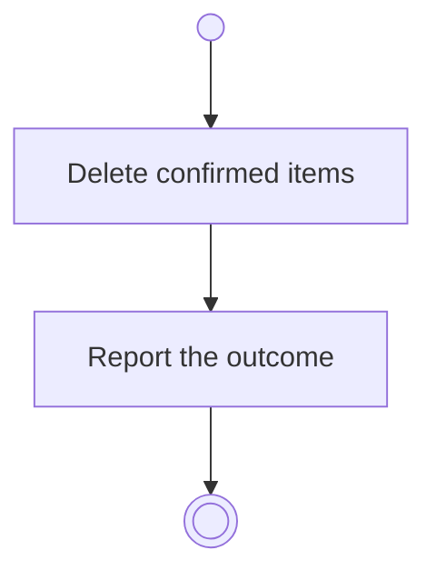

# BP18.06 — Delete an activity

> GENERATED by `bpmn-dsl si-export` — do not edit; the source is the `call` block in the
> `.bpd` (#1182/ADR-068, keyed by call site per ADR-069).
>
> hash: `sha256:6936748a8e02cd0e0dd719d6c8ce1999691849c734f31e3ba4147621f7b18cd7`

## BP18_PlanAProjectsCourse — Activity diagram

### Bound rules

| Where | Rule |
|---|---|
| Delete confirmed items | `BR-101` |
| Delete confirmed items | `BR-104` |

### Messages

| Where | Message | To | Payload |
|---|---|---|---|
| Delete an activity | The deletion outcome | User | — |

### Notes

- **Delete an activity**: The gap an edge leaves is not closed transitively. An activity is never archived on its own; only its project's archiving takes it.
