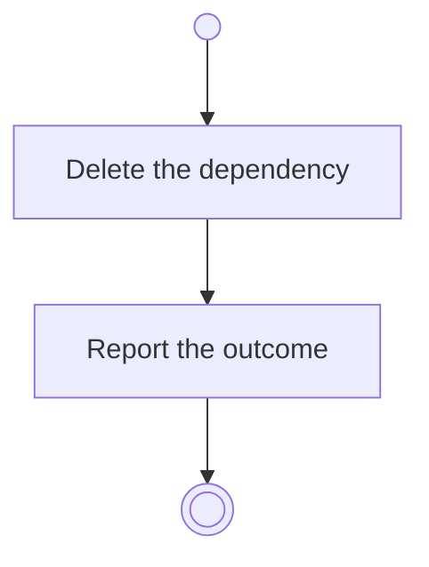

# BP18.08 — Remove a dependency

> GENERATED by `bpmn-dsl si-export` — do not edit; the source is the `call` block in the
> `.bpd` (#1182/ADR-068, keyed by call site per ADR-069).
>
> hash: `sha256:406428ee3c50e0146c835214cc09164d37a822ea39abcc13ac8d971841d678fb`

## BP18_PlanAProjectsCourse — Activity diagram

### Bound rules

| Where | Rule |
|---|---|
| Delete the dependency | `BR-99` |
| Delete the dependency | `BR-104` |

### Messages

| Where | Message | To | Payload |
|---|---|---|---|
| Remove a dependency | The removal outcome | User | — |
