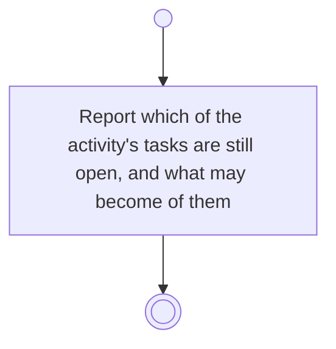

# BP18.10 — See what the state change takes

> GENERATED by `bpmn-dsl si-export` — do not edit; the source is the `call` block in the
> `.bpd` (#1182/ADR-068, keyed by call site per ADR-069).
>
> hash: `sha256:2c98cb27292c9e1d4825550b4e7ddf18c0a5d996a59d0d9954024743005139a7`

## BP18_PlanAProjectsCourse — Activity diagram

### Bound rules

| Where | Rule |
|---|---|
| Report which of the activity's tasks are still open, and what may become of them | `BR-127` |
| Report which of the activity's tasks are still open, and what may become of them | `BR-109` |

### Messages

| Where | Message | To | Payload |
|---|---|---|---|
| See what the state change takes | What the change will take | User | — |
