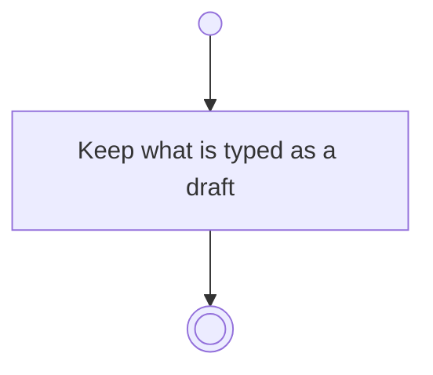

# BP19.01 — Keep the edit as a draft

> GENERATED by `bpmn-dsl si-export` — do not edit; the source is the `call` block in the
> `.bpd` (#1182/ADR-068, keyed by call site per ADR-069).
>
> hash: `sha256:bb4969b480fd50a26c84b8f19621437e7ef775946ee6ab3804d7fbfb58025b5b`

## BP19_KeepAnEditAsADraft — Activity diagram

### Bound rules

| Where | Rule |
|---|---|
| Keep what is typed as a draft | `BR-121` |

### Notes

- **Keep the edit as a draft**: One-way: nothing waits for the draft to be kept. It stays out of the planning history, and nothing it describes takes effect until the gesture that owns it completes.
