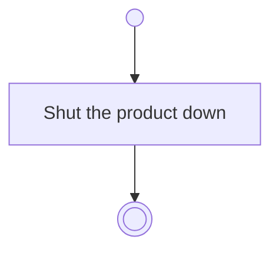

# BP20.01 — Close Bearing

> GENERATED by `bpmn-dsl si-export` — do not edit; the source is the `call` block in the
> `.bpd` (#1182/ADR-068, keyed by call site per ADR-069).
>
> hash: `sha256:44b1b97034e5b4ea979fd3fd7ae7f7f878a80d2ea9929ed0a5af5936a301f395`

## BP20_CloseBearing — Activity diagram

### Bound rules

| Where | Rule |
|---|---|
| Shut the product down | `BR-121` |
| Shut the product down | `BR-92` |

### Notes

- **Close Bearing**: One-way: nothing waits for the shutdown to be reported. The drafts and the remembered interface state stay where they are, and the next launch restores them.
