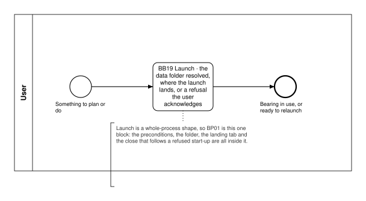

# BP01 — Start Bearing

**Stage.** Discovery / Mockup — **before the Intent gate**. Nothing here is const.

| | |
|---|---|
| **Trigger** | **App launch** — every launch, not only the first (ruled 2026-10-09; finding 1). |
| **Goal** | The user ends up working in Bearing, on their own data, with the data folder under version control — or is told why they cannot and what to do about it, before anything of theirs is touched. |
| **Actors** | **User** (the only human; also the stakeholder) · **Bearing** (the system). No external system takes part. |
| **Source** | `diagrams/BP01_StartBearing.bpd` — the one tagged source for both levels. |
| **Sources it traces to** | `wf §7.2` (bootstrapping, no settings), `wf §7.7` (new-data-folder notification). `wf §7.1`'s onboarding wizard is **void** (SA 2026-10-11). |
| **Rules it exercises** | BR-44, BR-48, BR-80, BR-81, BR-82, BR-92, BR-102, BR-121, BR-122 |

## The flow in one paragraph

Every launch inspects the data folder at its conventional path, then checks its start-up
preconditions — some of which are about that folder — and refuses to start when one is unmet,
writing nothing (BR-122). Which preconditions those are is technical and belongs to the use case,
not here. Past the check the launch ends in one of two ways, both success. **No folder at the path**
— Bearing creates it, brings it under version control, and installs the template files, the five
life areas and the **Chores board** among them, so the product is usable the moment it opens; the
user is told in passing — a quiet notice that blocks nothing and that no box draws, since noticing
it is nothing the user does (BR-81, UX-16) — and the launch lands on
**Themes**, where those five are waiting (BR-48). **A folder Bearing can work with** — loaded, and the
landing is Focus. A folder that is not Bearing's own,
or not in a state it can work with, is an unmet precondition like any other and never reaches either
path. That is the one dead end there is: the user acknowledges what Bearing reported, Bearing closes
on the acknowledgement, and putting the thing right is work outside the product, before the next
launch. Either launch that starts loads the folder and sets the current date to today —
not a rollover, since the starting point is no day rather than a previous one (BR-44). **There is no
onboarding wizard** (SA 2026-10-11): the template files make the product usable on their own, so a
first-time startup simply opens Themes, and renaming a life area, dropping one, adding one of the
user's own, and writing a vision and a mission are all `BP02`'s business, done the one way they are
done everywhere.

## Block view — the work loop with one box per building block



Each box is one path and names the **building block** it is, with what is inside the block left to [`00_Path-Patterns.md`](00_Path-Patterns.md) — the system pool is not drawn here at all. Source: `block-views/BP01_StartBearing.bpd`, authored from the one tagged source below and re-read whenever that process changes.

## Level 1 — fully detailed (system chains inline-expanded)


## Level 2 — detailed (system chains collapsed, one box per call site)


## Call sites

Two. The ids are **call sites of this process** (`BP01.yy`, ADR-069) — which System Interaction each
resolves to is a Design decision, recorded in `si-binding.yaml`, never a rename.

| Call site | On the box | What it does | Steps |
|---|---|---|---|
| [`BP01.01`](../02_System-Interactions/BP01.01_StartUp.md) | Start up | Inspects the data folder, then checks the start-up preconditions — some are about the folder — and past them does the one thing the folder's state calls for: load it, or **set it up** and load it. Both paths end in the same load, and what is loaded is then derived from — every count, flag, ordering and figure a surface shows (the derived-data inventory) — before the current date is set to today. A first-time start-up names Themes as the starting tab; any other launch names Focus. Every unmet precondition reaches one refusal box. Reports the outcome, the refusal included. | 10, three gateways |
| [`BP01.09`](../02_System-Interactions/BP01.09_CloseBearing.md) | Close Bearing | Shuts the product down. One-way — the product is gone, so there is nothing to answer with. Requested from the one dead end there is: a refused start-up the user has acknowledged. | 1 |

**Seven of this process's call sites are retired, and their ids are never reused** (ADR-066):
`BP01.02` *Seed the starter themes* — the five life areas ship with the template files (SA
2026-10-10); and with the onboarding wizard (SA 2026-10-11) `BP01.03` *Amend a starter theme*,
`BP01.04` *Record vision and mission*, `BP01.05` *Complete onboarding*, `BP01.06` *Remove a starter
theme*, `BP01.07` *Add a theme* and `BP01.08` *Draft the wizard input*. Every one of them is `BP02`'s
work — the same edit, done the same way, whether it is the first launch or the hundredth. What `BP01`
decides is only **where the launch lands**: Themes the first time, Focus after that.

## Findings for the Software Architect

1. ~~**The process is wider than its name.**~~ **RULED 2026-10-09 — the name and trigger widen.**
   This drawing covers **every** launch, because the usable-data state *is* the ordinary
   returning-user launch and §6 lists its interactions under this process. The Software Architect
   widened the process to match the drawing — **"Start Bearing"** / **"App launch"** — rather than
   splitting that state into a process of its own. Intent §5 and §6 carry the widened name; the
   drawing needed no change.
2. ~~**Repeated amendment is drawn as a multi-instance step.**~~ ~~**`BP01.03`, `BP01.06` and
   `BP01.07` may well be `BP02`'s theme edit, delete and create.**~~ **BOTH VOID 2026-10-11 — the
   wizard is gone.** The multi-instance question and the duplication question were both about
   screens this process no longer draws; the edits are `BP02`'s, which is what finding 8 records.
3. *(void — folded into 2)*
4. **A call site's speaking name is drawn in the *requester's* pool, so it is written in the
   requester's words.** The compiler labels the request arrow `<call-site id> · <speaking name>` and
   **discards the authored `send` label**, so that one string is both what the user asks for and what
   the system-side box is called. `BP01.01` therefore reads *Start up*, not *Resolve the data folder*
   — resolving the folder is what the system does inside the block, and no user thinks about it at
   launch. Same for `BP01.09`: the user confirms an error and wants the product gone, so the box
   reads *Close Bearing* — the request, not *Shut the product down*, which is the work inside the
   block. **The naming rule for every remaining BP:** name a call site for the request, never for
   the internal work.
   ⚠ Upstream: the arrow should carry the author's own `send` label and the box the speaking name;
   one string cannot honestly serve both. Worth raising against `bpmn-dsl`.
5. **Which files a usable folder must hold is still open.** The folder states narrowed from four
   to three on 2026-10-10: an unversioned folder is no longer brought under version control — it is
   refused, like a foreign repository and like one missing files this version requires. What the
   gateway checks is ruled — **the existence of the required files**, not a version marker — but
   **which files those are is not yet specified**, and BR-80 needs that list before Contract.
   `wf §7.2` state 4 ("Present, not a git repo: run `git init` in place and proceed") is superseded
   by the ruling.
6. **A created folder is loaded like any other.** Both success paths converge on the same *Load the
   data* box, and what the other path does first is **one** box, *Set up data folder*: creating it,
   bringing it under version control, installing the template files — which already carry the
   Chores board (BR-102, ruled 2026-10-10 — no separate step creates it) — and committing them are
   four technicalities of one business act, so they belong to the Detail Design and not to this
   drawing (SA 2026-10-11), exactly as the precondition list does (finding 10). The convergence is
   drawn with a `goto`, so the load exists once.
7. ~~**Nothing draws the close itself.**~~ **RULED 2026-10-10 — the close is drawn, as `BP01.09`.**
   Bearing closes on the user's confirmation of the start-up error, and that is the product
   acting, not the user quitting: it is drawn as a request into the system, the user's one terminal
   path ends at *Ready to relaunch*, and the system chain ends at *Bearing closed* — where a closing
   product belongs. **One call site, one call arrow**, because there is one dead end (finding 11):
   this finding said *two* until 2026-10-11, when Quit in the new-folder notice went (BR-81) and took
   the second requester with it. It is the one call site **§6 never listed**: the close surfaced from
   the drawing, not from the business input.
8. **The life areas ship, so the wizard had nothing left to do.** `BP01.02` *Seed the starter
   themes* went first (2026-10-10, the template files carry the five), and on 2026-10-11 the
   **onboarding wizard went with it**: *"since the idea to use template files to populate new
   Bearing folders, I don't think we need the wizard"*. A first-time startup — which is simply a launch
   on which a data folder had to be set up (BR-48, SA 2026-10-11) — opens **Themes**
   instead of Focus and every edit is `BP02`'s, which drops five more call sites from this process
   and the redundancy with them. **BR-82 is rewritten** and `wf §7.1`'s wizard, `05_UX-Directives`
   UX-03 and Acceptance's "themes editable inline" go with it. Asking for the five back went too,
   on 2026-10-11: **BR-83 is void**, they ship once with the data folder, and starting over means
   deleting that folder outside Bearing.
9. **Nothing is discarded on the way out.** `BP01.09` shuts the product down and does nothing else:
   the close is reachable only from the one start-up dead end, where no screen of the user's has
   been up yet, so there is no draft to lose (ruled 2026-10-10). BR-121's discard belongs wherever a
   form is actually abandoned, not here.
10. **Start-up has preconditions; which ones is not business.** The drawing carries one general
    check — *Check the start-up preconditions* / `Preconditions satisfied?` — and one refusal,
    bound to **BR-122**. The list (git present and at a version floor, a committing identity, no
    second Bearing process, the folder's file-structure version, the repository's state) is
    **technical** and lives in **Contract §4.7**, to be realized as use-case preconditions at
    Design: *"listing technicalities in a business intent is not acceptable"* (SA 2026-10-11). The
    folder is resolved and inspected **before** the check, because some preconditions are about the
    folder (SA 2026-10-11), and every unmet one — the machine's and the folder's alike — reaches
    **one** refusal box. What is left after the check is two success paths and nothing else. The
    user's recovery is one box too, because putting any of them right is work outside Bearing.
11. **There is one dead end, and the new-folder notice is not it.** Setting up a fresh folder is
    reported **in passing** — a quiet notice that blocks nothing, nothing waiting on it, the launch
    carrying on regardless, and since 2026-10-18 not a drawn box either: a launch that had to set
    the folder up is a launch with usable data like any other (UX-16) (**BR-81** rewritten; `[ Quit ]` / `[ Continue ]` void;
    Contract `E-13`; Acceptance `QA-01` void, `VS-16` loses its one exception). A Bearing folder
    that was there and is now gone is possible but unlikely, and the recovery costs nothing: quit,
    delete the fresh folder outside Bearing, restore the backup at that path — the fresh folder
    overwrote nothing. The only path that stands a launch down is the unmet precondition:
    *Acknowledge what Bearing reported* → `BP01.09` → *Put the reported thing right* →
    *Ready to relaunch*.

## Regenerating

```bash
bpmn-dsl build   diagrams/BP01_StartBearing.bpd --outputs       # both .bpmn levels
bpmn-dsl lint    diagrams/                                      # authoring rules
bpmn-dsl build   diagrams/ --check                              # staleness gate
bpmn-dsl si-export diagrams/ -o ../02_System-Interactions       # the per-call-site projections
render-bpmn-to-svg diagrams/<level>/BP01_StartBearing.bpmn -o SVG/BP01_StartBearing.<level>.svg \
  --si-docs ../02_System-Interactions
```

The `.bpmn`, the SVGs and everything under `02_System-Interactions/` are **generated**. Edit the
`.bpd` and rebuild; never hand-edit the output.
