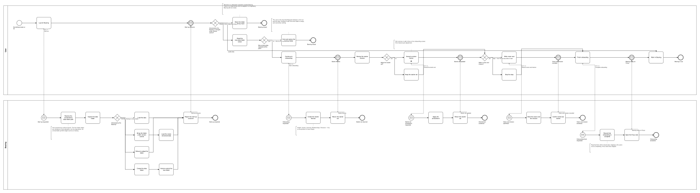
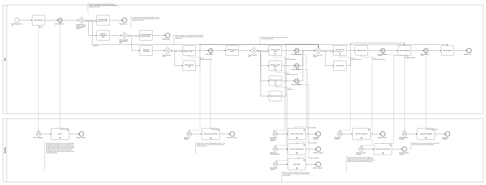

# BP01 — Start Bearing

**Stage.** Discovery / Mockup — **before the Intent gate**. Nothing here is const.

| | |
|---|---|
| **Trigger** | **App launch** — every launch, not only the first (ruled 2026-10-09; finding 1). |
| **Goal** | The user ends up working in Bearing, on their own data, with the data folder under version control — or is told why they cannot and what to do about it. |
| **Actors** | **User** (the only human; also the stakeholder) · **Bearing** (the system). No external system takes part. |
| **Source** | `diagrams/BP01_StartBearing.bpd` — the one tagged source for both levels. |
| **Sources it traces to** | `wf §7.1` (onboarding), `wf §7.2` (bootstrapping, no settings), `wf §7.7` (new-data-folder notification) |
| **Rules it exercises** | BR-44, BR-48, BR-80, BR-81, BR-82, BR-92, BR-102, BR-121 |

## The flow in one paragraph

Every launch resolves the conventional data folder and ends in one of three outcomes. **Usable
data** — the folder is Bearing's own, or is brought under version control on the spot — and the user
simply works. **A repository Bearing did not create** — refused; the user moves it aside by hand and
relaunches. **A new, empty folder** — the user is told before any of their data is touched, and is
the one who decides what that means: quit and restore a backup, or continue as a first run. Creating the folder is
also what brings the **Chores board** into existence, so there is always one board to work on. Every
launch sets the day in play to the current date — not a rollover, since the starting point is no day
rather than a previous one (BR-44). Only
that last path reaches onboarding, which offers a starter set of five life areas and adjusts them
inline, then offers vision and mission. Either step can be skipped, and so can the whole wizard:
skipping seeds nothing, and ideas and non-project tasks can be worked straight away. Completion lands
on Focus.

## Level 1 — fully detailed (system chains inline-expanded)



## Level 2 — detailed (system chains collapsed, one box per call site)



## Call sites

Eight, each one synchronous call into the system. The ids are **call sites of this process**
(`BP01.yy`, ADR-069) — which System Interaction each resolves to is a Design decision, recorded in
`si-binding.yaml`, never a rename.

| Call site | On the box | What it does | Steps |
|---|---|---|---|
| [`BP01.01`](../02_System-Interactions/BP01.01_StartUp.md) | Start up | Resolves the path, inspects the folder, and does the one thing its state calls for: load · version-control then load · refuse · create, version-control and bring Chores into existence. Sets the day in play to the current date. Where data was loaded it restores the remembered interface state and opens Focus. Reports the outcome. | 12, two gateways |
| [`BP01.02`](../02_System-Interactions/BP01.02_SeedTheStarterThemes.md) | Seed the starter themes | Creates the five starter themes and returns the set. Runs only when the user asks for a starter set. | 2 |
| [`BP01.03`](../02_System-Interactions/BP01.03_AmendAStarterTheme.md) | Amend a starter theme | Applies the name and colour as given and returns the set. | 2 |
| [`BP01.06`](../02_System-Interactions/BP01.06_RemoveAStarterTheme.md) | Remove a starter theme | Deletes the theme and returns the set. A starter theme has nothing under it yet. | 2 |
| [`BP01.07`](../02_System-Interactions/BP01.07_AddATheme.md) | Add a theme | Stores a theme of the user's own, last in the order, and returns the set. | 3 |
| [`BP01.04`](../02_System-Interactions/BP01.04_RecordVisionAndMission.md) | Record vision and mission | Stores both and confirms what was stored. | 2 |
| [`BP01.05`](../02_System-Interactions/BP01.05_CompleteOnboarding.md) | Complete onboarding | Records that onboarding is complete and opens Focus. | 2 |
| [`BP01.08`](../02_System-Interactions/BP01.08_DraftTheWizardInput.md) | Draft the wizard input | Keeps what is typed as a draft, out of version control. One-way: nothing waits for it, and the write that commits the form discards it. Every form on this surface drafts this way (BR-121). | 1 |

**Three of §6's eleven candidate interactions turned out not to be operations.** *Adopt a folder
already under version control*, *bring an unversioned folder under version control* and *create a
folder* are **branches of `BP01.01`**, not three calls — the launch is one request, and the folder's
state is a variation of one answer. *Report that a new folder was created* and *report a foreign
repository* are that call's **answer**, carried on the message back to the user. *Skip a wizard step*
and *skip the wizard* are **gateway edges into `BP01.05`**: skipping is completing, minus what was
skipped. What is left is the five above.

## Findings for the Software Architect

1. ~~**The process is wider than its name.**~~ **RULED 2026-10-09 — the name and trigger widen.**
   This drawing covers **every** launch, because three of the four folder states are ordinary
   returning-user launches and §6 lists their interactions under this process. The Software Architect
   widened the process to match the drawing — **"Start Bearing"** / **"App launch"** — rather than
   splitting states 1–2 into a process of their own. Intent §5 and §6 carry the widened name; the
   drawing needed no change.
2. **Repeated amendment is drawn as a multi-instance step**, not as a loop: one instance per
   adjustment on the onboarding screen. If reviewing it as an explicit loop back to the review step
   reads better to the stakeholder, it is a one-line change.
3. **`BP01.03`, `BP01.06` and `BP01.07` may well be `BP02`'s theme edit, delete and create.** The
   wizard's inline adjustments are three operations, not three variations of one, so they are three
   call sites — which is what lets each bind one-to-one to its BP02 counterpart at Design instead of
   one call site having to bind to three. Rule 9 forbids naming another process's call site
   here, so the drawing keeps its own id and Design records the reuse. Flagged so it is not
   rediscovered as duplication.
4. **A call site's speaking name is drawn in the *requester's* pool, so it is written in the
   requester's words.** The compiler labels the request arrow `<call-site id> · <speaking name>` and
   **discards the authored `send` label**, so that one string is both what the user asks for and what
   the system-side box is called. `BP01.01` therefore reads *Start up*, not *Resolve the data folder*
   — resolving the folder is what the system does inside the block, and no user thinks about it at
   launch. Same for `BP01.02`: the user asks the wizard for a starter set, so the box reads *Seed the starter
   themes* — the request, not the internal work of writing five documents. **The naming rule
   for every remaining BP:** name a call site for the request, never for the internal work.
   ⚠ Upstream: the arrow should carry the author's own `send` label and the box the speaking name;
   one string cannot honestly serve both. Worth raising against `bpmn-dsl`.

## Regenerating

```bash
bpmn-dsl build   diagrams/BP01_StartBearing.bpd --outputs       # both .bpmn levels
bpmn-dsl lint    diagrams/                                      # authoring rules
bpmn-dsl build   diagrams/ --check                              # staleness gate
bpmn-dsl si-export diagrams/ -o ../02_System-Interactions       # the per-call-site projections
render-bpmn-to-svg diagrams/<level>/BP01_StartBearing.bpmn -o SVG/BP01_StartBearing.<level>.svg \
  --si-docs ../02_System-Interactions
```

The `.bpmn`, the SVGs and everything under `02_System-Interactions/` are **generated**. Edit the
`.bpd` and rebuild; never hand-edit the output.
