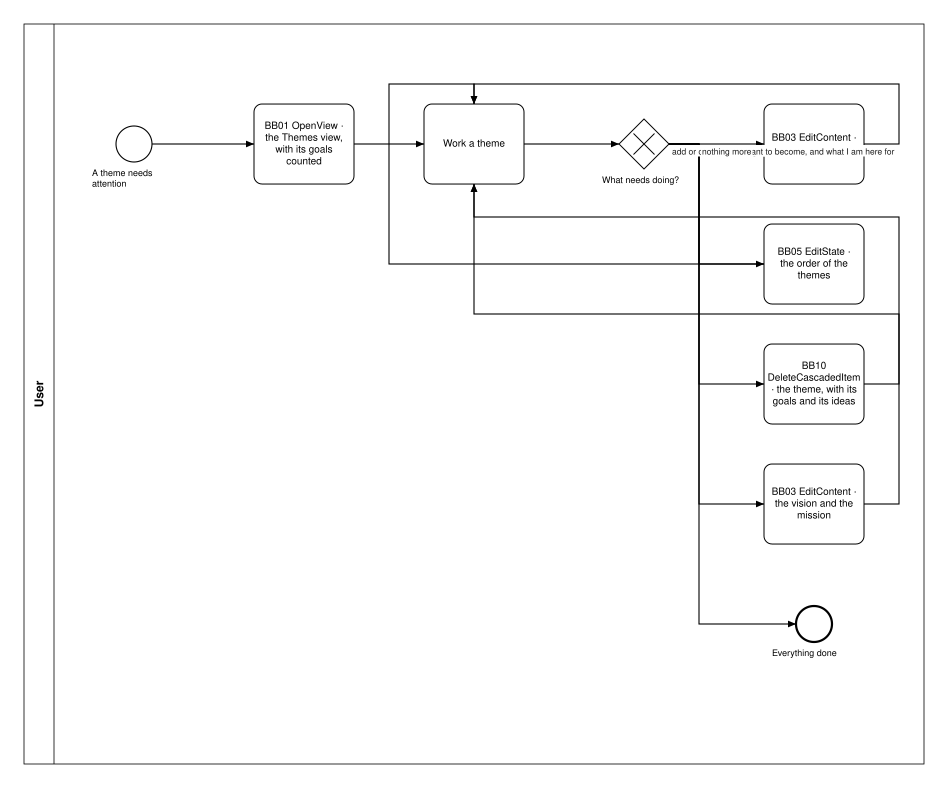
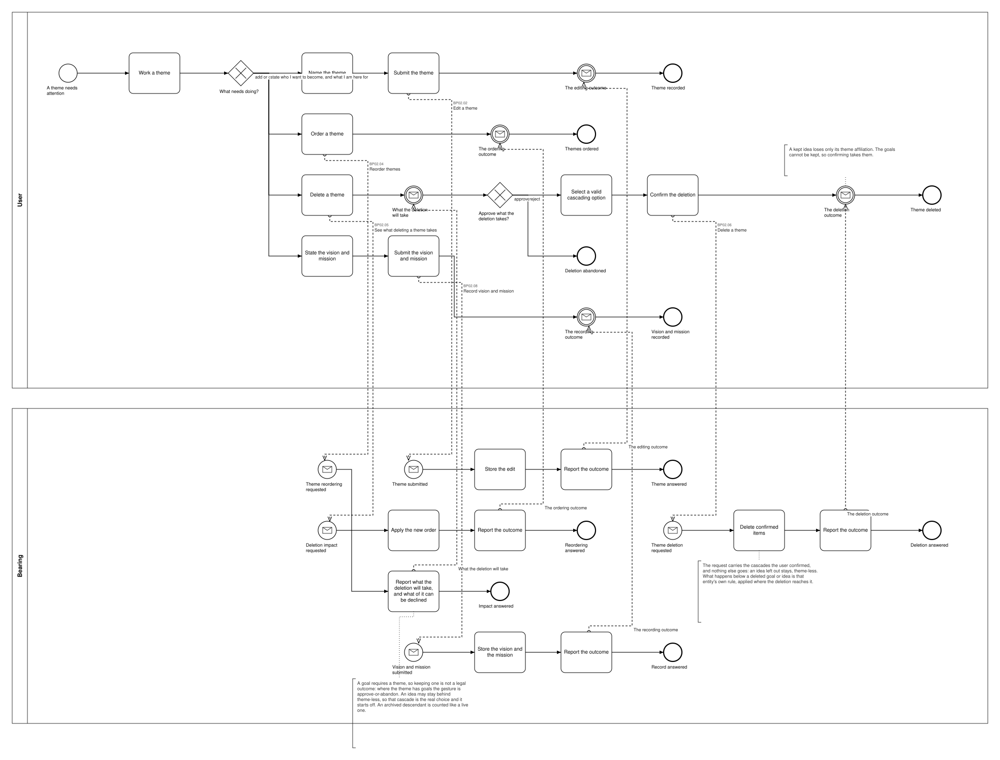
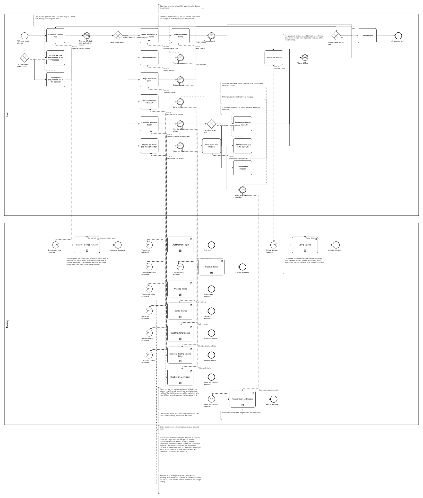

# BP02 — Maintain life themes

**Stage.** Discovery / Mockup — before the Intent gate. Nothing here is const.

| | |
|---|---|
| **Trigger** | **User**, several times a year — a theme needs attention. |
| **Goal** | The set of life areas say what matters to the user; vision and mission say who they want to become. |
| **Actors** | **User** (the only human; also the stakeholder) · **Bearing** (the system). No external system takes part. |
| **Source** | `diagrams/BP02_MaintainLifeThemes.bpd` — the one tagged source for both levels. |
| **Sources it traces to** | `funnel §1`, `wf §2.1`, `wf §2.2`, `wf §2.5` |
| **Rules it exercises** | BR-01, BR-03, BR-09, BR-12, BR-13, BR-14, BR-15, BR-19, BR-21, BR-95, BR-117, BR-118, BR-121 |

## The flow in one paragraph

The Themes tab works from the life areas with their vision and mission, and their goals with their progress measures, each theme carrying a live count of its goals — a derived figure like every other one a surface shows, and no act of this process. Routines are not on this tab at all: a routine has no theme, so it has a view of its own (BR-02, BR-10). Because that one read carries everything, expanding the vision and mission section has nothing left to fetch. Each act is one path through the drawing, ending on what its gesture did — the surface stays in front of the user, which is UIP01's business and is not redrawn here. One act follows: name a life area — one editor, one submit and one request, serving a life area the user has just named and one they are renaming or recolouring alike (UX-04) — reorder them, delete one, or state a vision and mission. Where a new one lands in the order is not drawn; ordering them is its own act (`BP02.04`). Showing that editor is the UI's own doing and asks the system for nothing, so no step draws it; which dialog it is lives in Intent §7. Only the deletion is consequential, and it discloses what it will take before it takes anything. The drawing then carries **one** choice — select a valid cascading option, or reject the deletion — because which cascades the gesture offers, and in what order they are answered, is not business relevant (SA 2026-10-11); what the legal combinations are is the disclosure's content (`BP02.05`). Those combinations: a **goal** cannot be left theme-less (BR-01), so where the theme has goals every legal option takes them; its **ideas** can stay behind theme-less (BR-03), off until the user asks for it (BR-19). Routines are not reached at all: a routine has no theme, so the theme deletion has two cascades and no second level under them (BR-02, BR-13).

## Block view — the work loop with one box per building block

Each box is one path and names the **building block** it is, with what is inside the block left to [`00_Path-Patterns.md`](00_Path-Patterns.md) — the system pool is not drawn here at all. Source: `block-views/BP02_MaintainLifeThemes.bpd`, authored from the one tagged source below and re-read whenever that process changes.

## Level 1 — fully detailed (system chains inline-expanded)

## Level 2 — detailed (system chains collapsed, one box per call site)

## Call sites

Five, each one synchronous call into the system. **`BP02.01` *Read the themes overview* is retired on 2026-10-17**, its id never reused (ADR-066): what a surface shows is loaded and derived at start-up, so opening it asks the system for nothing — the derived-data inventory carries each value with the rule that governs it. **Four are retired, and their ids are never reused** (ADR-066, all SA 2026-10-11): `BP02.03` *Amend a theme*, because one editor serves creating and editing alike and the only thing that separated the two chains was where a new theme lands in the order, which is not business relevant; `BP02.07` *Read vision and mission*, because the overview reads this surface whole and an expand has nothing left to fetch; `BP02.09` *Restore the shipped life areas*, with BR-83 — there is no restore and no reset, and starting over means deleting the data folder outside Bearing; and `BP02.10` *Draft the theme input*, because a theme is a name and a colour and a colour does not draft. The ids are **call sites of this process**
(`BP02.yy`, ADR-069) — which System Interaction each resolves to is a Design decision, recorded in
`si-binding.yaml`, never a rename. Variations of one request are permutations of one operation and
never a second call site; the `.bpd`'s header comment records which were collapsed and why.

| Call site | On the box | What it does | Steps |
|---|---|---|---|
| [`BP02.02`](../02_System-Interactions/BP02.02_EditTheme.md) | Edit a theme | One request stores a life area the user has just named and one they have renamed or recoloured alike. The colour reaches every entity under the theme (BR-09). | 2 |
| [`BP02.04`](../02_System-Interactions/BP02.04_ReorderThemes.md) | Reorder themes | Applies the new order and answers the outcome, so a client can compare it with what it predicted. | 2 |
| [`BP02.05`](../02_System-Interactions/BP02.05_ReadTheDeletionImpact.md) | See what deleting a theme takes | A goal requires a theme, so keeping one is not a legal outcome: where the theme has goals the gesture is approve-or-abandon. An idea may stay behind theme-less, so that cascade is the real choice and it starts off. The disclosure reaches two levels down, because a deleted goal takes its projects and measures with it, and so does an included idea. An archived descendant is counted like a live one. | 1 |
| [`BP02.06`](../02_System-Interactions/BP02.06_DeleteTheme.md) | Delete a theme | The request carries the cascades the user approved. What happens below a deleted goal or idea is that entity's own rule, applied where the deletion reaches it. The ideas the user kept are left theme-less (BR-03). | 2 |
| [`BP02.08`](../02_System-Interactions/BP02.08_RecordVisionAndMission.md) | Record vision and mission | Storing them is the whole of it. Both fields are optional, and empty text is the unset state. | 2 |
