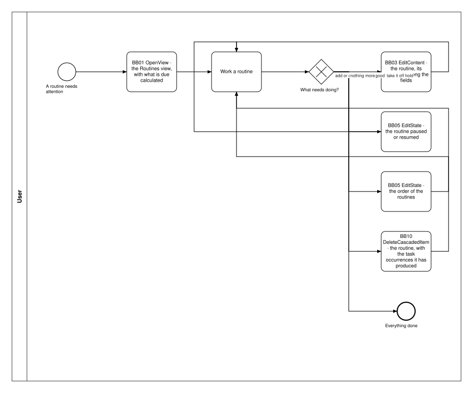
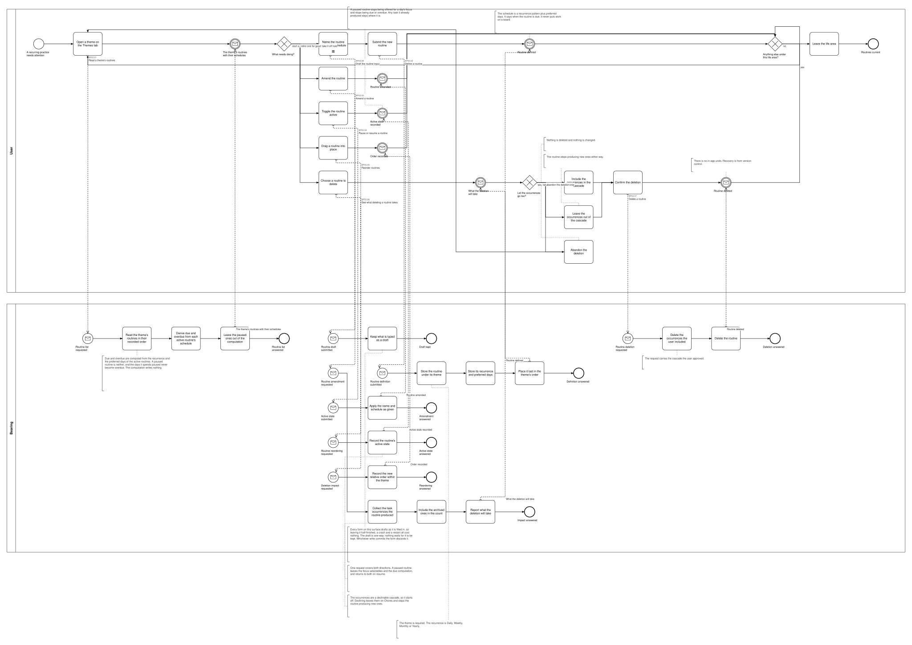
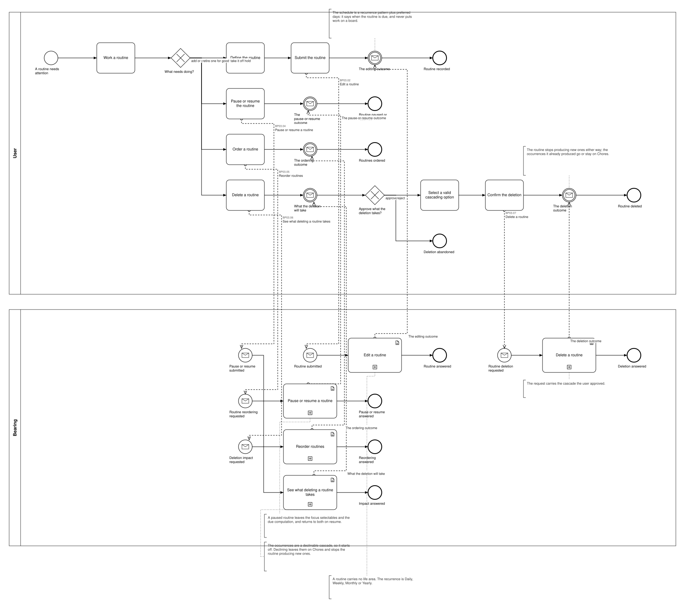

# BP03 — Maintain routines

**Stage.** Discovery / Mockup — before the Intent gate. Nothing here is const.

| | |
|---|---|
| **Trigger** | **User**, rarely — a routine needs attention. |
| **Goal** | The practices the user keeps up are defined, scheduled, on or off hold, and in the order they want to read them — in a view of their own, under no life area at all. |
| **Actors** | **User** (the only human; also the stakeholder) · **Bearing** (the system). No external system takes part. |
| **Source** | `diagrams/BP03_MaintainRoutines.bpd` — the one tagged source for both levels. |
| **Sources it traces to** | `funnel §Routines`, `wf §2.3` |
| **Rules it exercises** | BR-02, BR-10, BR-12, BR-16, BR-19, BR-43, BR-91, BR-94, BR-117, BR-118, BR-121 |

## The flow in one paragraph

The Routines view — the routines' own home, since a routine has no theme (BR-02, BR-10) — works from them in their recorded order, due and overdue derived from each active routine's schedule — a computation that writes nothing, and one a paused routine is out of altogether: it is not active, so it is neither due nor overdue, and the days it spends paused never become overdue once it is resumed. Each act is one path through the drawing, ending on what its gesture did — the surface stays in front of the user, which is UIP01's business and is not redrawn here. One act follows: define a routine, amend one, put one on hold or take it off hold, reorder them, or delete one. A routine has no life area (BR-02): it is maintenance rather than achievement, so it stands beside the funnel instead of inside it, and the tasks it puts on Chores reach no theme and carry no colour (BR-09). Deleting discloses the task occurrences the routine already produced; that cascade is declinable, so it starts off, and declining leaves the occurrences on Chores while the routine stops producing new ones.

## Block view — the work loop with one box per building block

Each box is one path and names the **building block** it is, with what is inside the block left to [`00_Path-Patterns.md`](00_Path-Patterns.md) — the system pool is not drawn here at all. Source: `block-views/BP03_MaintainRoutines.bpd`, authored from the one tagged source below and re-read whenever that process changes.

## Level 1 — fully detailed (system chains inline-expanded)

## Level 2 — detailed (system chains collapsed, one box per call site)

## Call sites

Five, each one synchronous call into the system. **`BP03.01` *Read the routines* is retired on 2026-10-17**, its id never reused (ADR-066): what a surface shows is loaded and derived at start-up, so opening it asks the system for nothing — the derived-data inventory carries each value with the rule that governs it. **`BP03.03` *Amend a routine* is retired**, and its id is never reused (ADR-066): one editor per entity serves creating and editing alike, and nothing separated the two chains but the fields they stored, so `BP03.02` *Edit a routine* is the one editing request (UX-04, SA 2026-10-11). **`BP03.08` *Draft the routine input* is retired**, and its id is never reused (ADR-066): every draftable field is kept by **`BP19.01`**, drawn once in `BP19 — Keep an edit as a draft`, and this process binds **BR-121** to the step that fills the field instead (SA 2026-10-11). The ids are **call sites of this process**
(`BP03.yy`, ADR-069) — which System Interaction each resolves to is a Design decision, recorded in
`si-binding.yaml`, never a rename. Variations of one request are permutations of one operation and
never a second call site; the `.bpd`'s header comment records which were collapsed and why.

| Call site | On the box | What it does | Steps |
|---|---|---|---|
| [`BP03.02`](../02_System-Interactions/BP03.02_EditRoutine.md) | Edit a routine | One request stores what the editor was filled in with, whether the entity is new or not. | 2 |
| [`BP03.04`](../02_System-Interactions/BP03.04_SetRoutineActive.md) | Pause or resume a routine | A paused routine leaves the focus selectables and the due computation, and returns to both on resume. The change is applied and the outcome answered. | 2 |
| [`BP03.05`](../02_System-Interactions/BP03.05_ReorderRoutines.md) | Reorder routines | Applies the new order and answers the outcome, so a client can compare it with what it predicted. | 2 |
| [`BP03.06`](../02_System-Interactions/BP03.06_ReadTheDeletionImpact.md) | See what deleting a routine takes | The occurrences are a declinable cascade, so it starts off. Declining leaves them on Chores and stops the routine producing new ones. | 1 |
| [`BP03.07`](../02_System-Interactions/BP03.07_DeleteRoutine.md) | Delete a routine | The request carries the cascade the user approved. | 2 |
