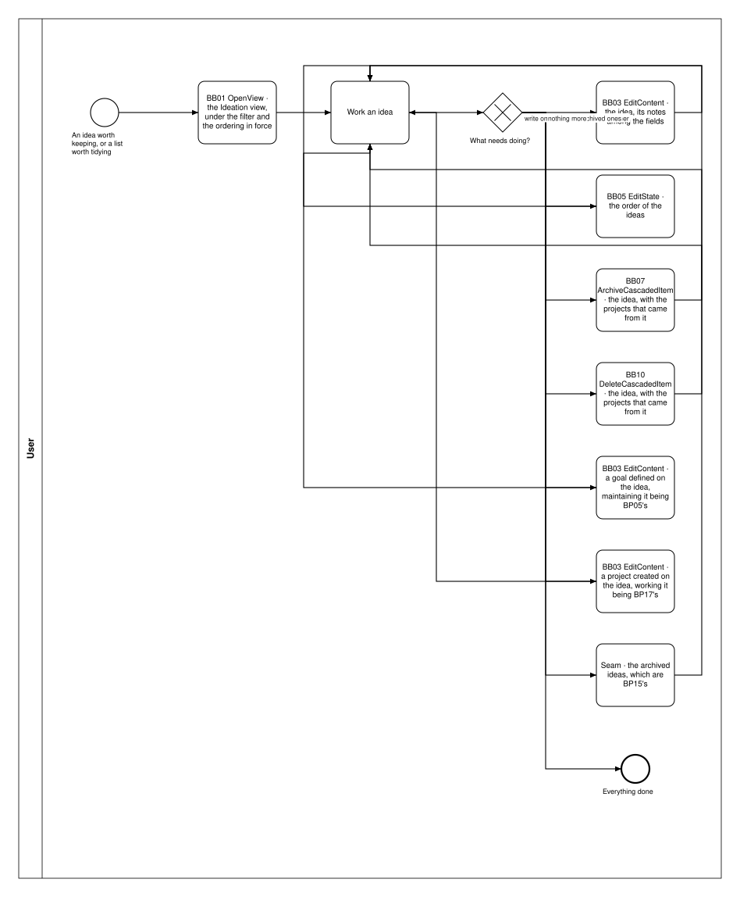

# BP04 — Capture and curate ideas

**Stage.** Discovery / Mockup — before the Intent gate. Nothing here is const.

| | |
|---|---|
| **Trigger** | **User**, opportunistically — including during execution, which is why the gesture is reachable from anywhere. |
| **Goal** | Candidates for future realization are written down, kept findable, and either parked or dropped without ceremony. |
| **Actors** | **User** (the only human; also the stakeholder) · **Bearing** (the system). No external system takes part. |
| **Source** | `diagrams/BP04_CaptureAndCurateIdeas.bpd` — the one tagged source for both levels. |
| **Sources it traces to** | `funnel §2`, `wf §3.1`, `wf §3.2` |
| **Rules it exercises** | BR-01, BR-03, BR-04, BR-05, BR-08, BR-12, BR-14, BR-19, BR-43, BR-84, BR-88, BR-96, BR-97, BR-101, BR-108, BR-111, BR-112, BR-117, BR-118, BR-121 |

## The flow in one paragraph

The Ideation tab works from the ideas the filter admits, in the ordering in force, with the theme-less ones grouped under Unthemed. Each act is one path through the drawing, ending on what its gesture did — the surface stays in front of the user, which is UIP01's business and is not redrawn here. One act follows: capture an idea, amend one, group related ones together, archive one, or delete one. A theme is optional throughout. One editor serves the whole idea, its notes among its fields (UX-04), and everything typed into it drafts as it is filled in, outside version control and changing nothing until the submit commits it (BR-121). The filter and the ordering in force are remembered interface state, not an act (BR-88, BR-92): the read answers what they admit. Archiving and deleting both reach the projects that came from the idea and both disclose what they will take; neither offers to leave a project behind, because a project created from an idea is about that idea.

Two acts on an idea end somewhere else but write from here: defining a goal on the idea opens the goal editor with the idea already linked, and creating a project on it opens the project editor with the idea as its parent — each submitted here, so each is this process's own call site (`BP04.11`, `BP04.12`), with maintaining the goal or working the project left to `BP05` and `BP17`. One act only opens another surface: the archived ideas (`BP15`) — each drawn as the one step it is, because what the user can do from this surface is the drawing's business even where the gesture belongs elsewhere (DRW-02).

## Block view — the work loop with one box per building block

Each box is one path and names the **building block** it is, with what is inside the block left to [`00_Path-Patterns.md`](00_Path-Patterns.md) — the system pool is not drawn here at all. Source: `block-views/BP04_CaptureAndCurateIdeas.bpd`, authored from the one tagged source below and re-read whenever that process changes.

## Level 1 — fully detailed (system chains inline-expanded)

## Level 2 — detailed (system chains collapsed, one box per call site)

## Call sites

Eight, each one synchronous call into the system. **`BP04.01` *Read the ideation overview* is retired on 2026-10-17**, its id never reused (ADR-066): what a surface shows is loaded and derived at start-up, so opening it asks the system for nothing — the derived-data inventory carries each value with the rule that governs it. **`BP04.10` *Commit the idea notes* is retired**, and its id is never reused (ADR-066): the notes are a field of the one idea editor rather than an editor of their own, so writing them is part of editing the idea and the submit is the commit (UX-04, DRW-12, SA 2026-10-14). **`BP04.03` *Amend an idea* is retired**, and its id is never reused (ADR-066): one editor per entity serves creating and editing alike, and nothing separated the two chains but the fields they stored, so `BP04.02` *Edit an idea* is the one editing request (UX-04, SA 2026-10-11). **`BP04.04` *Draft the idea input* is retired**, and its id is never reused (ADR-066): every draftable field is kept by **`BP19.01`**, drawn once in `BP19 — Keep an edit as a draft`, and this process binds **BR-121** to the step that fills the field instead (SA 2026-10-11). The ids are **call sites of this process**
(`BP04.yy`, ADR-069) — which System Interaction each resolves to is a Design decision, recorded in
`si-binding.yaml`, never a rename. Variations of one request are permutations of one operation and
never a second call site; the `.bpd`'s header comment records which were collapsed and why.

| Call site | On the box | What it does | Steps |
|---|---|---|---|
| [`BP04.02`](../02_System-Interactions/BP04.02_EditIdea.md) | Edit an idea | One request stores what the editor was filled in with, whether the entity is new or not. | 2 |
| [`BP04.05`](../02_System-Interactions/BP04.05_ReorderIdeas.md) | Reorder ideas | Applies the new order and answers the outcome, so a client can compare it with what it predicted. | 2 |
| [`BP04.06`](../02_System-Interactions/BP04.06_ReadTheArchivingImpact.md) | See what archiving an idea takes | The projects that came from the idea, and what of it can be declined — nothing below a project can be left behind, so that combination is the only legal one. | 1 |
| [`BP04.07`](../02_System-Interactions/BP04.07_ArchiveIdea.md) | Archive an idea | Unarchiving restores the whole bundle. | 2 |
| [`BP04.08`](../02_System-Interactions/BP04.08_ReadTheDeletionImpact.md) | See what deleting an idea takes | Keeping a project behind is not offered. A goal that links the idea survives minus the link. | 1 |
| [`BP04.11`](../02_System-Interactions/BP04.11_DefineGoal.md) | Define a goal | The goal editor opened on the idea and submitted here: one request stores it with the idea among the ideas behind it, or refuses it with its reason where the goal names no theme — a theme-less idea gives it none (BR-01, BR-84). The same chain the Goals view's own editor draws (`BP05.02`); which System Interaction the two resolve to is a Design finding. | 3, one gateway |
| [`BP04.12`](../02_System-Interactions/BP04.12_CreateProject.md) | Create a project | The project editor opened with the idea as its parent and submitted here: one request stores it, creates the column template a new project has none of, and gives it what its kind brings — one board where it is simple, an empty plan where it is activity-based. The same chain `BP17.02` draws. | 4 |
| [`BP04.09`](../02_System-Interactions/BP04.09_DeleteIdea.md) | Delete an idea | A goal left with no linked idea is flagged on its current state. | 3 |
