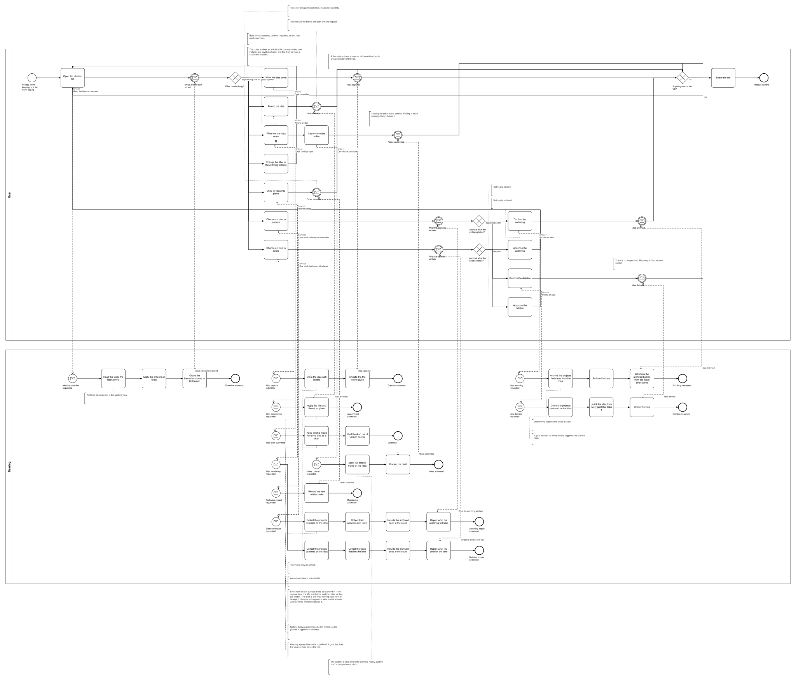
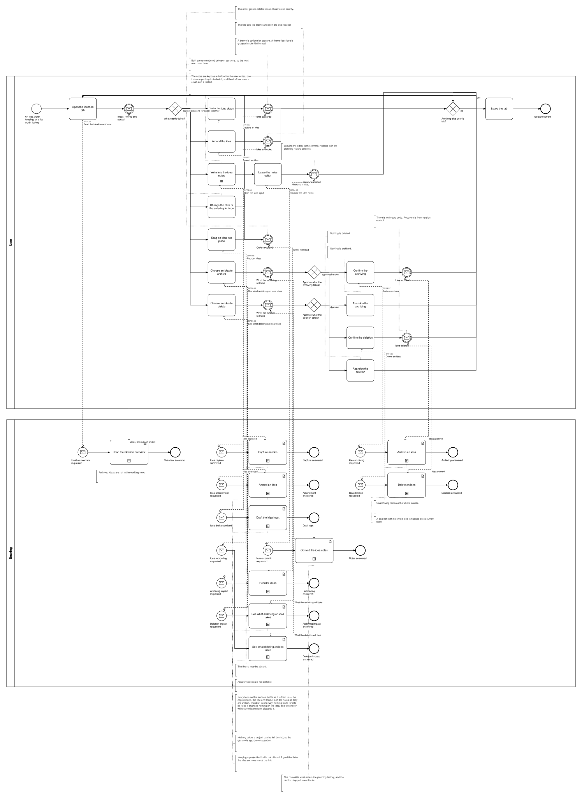

# BP04 — Capture and curate ideas

**Stage.** Discovery / Mockup — before the Intent gate. Nothing here is const.

| | |
|---|---|
| **Trigger** | **User**, opportunistically — including during execution, which is why the gesture is reachable from anywhere. |
| **Goal** | Candidates for future realization are written down, kept findable, and either parked or dropped without ceremony. |
| **Actors** | **User** (the only human; also the stakeholder) · **Bearing** (the system). No external system takes part. |
| **Source** | `diagrams/BP04_CaptureAndCurateIdeas.bpd` — the one tagged source for both levels. |
| **Sources it traces to** | `funnel §2`, `wf §3.1`, `wf §3.2` |
| **Rules it exercises** | BR-03, BR-05, BR-14, BR-43, BR-88, BR-112, BR-121 |

## The flow in one paragraph

The Ideation tab reads the ideas the filter admits, in the ordering in force, with the theme-less ones grouped under Unthemed. One act follows: capture an idea, amend one, write into its notes, narrow or reorder the list, archive one, or delete one. A theme is optional throughout. Every form here drafts as it is filled in, outside version control and changing nothing until it is committed (BR-121). The notes make that visible as two acts: what the editor keeps as the user types is the draft, and leaving the editor is the commit that enters it in the planning history. Archiving and deleting both reach the projects that came from the idea and both disclose what they will take; neither offers to leave a project behind, because a project created from an idea is about that idea.

## Level 1 — fully detailed (system chains inline-expanded)

## Level 2 — detailed (system chains collapsed, one box per call site)

## Call sites

Ten, each one synchronous call into the system. The ids are **call sites of this process**
(`BP04.yy`, ADR-069) — which System Interaction each resolves to is a Design decision, recorded in
`si-binding.yaml`, never a rename. Variations of one request are permutations of one operation and
never a second call site; the `.bpd`'s header comment records which were collapsed and why.

| Call site | On the box | What it does | Steps |
|---|---|---|---|
| [`BP04.01`](../02_System-Interactions/BP04.01_ReadTheIdeationOverview.md) | Read the ideation overview | Archived ideas are not in the working view. | 3 |
| [`BP04.02`](../02_System-Interactions/BP04.02_CaptureIdea.md) | Capture an idea | The theme may be absent. | 2 |
| [`BP04.03`](../02_System-Interactions/BP04.03_AmendIdea.md) | Amend an idea | An archived idea is not editable. | 1 |
| [`BP04.04`](../02_System-Interactions/BP04.04_DraftTheIdeaInput.md) | Draft the idea input | Keeps what is typed for a live idea as a draft, out of version control — the capture form, the title and theme, and the notes as they are written. One-way: nothing waits for it, and the write that commits the form discards it (BR-121). | 2 |
| [`BP04.05`](../02_System-Interactions/BP04.05_ReorderIdeas.md) | Reorder ideas | — | 1 |
| [`BP04.06`](../02_System-Interactions/BP04.06_ReadTheArchivingImpact.md) | See what archiving an idea takes | Nothing below a project can be left behind, so the gesture is approve-or-abandon. | 4 |
| [`BP04.07`](../02_System-Interactions/BP04.07_ArchiveIdea.md) | Archive an idea | Unarchiving restores the whole bundle. | 3 |
| [`BP04.08`](../02_System-Interactions/BP04.08_ReadTheDeletionImpact.md) | See what deleting an idea takes | Keeping a project behind is not offered. A goal that links the idea survives minus the link. | 4 |
| [`BP04.09`](../02_System-Interactions/BP04.09_DeleteIdea.md) | Delete an idea | A goal left with no linked idea is flagged on its current state. | 3 |
| [`BP04.10`](../02_System-Interactions/BP04.10_CommitIdeaNotes.md) | Commit the idea notes | Stores the drafted notes on the idea and discards the draft. The commit is what enters the planning history. | 2 |
