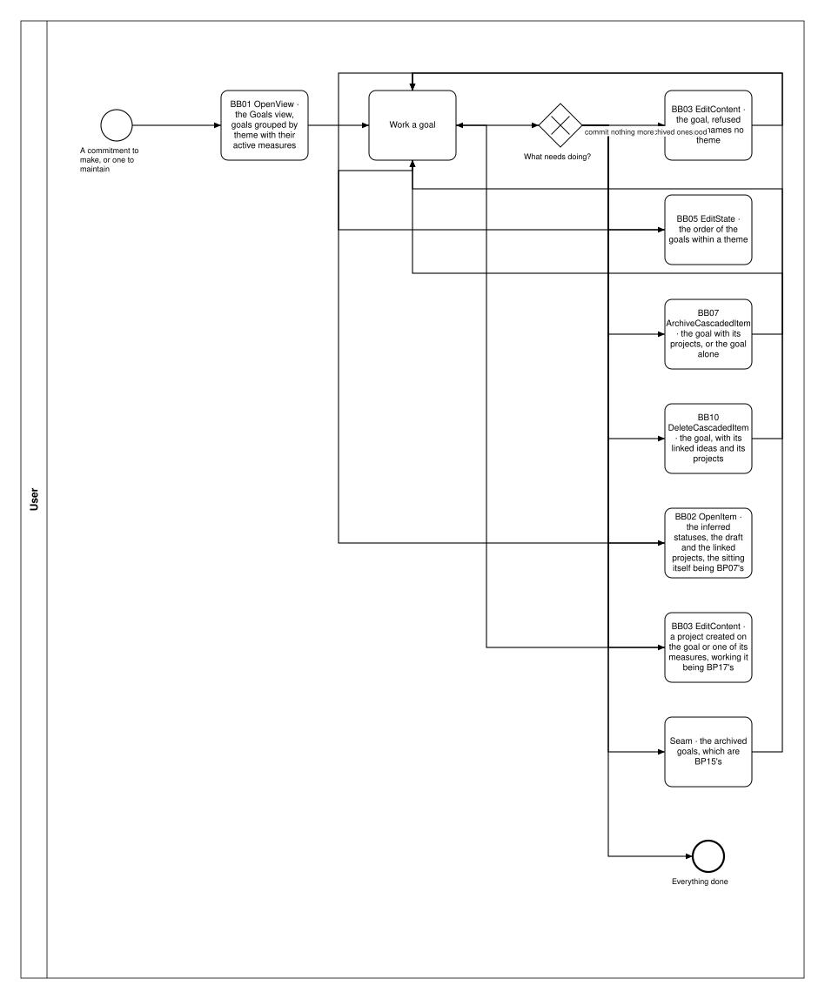
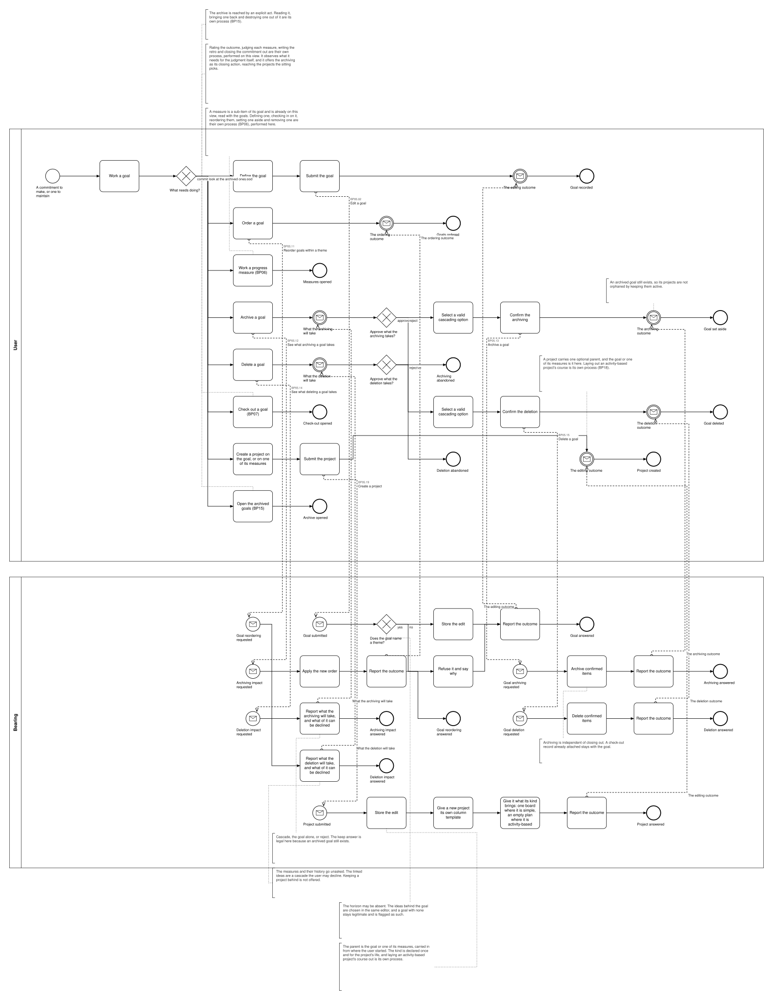
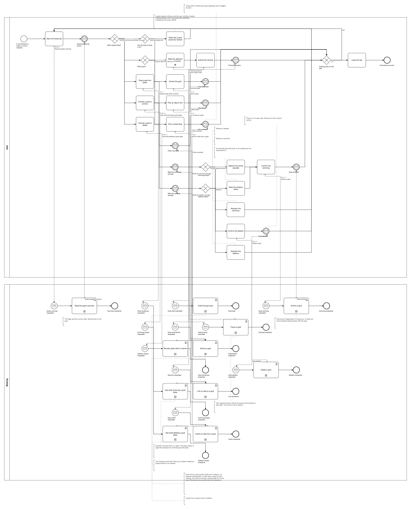

# BP05 — Commit to and maintain a goal

**Stage.** Discovery / Mockup — before the Intent gate. Nothing here is const.

| | |
|---|---|
| **Trigger** | **User**, at the start of a cycle — a commitment to make, or one to maintain. |
| **Goal** | A commitment exists with an objective, the ideas behind it and a horizon if it has one — and ends its life by being archived or deleted. What it is judged against is BP06's. |
| **Actors** | **User** (the only human; also the stakeholder) · **Bearing** (the system). No external system takes part. |
| **Source** | `diagrams/BP05_CommitToAndMaintainAGoal.bpd` — the one tagged source for both levels. |
| **Sources it traces to** | `funnel §3`, `wf §4.1` |
| **Rules it exercises** | BR-01, BR-04, BR-08, BR-12, BR-15, BR-19, BR-22, BR-23, BR-26, BR-28, BR-29, BR-39, BR-43, BR-84, BR-87, BR-96, BR-97, BR-101, BR-108, BR-111, BR-112, BR-117, BR-118, BR-121 |

## The flow in one paragraph

The Goals tab works from the active goals grouped by theme with each one's active progress measures — a measure is a sub-item of its goal and has no page of its own, and one set aside is reached through the archive (`BP15`) — flagging the goals with no linked idea and those whose horizon has passed. Each act is one path through the drawing, ending on what its gesture did — the surface stays in front of the user, which is UIP01's business and is not redrawn here. One act follows: define a goal — one editor, one submit and one request, serving a goal just committed to and one being changed alike (UX-04), the ideas behind it among the fields it carries — reorder them, archive one, or delete one. Two acts on a goal are answered by the system here although another process carries on with them. Checking a goal out is handed over whole: the sitting is `BP07`'s — the rating, the per-measure judgment, the retro, the closing action — and it observes for itself what it judges, so this view asks the system for nothing when it hands over. Creating a project on the goal or on one of its measures opens the project editor with that parent and submits it here (`BP05.19`), the course and the board being `BP18`'s and `BP11`'s. Two acts hand the user on without asking the system anything: **working a goal's measures**, which happens on this very view and is `BP06`'s whole process, and opening the archived goals (`BP15`). Each is the one step it is, because what the user can do from this surface is the drawing's business even where the gesture belongs elsewhere (DRW-02). The tab never navigates ideas and never acts on one; reaching a goal from an idea is the idea page's direction, not this one's. A goal requires a theme (BR-01) and cannot be framed before one exists (BR-84): the overview reports whether a life area exists, so the surface can say so before the form, and the framing request verifies the theme and answers with its outcome. Committing to something is an edit like any other, with no gateway in front of it. Archiving and deleting each disclose what they will take first, the live progress measures and their check-in history going along unasked either way (BR-15, BR-112); a keep answer is legal here, as it is when a measure itself is set aside (`BP06`) and nowhere else, because an archived goal and an archived measure both still exist and so orphan nothing. Shaping what a goal is measured by is BP06's, and judging it is BP07's.

## Block view — the work loop with one box per building block

Each box is one path and names the **building block** it is, with what is inside the block left to [`00_Path-Patterns.md`](00_Path-Patterns.md) — the system pool is not drawn here at all. Source: `block-views/BP05_CommitToAndMaintainAGoal.bpd`, authored from the one tagged source below and re-read whenever that process changes.

## Level 1 — fully detailed (system chains inline-expanded)

## Level 2 — detailed (system chains collapsed, one box per call site)

## Call sites

Seven, each one synchronous call into the system. **`BP05.18` *Read the inferred statuses and the linked projects* is retired on 2026-10-17**, its id never reused (ADR-066): checking a goal out is BP07's whole process, and the sitting observes what it judges itself (`BP07.01`). **`BP05.01` *Read the goals overview* is retired on 2026-10-17**, its id never reused (ADR-066): what a surface shows is loaded and derived at start-up, so opening it asks the system for nothing — the derived-data inventory carries each value with the rule that governs it. **`BP05.17` *Read check-in history* is retired**, and its id is never reused (ADR-066): it read a check-in history held by the goal, and the goal-held history is withdrawn — a measure keeps its own, read in `BP06.01` (SA 2026-10-16). **`BP05.04` *Link an idea to a goal* and `BP05.05` *Unlink an idea from a goal* are retired**, and their ids are never reused (ADR-066): the ideas behind a goal are a field of the goal's own editor, chosen and cleared there, and the Goals tab never navigates ideas nor acts on one — that direction belongs to the idea page (DRW-12, DRW-22, SA 2026-10-14). **`BP05.03` *Amend a goal* is retired**, and its id is never reused (ADR-066): framing a goal and changing one are the same act, so one editor, one submit and one request serve both — `BP05.02` is that request (UX-04, DRW-11, SA 2026-10-14). **`BP05.16` *Draft the goal input* is retired**, and its id is never reused (ADR-066): every draftable field is kept by **`BP19.01`**, drawn once in `BP19 — Keep an edit as a draft`, and this process binds **BR-121** to the step that fills the field instead (SA 2026-10-11). The ids are **call sites of this process**
(`BP05.yy`, ADR-069) — which System Interaction each resolves to is a Design decision, recorded in
`si-binding.yaml`, never a rename. Variations of one request are permutations of one operation and
never a second call site; the `.bpd`'s header comment records which were collapsed and why.

**`BP05.06` to `BP05.10` are retired** — the progress-measure lifecycle moved to **BP06** on
2026-10-10, so one process holds the measure and this one holds the commitment. A retired number is
never reused, which is why the ids below run `.01`–`.05` and then `.11`–`.15`: an id is an
identifier, not a position.

| Call site | On the box | What it does | Steps |
|---|---|---|---|
| [`BP05.02`](../02_System-Interactions/BP05.02_FrameGoal.md) | Edit a goal | One request stores what the editor was filled in with, whether the goal is new or not, or refuses it with its reason where the goal names no theme (BR-01, BR-84) and answers that outcome. The horizon may be absent, and so are the ideas behind it: they are chosen and cleared in this same editor. | 3, one gateway |
| [`BP05.11`](../02_System-Interactions/BP05.11_ReorderGoals.md) | Reorder goals within a theme | Applies the new order and answers the outcome, so a client can compare it with what it predicted. | 2 |
| [`BP05.12`](../02_System-Interactions/BP05.12_ReadTheArchivingImpact.md) | See what archiving a goal takes | Cascade, the goal alone, or reject, and the answer says which of them is legal. The keep answer is one of them here because an archived goal still exists. | 1 |
| [`BP05.13`](../02_System-Interactions/BP05.13_ArchiveGoal.md) | Archive a goal | Archiving is independent of closing out. A check-out record already attached stays with the goal. | 2 |
| [`BP05.14`](../02_System-Interactions/BP05.14_ReadTheDeletionImpact.md) | See what deleting a goal takes | The measures and their history go unasked. The linked ideas are a cascade the user may decline, so it starts off (BR-19). Keeping a project behind is not offered. | 1 |
| [`BP05.15`](../02_System-Interactions/BP05.15_DeleteGoal.md) | Delete a goal | — | 2 |
| [`BP05.19`](../02_System-Interactions/BP05.19_CreateProject.md) | Create a project | The project editor opened with the goal or one of its measures as its parent and submitted here: one request stores it, creates the column template a new project has none of, and gives it what its kind brings — one board, or an empty plan. The same chain `BP17.02` draws. | 4 |
