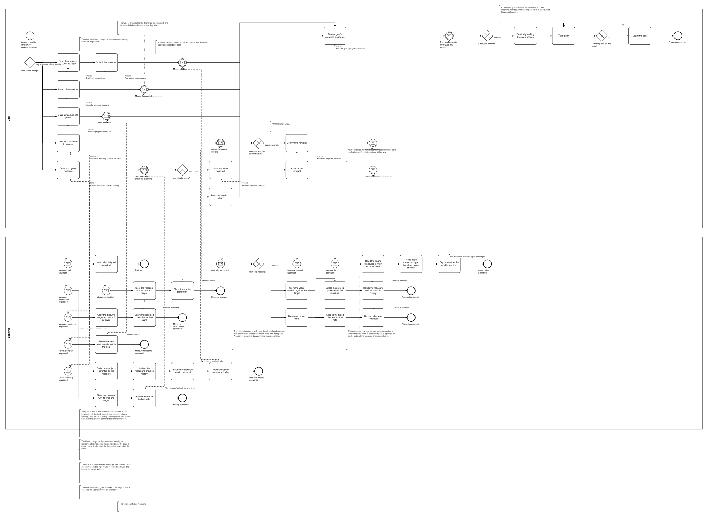
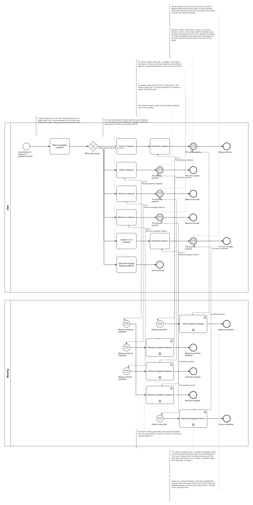

# BP06 — Measure a goal's progress

**Stage.** Discovery / Mockup — before the Intent gate. Nothing here is const.

| | |
|---|---|
| **Trigger** | **User** — at the start of a cycle to say what counts, then on their own out-of-band cadence to record where it stands. |
| **Goal** | A goal carries the typed measures it is judged against, each with a dated, append-only history of where it stood and the user's own notes. |
| **Actors** | **User** (the only human; also the stakeholder) · **Bearing** (the system). No external system takes part. |
| **Source** | `diagrams/BP06_MeasureGoalProgress.bpd` — the one tagged source for both levels. |
| **Sources it traces to** | `wf §4.2`, `wf §4.3` |
| **Rules it exercises** | BR-05, BR-28, BR-115, BR-117, BR-119, BR-121 |

## The flow in one paragraph

This is the whole life of a goal's progress measures. Opening them reads the measures in their recorded order with each one's type, target and latest check-in, and reports whether the goal is archived — an archived goal is frozen, its measures and their check-ins included, so nothing here can change and the user is told why instead of being shown forms that cannot be submitted. Otherwise one act follows: say what counts, change what counts, reorder the measures, drop one, or record where one stands. A measure is typed numeric or boolean and there is no untyped measure; the type is amendable afterwards like the target and the unit, and the recorded check-ins are left as they stand, so the history is never rewritten. Dropping a measure discloses what it will take — its check-in history goes unasked, the projects parented on it are a cascade the user approves or abandons. Recording opens a measure, which reads its history in date order. A check-in is one dated data point with an optional note, and the history being append-only is what decides a second check-in on an already-covered date — another data point beside the first, never a correction. Nothing is inferred and nothing is judged here: the per-measure status is the check-out's business (BP07).

## Level 1 — fully detailed (system chains inline-expanded)

## Level 2 — detailed (system chains collapsed, one box per call site)

## Call sites

Nine, each one synchronous call into the system. The ids are **call sites of this process**
(`BP06.yy`, ADR-069) — which System Interaction each resolves to is a Design decision, recorded in
`si-binding.yaml`, never a rename. Variations of one request are permutations of one operation and
never a second call site; the `.bpd`'s header comment records which were collapsed and why.

**`BP06.03` to `BP06.07` were drawn in BP05 until 2026-10-10** and moved here on the Software
Architect's ruling, so that the measure and the commitment are one process each. They are minted
here as new call sites; `BP05.06`–`BP05.10` are retired there and never reused.

| Call site | On the box | What it does | Steps |
|---|---|---|---|
| [`BP06.08`](../02_System-Interactions/BP06.08_ReadAGoalsProgressMeasures.md) | Read the goal's progress measures | The measures in their recorded order with type, target and latest check-in, plus whether the goal is archived. The goals overview carries no measures, so this is where they are read. | 3 |
| [`BP06.01`](../02_System-Interactions/BP06.01_ReadTheCheckInHistory.md) | Read a measure's check-in history | Reads the measure and its check-ins in date order. The history hangs on the measure's identity, so reordering the measures never disturbs it. | 2 |
| [`BP06.02`](../02_System-Interactions/BP06.02_RecordProgressCheckIn.md) | Record a progress check-in | Appends one dated data point with its note. A date already carrying a check-in takes another; nothing is corrected and no status is inferred. | 2, one gateway |
| [`BP06.03`](../02_System-Interactions/BP06.03_AddProgressMeasure.md) | Add a progress measure | Stores the measure with its type and target, last in the goal's order. There is no untyped measure. | 2 |
| [`BP06.04`](../02_System-Interactions/BP06.04_AmendProgressMeasure.md) | Amend a progress measure | Applies the type, the target and the unit as given. The type is amendable like the rest, and the recorded check-ins are left as they stand, so the history is never rewritten. | 2 |
| [`BP06.05`](../02_System-Interactions/BP06.05_ReorderProgressMeasures.md) | Reorder progress measures | Records the new relative order within the goal. The check-in history hangs on identity, never on position. | 1 |
| [`BP06.06`](../02_System-Interactions/BP06.06_ReadTheMeasureRemovalImpact.md) | See what removing a measure takes | The check-in history goes unasked. The projects are a cascade the user approves or abandons, archived ones counted. | 4 |
| [`BP06.07`](../02_System-Interactions/BP06.07_RemoveProgressMeasure.md) | Remove a progress measure | Deletes the projects the user approved and the measure with its check-in history. | 2 |
| [`BP06.09`](../02_System-Interactions/BP06.09_DraftTheMeasureInput.md) | Draft the measure input | Keeps what is typed as a draft, out of version control. One-way: nothing waits for it, and the write that commits the form discards it. Every form on this surface drafts this way (BR-121). | 1 |
