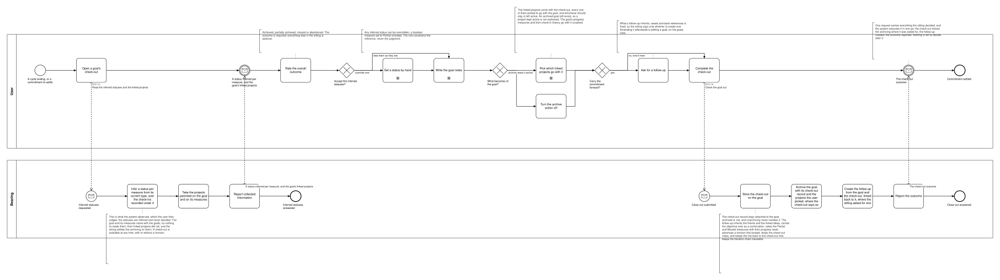
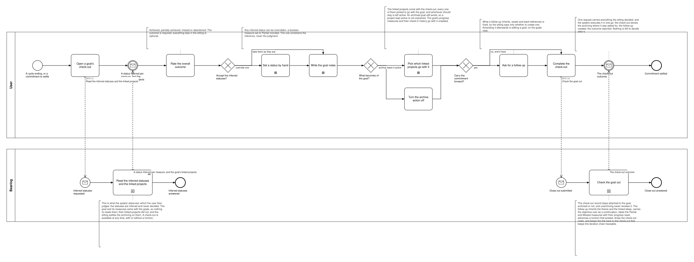

# BP07 — Check out a goal

**Stage.** Discovery / Mockup — before the Intent gate. Nothing here is const.

| | |
|---|---|
| **Trigger** | **User**, at the end of a cycle — a commitment to settle. Available at any time, with or without a horizon. |
| **Goal** | A goal carries a judgment of record — outcome, a status per measure, a retro — and its cycle has ended, optionally with a successor seeded from it. |
| **Actors** | **User** (the only human; also the stakeholder) · **Bearing** (the system). No external system takes part. |
| **Source** | `diagrams/BP07_CheckOutAGoal.bpd` — the one tagged source for both levels. |
| **Sources it traces to** | `funnel §Archive`, `wf §4.4` |
| **Rules it exercises** | BR-05, BR-23, BR-27, BR-28, BR-29, BR-30, BR-31, BR-32, BR-39, BR-112, BR-121 |

## The flow in one paragraph

The check-out follows the shape every check-out follows (BR-39): what the system observed, then reflection, then judgment, then opt-in closing actions, then one named gesture. An archived goal is frozen and cannot be checked out at all, so no path of this drawing is about one: the check-out is reached from the Goals view, which carries the live goals, and the write verifies what it is handed (BR-05, BR-128). What the system observed arrives with a status already inferred per active measure from its type — a measure set aside during the cycle is out of the working set, so it is neither judged nor carried forward (BR-23, BR-27) — together with the goal's linked projects, the one thing the Goals view does not carry. The user rates the overall outcome — required — overrides any inferred status they disagree with, boolean to Partial included, and writes the notes. The sitting is a draft throughout, so leaving it, a crash and a restart cost nothing. Two closing actions follow, both answered inside the sitting: archive the goal or leave it active, and carry the commitment forward or end it here, default OFF. Where the goal is archived, the sitting carries its linked projects with every one of them picked to go along, and the user leaves active whichever should stay — no disclosure, no approval cycle and nothing approved twice, because the pick rides on the completing write (BR-30, BR-112). The informed approval belongs to an explicit archiving request, where the goal is archived on its own (BP05). Carrying the commitment forward is answered the same way: the sitting says whether, and what the follow-up inherits, resets and back-references is the rule's (BR-31), so nothing is fetched to look at. Then one request carries everything the sitting decided and the system executes it in one go — the check-out stored, the archiving done where it was asked for, the follow-up created with its link back, the outcome reported — so nothing is left to decide after that gesture (BR-39). Amending the follow-up is not part of the check-out: it is a goal like any other and BP05's editor serves it. The check-out completes under every answer.

## Level 1 — fully detailed (system chains inline-expanded)

## Level 2 — detailed (system chains collapsed, one box per call site)

## Call sites

Two, each one synchronous call into the system. **`BP07.03` *See what archiving the goal takes* is retired** with the approval cycle it served — the sitting picks the projects itself — **`BP07.05` *Seed a follow-up goal* and `BP07.06` *Create the follow-up goal*** with the seed, the review and the tail gesture they served, the one completing request creating the follow-up instead, and **`BP07.02` *Draft the goal check-out*** with the drafting chain; no id is ever reused (ADR-066): every draftable field is kept by **`BP19.01`**, drawn once in `BP19 — Keep an edit as a draft`, and this process binds **BR-121** to the step that fills the field instead (SA 2026-10-11). The ids are **call sites of this process**
(`BP07.yy`, ADR-069) — which System Interaction each resolves to is a Design decision, recorded in
`si-binding.yaml`, never a rename. Variations of one request are permutations of one operation and
never a second call site; the `.bpd`'s header comment records which were collapsed and why.

| Call site | On the box | What it does | Steps |
|---|---|---|---|
| [`BP07.01`](../02_System-Interactions/BP07.01_ReadTheInferredStatuses.md) | Read the inferred statuses and the linked projects | Infers a status per measure from its current type over the check-ins recorded under it and collects the projects parented on the goal and on its measures. A half-written sitting is there when the user comes back, but this chain does not fetch it: picking a draft up is the drafting UX of every content edit, drawn once in `BP19` and bound here as BR-121 on the step that writes (SA 2026-10-17). It reads neither the goal nor its measures: those came with the goals (`BP05.01`) and a view is read whole (DRW-14). `BP05.18` draws the same chain, from the view the check-out is opened on. | 3 |
| [`BP07.04`](../02_System-Interactions/BP07.04_CheckOutGoal.md) | Check the goal out | One request, executed in one go: stores the judgment, archives the goal with the projects the user picked where the check-out says so, and — where the sitting asked for one — creates the follow-up, which inherits theme and linked ideas, carries the objective over as a continuation, takes only the Partial and Missed measures with their progress reset, advances a horizon that existed, drops the check-out notes and back-references the check-out. The check-out record stays attached whether the goal is archived or not. | 4 |

**§6's four candidates came out as two calls.** Nothing in the sitting needs a chain of its own: the
per-measure judgment, the archiving reach and the follow-up are all fields of the one request, the
statuses and the linked projects arriving with what the system observed. The follow-up needs no seed
to look at either, because what it inherits is BR-31's and not a choice.

## Findings for the Software Architect

1. **Close-out and archiving stay two acts, and this drawing keeps them that way.** The check-out
   records a judgment and *offers* archiving; a goal can also be archived directly at any time
   (BP05, BR-23). Leaving the goal active is therefore not a failure — it is a legal answer that
   leaves the goal active with its judgment recorded. The two acts also differ in how the cascade
   is settled: the explicit archiving request discloses its reach and is approved or rejected whole,
   while the check-out carries the linked projects as a field of the sitting and picks them one by
   one.
