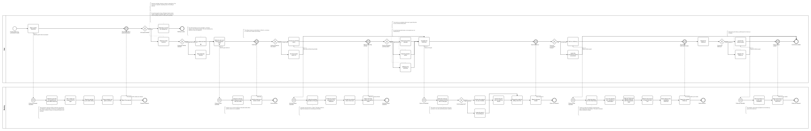
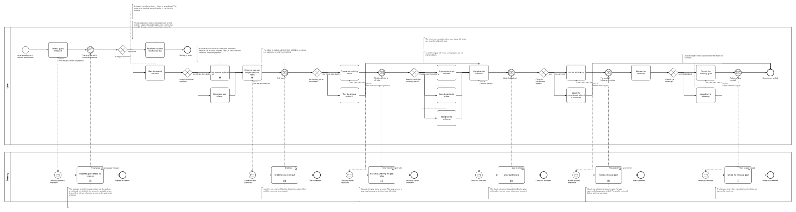

# BP07 — Close out a goal

**Stage.** Discovery / Mockup — before the Intent gate. Nothing here is const.

| | |
|---|---|
| **Trigger** | **User**, at the end of a cycle — a commitment to settle. Available at any time, with or without a horizon. |
| **Goal** | A goal carries a judgment of record — outcome, a status per measure, a retro — and its cycle has ended, optionally with a successor seeded from it. |
| **Actors** | **User** (the only human; also the stakeholder) · **Bearing** (the system). No external system takes part. |
| **Source** | `diagrams/BP07_CloseOutAGoal.bpd` — the one tagged source for both levels. |
| **Sources it traces to** | `funnel §Archive`, `wf §4.4` |
| **Rules it exercises** | BR-05, BR-23, BR-27, BR-28, BR-29, BR-30, BR-31, BR-32, BR-39, BR-112, BR-117, BR-121 |

## The flow in one paragraph

The check-out follows the shape every check-out follows (BR-39): what the system observed, then reflection, then judgment, then opt-in closing actions, then one named gesture. An archived goal is frozen and cannot be checked out at all, so the proposal says whether it is one and the user is told why rather than judging something that cannot take the judgment. Otherwise the proposal arrives with a status already inferred per measure from its type; the user rates the overall outcome — required — overrides any inferred status they disagree with, boolean to Partial included, and writes the retro. The sitting is a draft throughout, so leaving it, a crash and a restart cost nothing. Two closing actions follow, archiving the goal default ON and a follow-up default OFF. Leaving the archive on hands the gesture to BR-112's three answers — cascade, the goal alone, or reject — and rejecting it leaves the goal active; the check-out completes either way. Carry-forward seeds a follow-up from the checked-out goal, which the user reviews before anything is created, and abandoning it still leaves the check-out complete.

## Level 1 — fully detailed (system chains inline-expanded)

## Level 2 — detailed (system chains collapsed, one box per call site)

## Call sites

Six, each one synchronous call into the system. The ids are **call sites of this process**
(`BP07.yy`, ADR-069) — which System Interaction each resolves to is a Design decision, recorded in
`si-binding.yaml`, never a rename. Variations of one request are permutations of one operation and
never a second call site; the `.bpd`'s header comment records which were collapsed and why.

| Call site | On the box | What it does | Steps |
|---|---|---|---|
| [`BP07.01`](../02_System-Interactions/BP07.01_ReadTheCheckOutProposal.md) | Read the goal's check-out proposal | Reads the goal, its measures and their latest check-ins, infers a status per measure from its type, picks up the draft an earlier sitting left, and reports whether the goal is archived. | 5 |
| [`BP07.02`](../02_System-Interactions/BP07.02_DraftTheGoalCheckOut.md) | Draft the goal check-out | Keeps the outcome, the statuses and the retro as a draft, out of version control. | 2 |
| [`BP07.03`](../02_System-Interactions/BP07.03_ReadTheArchivingImpact.md) | See what archiving the goal takes | Collects the projects parented on the goal and on its measures, archived ones counted, and reports the three answers the gesture offers. | 4 |
| [`BP07.04`](../02_System-Interactions/BP07.04_CloseOutGoal.md) | Close out the goal | Stores the judgment, archives where the user approved it, discards the draft. The check-out record stays attached whether the goal is archived or not. | 4, one gateway |
| [`BP07.05`](../02_System-Interactions/BP07.05_SeedFollowUpGoal.md) | Seed a follow-up goal | Inherits theme and linked ideas, carries the objective over as a continuation, takes only the Partial and Missed measures with their progress reset, advances a horizon that existed, and back-references the check-out. | 6 |
| [`BP07.06`](../02_System-Interactions/BP07.06_CreateFollowUpGoal.md) | Create the follow-up goal | Stores the follow-up as reviewed, keeping its link back to the check-out. | 2 |

**Two of §6's four candidates turned out to be more than four.** The archiving reach must be
**disclosed before it is written** (BR-112, BR-117), so the closing action is an impact read and a
write, not one call; and the follow-up is **seeded then committed**, because BR-31 has the user
review it before anything is created. The per-measure judgment is not a chain of its own: the
statuses arrive with the proposal and leave with the close-out.

## Findings for the Software Architect

1. **Close-out and archiving stay two acts, and this drawing keeps them that way.** The check-out
   records a judgment and *offers* archiving; a goal can also be archived directly at any time
   (BP05, BR-23). Rejecting the archiving inside the check-out is therefore not a failure — it is a
   legal answer that leaves the goal active with its judgment recorded.
