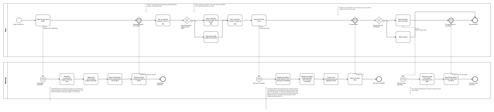
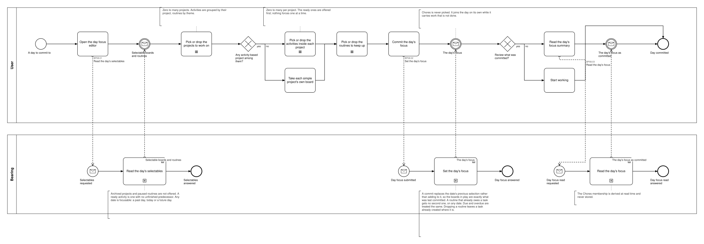

# BP08 — Set a day's focus

**Stage.** Discovery / Mockup — before the Intent gate. Nothing here is const.

| | |
|---|---|
| **Trigger** | **User**, every morning — a day to commit to. Reached directly or from a period view (BP09). |
| **Goal** | One date carries the user's commitment: which boards they will work and which practices they will keep up. |
| **Actors** | **User** (the only human; also the stakeholder) · **Bearing** (the system). No external system takes part. |
| **Source** | `diagrams/BP08_SetADaysFocus.bpd` — the one tagged source for both levels. |
| **Sources it traces to** | `funnel §4`, `wf §5.1.a`, `arch §8 S1` |
| **Rules it exercises** | BR-41, BR-42, BR-43, BR-91, BR-99, BR-102, BR-107 |

## The flow in one paragraph

The day focus editor works from that date's committed focus — what is already picked is what the user drops — together with the non-archived projects with their kind, each activity-based project's activities with the ready ones marked, and the active routines as one list, grouped by nothing, since a routine has no theme (BR-02). The user picks zero to many projects and, inside each activity-based one, zero to many of its activities, then the routines they mean to keep up, and commits, and the write answers with the focus it committed, so nothing is read again afterwards. Any date can be focused — a past day, today or a future day, with no restriction — and a commit replaces that date's previous selection rather than adding to it, so the boards in play are exactly what was last committed. Selecting a routine is what creates its task, and it creates at most one: a routine that already owes a task gets no second one, due and overdue alike. Chores is never picked — it joins the day on its own while it carries work that is not done (BR-107).

## Level 1 — fully detailed (system chains inline-expanded)

## Level 2 — detailed (system chains collapsed, one box per call site)

## Call sites

One synchronous call into the system. **`BP08.01` *Read the day's selectables* is retired on 2026-10-17**, its id never reused (ADR-066): what a surface shows is loaded and derived at start-up, so opening it asks the system for nothing — the derived-data inventory carries each value with the rule that governs it. **One is retired, and its id is never reused**
(ADR-066, SA 2026-10-16): `BP08.03` *Read the day's focus* — the write answers with the focus it
committed, so a client that just wrote the state knows it, and the editor's own opening read
carries what the date already holds. The ids are **call sites of this process**
(`BP08.yy`, ADR-069) — which System Interaction each resolves to is a Design decision, recorded in
`si-binding.yaml`, never a rename. Variations of one request are permutations of one operation and
never a second call site; the `.bpd`'s header comment records which were collapsed and why.

| Call site | On the box | What it does | Steps |
|---|---|---|---|
| [`BP08.02`](../02_System-Interactions/BP08.02_SetTheDaysFocus.md) | Set the day's focus | Replaces the date's selection with what was committed and creates the task a selected routine owes where none is outstanding, on Chores. Nothing here puts Chores in play either: carrying a task that is not done is what does, and that is derived where the boards are shown (BR-107). A routine that already owes a task gets no second one, on any date. Due and overdue are treated the same. Dropping a routine leaves a task already created where it is. | 3 |
