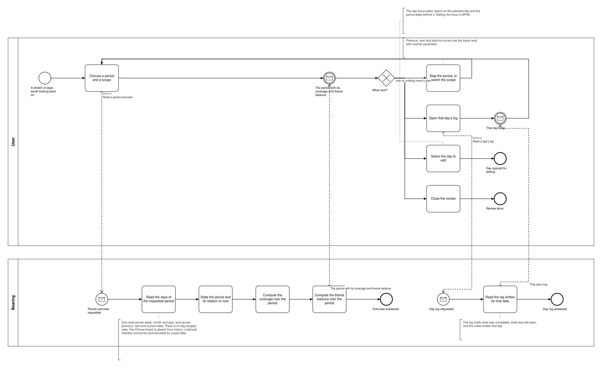
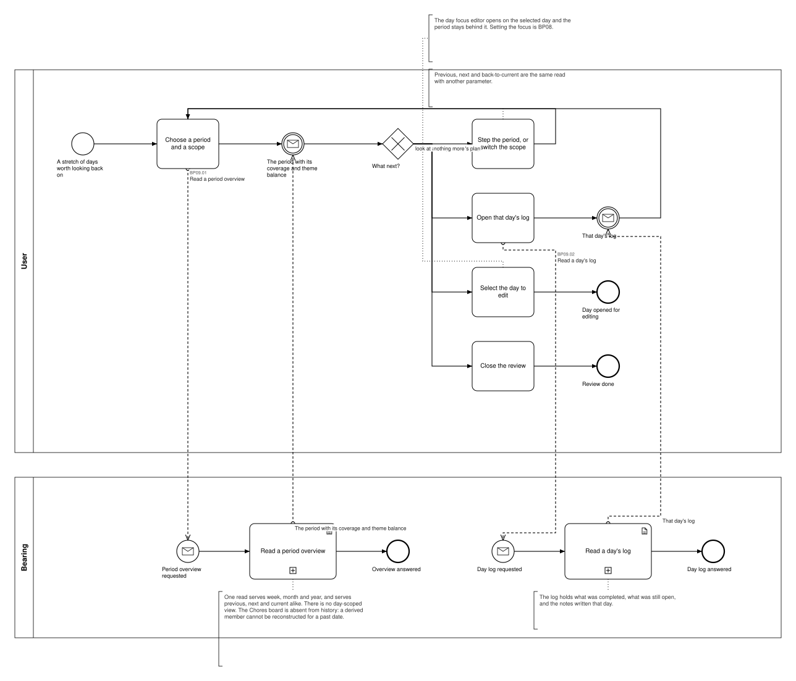

# BP09 — Review focus history

**Stage.** Discovery / Mockup — before the Intent gate. Nothing here is const.

| | |
|---|---|
| **Trigger** | **User**, occasionally — a stretch of days worth looking back on. |
| **Goal** | The user can see how their attention was actually distributed over a week, a month or a year, and reach any day in it. |
| **Actors** | **User** (the only human; also the stakeholder) · **Bearing** (the system). No external system takes part. |
| **Source** | `diagrams/BP09_ReviewFocusHistory.bpd` — the one tagged source for both levels. |
| **Sources it traces to** | `funnel §4`, `wf §5.1.b–d` |
| **Rules it exercises** | BR-38, BR-46, BR-47, BR-93 |

## The flow in one paragraph

One read serves every period view: it returns the days of the requested period, states which period it is and how that relates to now, and computes the coverage and the theme balance over it. Stepping to the previous or next period, going back to the current one and switching the scope are that same read with another parameter, which is why the review loops back to it instead of calling anything else. A day's log can be opened to explain that day. Picking a day to change ends the process by opening the day focus editor on it; setting that focus is BP08.

## Level 1 — fully detailed (system chains inline-expanded)

## Level 2 — detailed (system chains collapsed, one box per call site)

## Call sites

Two, each one synchronous call into the system. The ids are **call sites of this process**
(`BP09.yy`, ADR-069) — which System Interaction each resolves to is a Design decision, recorded in
`si-binding.yaml`, never a rename. Variations of one request are permutations of one operation and
never a second call site; the `.bpd`'s header comment records which were collapsed and why.

| Call site | On the box | What it does | Steps |
|---|---|---|---|
| [`BP09.01`](../02_System-Interactions/BP09.01_ReadThePeriodOverview.md) | Read a period overview | One read serves week, month and year, and serves previous, next and current alike. There is no day-scoped view. The Chores board is absent from history: a derived member cannot be reconstructed for a past date. | 4 |
| [`BP09.02`](../02_System-Interactions/BP09.02_ReadADaysLog.md) | Read a day's log | The log holds what was completed, what was still open, and the notes written that day. | 1 |
