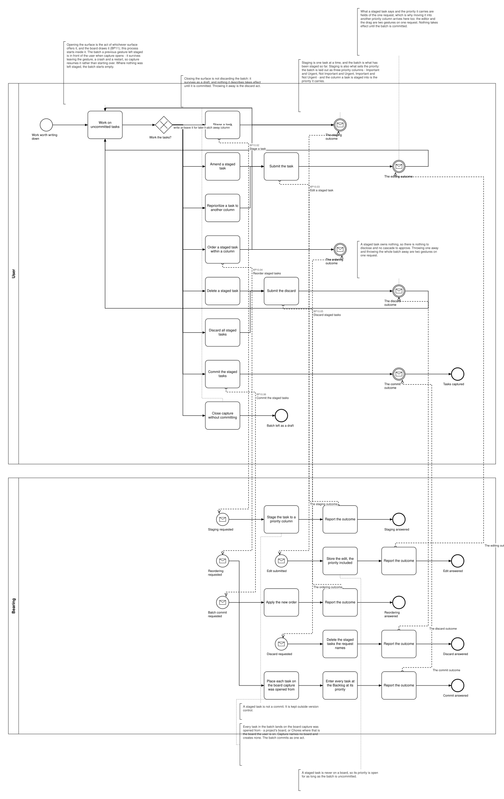
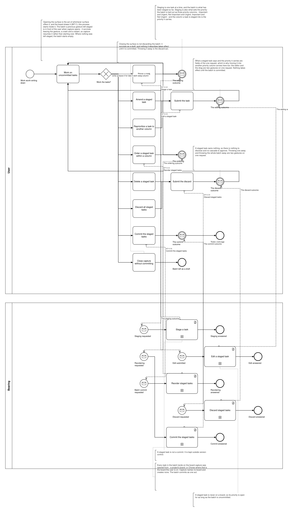

# BP10 — Capture tasks

**Stage.** Discovery / Mockup — before the Intent gate. Nothing here is const.

| | |
|---|---|
| **Trigger** | **User**, at intake — work worth writing down, often mid-execution. |
| **Goal** | A batch of tasks lands on the board capture was opened from, at the Backlog, at the priorities the user captured them into. |
| **Actors** | **User** (the only human; also the stakeholder) · **Bearing** (the system). No external system takes part. |
| **Source** | `diagrams/BP10_CaptureTasks.bpd` — the one tagged source for both levels. |
| **Sources it traces to** | `wf §6.2` |
| **Rules it exercises** | BR-53, BR-55, BR-62, BR-63, BR-90, BR-103, BR-118 |

## The flow in one paragraph

Opening the surface is the act of whichever surface offers it — the board draws it (BP11) and hands over — so this process starts inside it, on the hub every act returns to. Capture names no board: it is opened on a board and the batch lands on that board, a project's board or Chores, because the user can only write tasks down for the board in front of them. For as long as capture is open the surface asks one question, and everything is an answer to it: write another task down, staging it into one of the three priority columns — the column a task is staged into is the priority it carries — amend a staged task, move one into another priority column, order them inside a column, delete one or discard them all, commit the batch as one act, or close capture with it still staged. Staging is not a phase that ends when tidying starts: another task can be written down at any point. A staged batch is a draft: it survives leaving the gesture, a crash and a restart, is kept outside version control, and takes effect only on commit. Resuming one is not an act of the user's — the batch is in play like every other record and the surface opens on it, so the drawing says so in a note and draws no box. Work with no project behind it is captured on Chores by capture being opened there, and capturing a task never creates a board.

## Level 1 — fully detailed (system chains inline-expanded)

## Level 2 — detailed (system chains collapsed, one box per call site)

## Call sites

Five, each one synchronous call into the system. **`BP10.01` *Read the selectable boards* is retired on 2026-10-17**, its id never reused (ADR-066): what a surface shows is loaded and derived at start-up, so opening it asks the system for nothing — and since 2026-10-18 there is nothing to offer either, capture landing the batch on the board it was opened from (BR-62). **`BP10.07` *Read the staged batch* is retired on 2026-10-17**, and its id is never reused (ADR-066): every record is loaded at start-up, so a batch left staged is in play and capture picks it up without asking (DRW-14). The ids are **call sites of this process**
(`BP10.yy`, ADR-069) — which System Interaction each resolves to is a Design decision, recorded in
`si-binding.yaml`, never a rename. Variations of one request are permutations of one operation and
never a second call site; the `.bpd`'s header comment records which were collapsed and why.

| Call site | On the box | What it does | Steps |
|---|---|---|---|
| [`BP10.02`](../02_System-Interactions/BP10.02_StageTaskDraft.md) | Stage a task | A staged task is not a commit. It is kept outside version control. | 2 |
| [`BP10.03`](../02_System-Interactions/BP10.03_AmendStagedDraft.md) | Edit a staged task | A staged task is never on a board, so its priority is open for as long as the batch is uncommitted. Amending what it says and moving it into another priority column are two gestures on this one request. | 2 |
| [`BP10.04`](../02_System-Interactions/BP10.04_ReorderStagedDrafts.md) | Reorder staged tasks | Ranking inside a priority column. Applies the new order and answers the outcome, so a client can compare it with what it predicted. | 2 |
| [`BP10.05`](../02_System-Interactions/BP10.05_DiscardStagedDrafts.md) | Discard staged tasks | One staged task, or the whole batch: two gestures on one request, routed into the one submit. A staged task owns nothing, so nothing is disclosed and nothing is approved. | 2 |
| [`BP10.06`](../02_System-Interactions/BP10.06_CommitStagedTasks.md) | Commit the staged tasks | Every task lands on the board capture was opened from — a project's board, or Chores where that is the board the user is on. Capture names no board and creates none. The batch commits as one act. | 3 |
