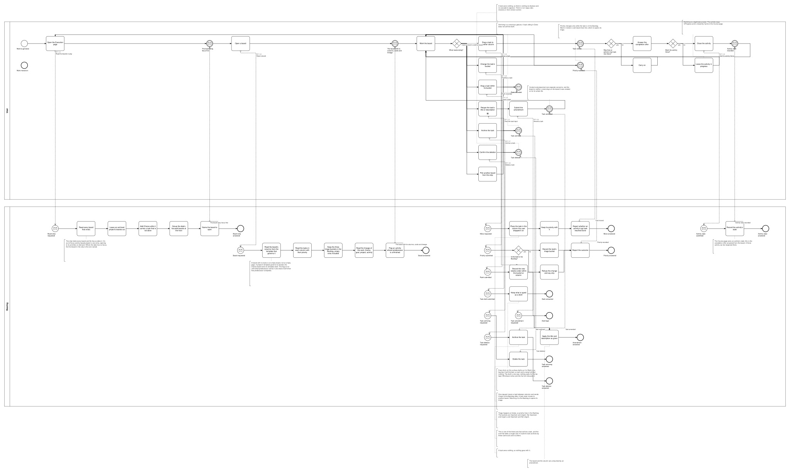
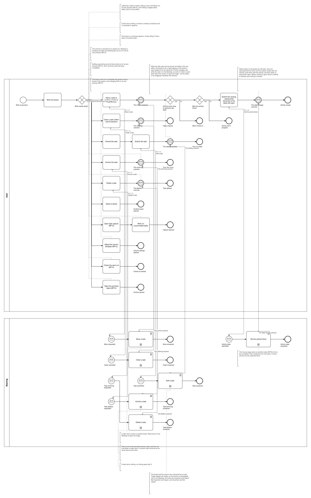

# BP11 — Work the board

**Stage.** Discovery / Mockup — before the Intent gate. Nothing here is const.

| | |
|---|---|
| **Trigger** | **User**, continuously — the hot path. This is where the day is actually spent. |
| **Goal** | Work moves along: the right board is open, tasks sit where they belong, and what is finished is finished. |
| **Actors** | **User** (the only human; also the stakeholder) · **Bearing** (the system). No external system takes part. |
| **Source** | `diagrams/BP11_WorkTheBoard.bpd` — the one tagged source for both levels. |
| **Sources it traces to** | `wf §6.1`, `wf §6.3`, `arch §8 UC2` |
| **Rules it exercises** | BR-09, BR-17, BR-20, BR-23, BR-43, BR-49, BR-50, BR-51, BR-53, BR-54, BR-56, BR-57, BR-61, BR-64, BR-96, BR-102, BR-107, BR-108, BR-109, BR-110, BR-116, BR-118, BR-121, BR-126, BR-127 |

## The flow in one paragraph

The Execution page works from the strip — every board that exists except an archived project's, which archiving hides along with withdrawing the project from the selectables, Chores among them while it carries work that is not done, with the date's focused boards grouped at the front and one board named to open. A board reads its columns from its owner's template, its cards with their priority, the Backlog's three triage sections including the empty ones, and the lineage of the work on it: theme, goal, project, activity. Then one act, repeatable: move work along, order what is waiting, fix what a task says or re-triage it, file one away, throw one away, or move to another board, which reads the strip and the board it names afresh. Moving an activity's last task into Done raises the completion offer: the move's own answer says so, the cards still open on that board are on the surface already (D-31), and the user answers the offer straight away, either way — declining leaves the activity InProgress, to be closed by hand on the Course page. Where cards are open, closing it asks what becomes of them — close them with it, set them aside, or leave them open — and that answer travels with the close itself. Priority changes only in the Backlog, so work in motion is sent back there first, which re-opens its triage — by the editor, or by dragging the card from one triage section to another, placement being what the move act covers: column to column, section to section, and either way between the two. The board is not placement's business: a task stays on the board it was created on for its whole life. Four further acts leave this process for another: writing more work down (`BP10`), changing the lanes (`BP12`), settling what is done (`BP13`) and opening the archived tasks (`BP15`) — each drawn as the step it is — capture as two, the act that opens the surface and the handover into the process that works the drafts, which is why BP10 no longer draws an opening of its own — because what the user can do from this surface is the drawing's business even where the gesture belongs elsewhere (DRW-02, DRW-29).

## Level 1 — fully detailed (system chains inline-expanded)

## Level 2 — detailed (system chains collapsed, one box per call site)

## Call sites

Six, each one synchronous call into the system. **`BP11.01` *Read the boards in play*, `BP11.02` *Read a board* are retired on 2026-10-17**, their ids never reused (ADR-066): what a surface shows is loaded and derived at start-up, so opening it asks the system for nothing — the derived-data inventory carries each value with the rule that governs it. **`BP11.11` *See what closing the activity takes* is retired on 2026-10-18**, its id never reused (ADR-066): the move's own answer says the activity's last task reached Done, and which cards are still open on that board is derived from what start-up loaded (D-31), so the offer discloses without the system being asked anything — and nothing stands between the answer and the decision. **`BP11.04` *Prioritize a task* is retired**, and its id is never reused (ADR-066): the priority is a field of the task, so re-triaging it and changing what it says are two variations of one request — the priority has no owner and no consequence beyond the record, which is what would earn it a call site of its own (DRW-12, DRW-23, SA 2026-10-16). **`BP11.10` *Draft the task input* is retired**, and its id is never reused (ADR-066): every draftable field is kept by **`BP19.01`**, drawn once in `BP19 — Keep an edit as a draft`, and this process binds **BR-121** to the step that fills the field instead (SA 2026-10-11). The ids are **call sites of this process**
(`BP11.yy`, ADR-069) — which System Interaction each resolves to is a Design decision, recorded in
`si-binding.yaml`, never a rename. Variations of one request are permutations of one operation and
never a second call site; the `.bpd`'s header comment records which were collapsed and why.

| Call site | On the box | What it does | Steps |
|---|---|---|---|
| [`BP11.03`](../02_System-Interactions/BP11.03_MoveTask.md) | Move a task | Places the task where it was dropped — another column, another triage section, or a section out of a column. A move inside the Backlog re-triages it, taking the section it lands in as its priority; any other move carries its priority with it, which re-applies when the card comes back (BR-54). Answers the outcome together with whether an activity's last task reached Done. | 4, one gateway |
| [`BP11.05`](../02_System-Interactions/BP11.05_RankTask.md) | Order a task | Applies the new order within the triage section or the column and answers the outcome. | 2 |
| [`BP11.06`](../02_System-Interactions/BP11.06_AmendTask.md) | Edit a task | One request stores what the editor was filled in with, the priority included, and refuses a priority change with its reason for a task outside the Backlog. The board and the column are untouched. | 3, one gateway |
| [`BP11.07`](../02_System-Interactions/BP11.07_ArchiveTask.md) | Archive a task | The archiving act that takes a single card — one of the three a task has. | 2 |
| [`BP11.08`](../02_System-Interactions/BP11.08_DeleteTask.md) | Delete a task | Deletes the task. It owns nothing, so nothing goes with it. | 2 |
| [`BP11.09`](../02_System-Interactions/BP11.09_SetTheActivityDone.md) | Set the activity Done | Records the state the request names and does with the open tasks what the request carries — the completion offer answered from the board. | 2 |

**Moving between columns and sending a task back to the Backlog are one request**, as are ordering
within a triage section and ordering within a column, and as are changing what a task says and re-triaging it. `BP11.09` is the one call site §6 did not list under
this process: the completion offer BR-109 raises has to be answerable where it is raised, and the
same operation is BP18's in the project's plan — which binding records at Design, not this drawing.

## Findings for the Software Architect

1. **A task deletion has no impact read, and that is deliberate.** Every other destructive act in
   the product is two call sites, an impact read then the write, because it reaches something. A task
   owns nothing (BR-17), so there is nothing to disclose; the drawing keeps the confirmation step —
   there is no in-app undo (BR-20) — and skips the empty read rather than minting a call site that
   would always answer *nothing*.
2. **An activity's state is the Course page's to own (BR-109), and this process only answers the
   offer.** It never sets a state the user did not ask for, and reopening a Done activity is BP18's.
