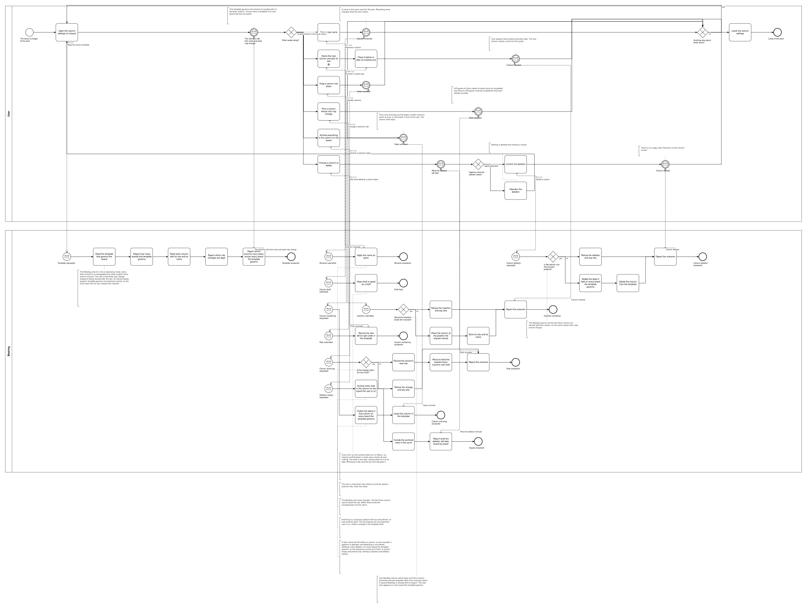
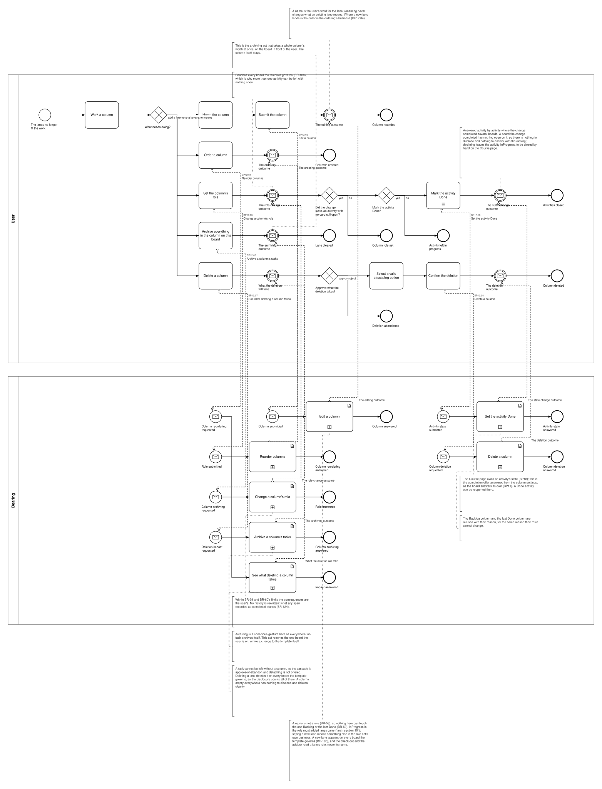

# BP12 — Manage board columns

**Stage.** Discovery / Mockup — before the Intent gate. Nothing here is const.

| | |
|---|---|
| **Trigger** | **User**, rarely — the lanes no longer fit the work. |
| **Goal** | The board's lanes match how the work actually flows, with one Backlog and at least one Done still standing. |
| **Actors** | **User** (the only human; also the stakeholder) · **Bearing** (the system). No external system takes part. |
| **Source** | `diagrams/BP12_ManageBoardColumns.bpd` — the one tagged source for both levels. |
| **Sources it traces to** | `wf §6.1`, `arch §8 DeleteColumn`, `arch §10` |
| **Rules it exercises** | BR-12, BR-18, BR-19, BR-23, BR-58, BR-59, BR-60, BR-61, BR-97, BR-108, BR-109, BR-117, BR-118, BR-121, BR-127 |

## The flow in one paragraph

Columns come from a template, never from the board itself: one per project governing every board of that project with no deviation inside it, plus Chores's own, which governs that one board. The surface works from each column with its role and its name, how many boards that template governs, which role changes are legal, and which columns carry tasks across all of those boards — so the user is told what may change, and how far it reaches, instead of being refused after the fact. That reach is the thing to keep in view: an activity-based project's template governs one board per activity, so inserting, reordering, re-roling or deleting a lane lands on every one of them at once, while archiving a lane's tasks reaches only the board the user is on. Then one act, repeatable: add a lane or rename one, reorder them, change what a lane means, clear a lane out by archiving everything in it, or remove a lane. A name is not a role: naming a lane can neither set what it means nor change it, so the editor gives a new lane the InProgress role and the role act is the only way to say otherwise — which is also where the one-Backlog invariant is enforced. The Backlog role never changes, the last Done column cannot leave the role, and no change may leave a second Backlog; within those limits the consequences are the user's. The write that changes a lane's role then sets the cards in that lane to the state it gives them — done where it becomes Done, waiting or in motion where it leaves Done — and no history is rewritten either way, so what any span recorded as completed stands. The new role is never Backlog, so those three are the states a card is set to. A lane becoming Done can leave an activity with nothing open, which raises the same completion offer the board raises on a last move into Done (BR-109) — answered activity by activity, since the change reaches every board the template governs. It fires exactly where nothing is left open, so unlike the board's offer it has nothing to disclose and its closing carries no answer about open cards (BR-127). Deleting a column discloses the tasks it holds board by board, archived ones counted, and declining rejects the deletion rather than detaching, because a task cannot be left without a column; a column empty everywhere has nothing to disclose and deletes cleanly. A role change that would leave a second Backlog, and the removal of the Backlog or the last Done, are refused with their reason rather than silently prevented.

## Level 1 — fully detailed (system chains inline-expanded)

## Level 2 — detailed (system chains collapsed, one box per call site)

## Call sites

Seven, each one synchronous call into the system. **`BP12.01` *Read the column template* is retired on 2026-10-17**, its id never reused (ADR-066): what a surface shows is loaded and derived at start-up, so opening it asks the system for nothing — the derived-data inventory carries each value with the rule that governs it. **`BP12.03` *Insert a column* is retired**, and its id is never reused (ADR-066): one editor per entity serves adding a lane and renaming one alike, and where a new lane lands is not drawn — `BP12.04` orders them (UX-04, DRW-11, SA 2026-10-16). **`BP12.10` *Set the activity Done* is minted on 2026-10-18** for the completion offer a lane that becomes Done raises (BR-109, BR-60) — the same operation the board's own offer submits (`BP11.09`), which call site resolves to which System Interaction being a Design decision. **`BP12.09` *Draft the column input* is retired**, and its id is never reused (ADR-066): every draftable field is kept by **`BP19.01`**, drawn once in `BP19 — Keep an edit as a draft`, and this process binds **BR-121** to the step that fills the field instead (SA 2026-10-11). The ids are **call sites of this process**
(`BP12.yy`, ADR-069) — which System Interaction each resolves to is a Design decision, recorded in
`si-binding.yaml`, never a rename. Variations of one request are permutations of one operation and
never a second call site; the `.bpd`'s header comment records which were collapsed and why.

| Call site | On the box | What it does | Steps |
|---|---|---|---|
| [`BP12.02`](../02_System-Interactions/BP12.02_RenameColumn.md) | Edit a column | One request stores what the editor was filled in with, whether the lane is new or not, and sets a new lane to InProgress. A name is not a role: an existing lane's meaning is untouched, so nothing here can reach the one-Backlog invariant — the check-out and the advisor read the role, never the name. | 2 |
| [`BP12.04`](../02_System-Interactions/BP12.04_ReorderColumns.md) | Reorder columns | Applies the new order of the columns and answers the outcome. | 2 |
| [`BP12.05`](../02_System-Interactions/BP12.05_ChangeColumnRole.md) | Change a column's role | Records the new role where the column may take it — the Backlog's never changes, the last Done cannot leave the role, and a second Backlog is refused (BR-59, BR-60) — then sets every card in that lane to the state the new role gives it; or refuses with its reason. Answers which activities the change left with no card still open (BR-109). | 4, one gateway |
| [`BP12.06`](../02_System-Interactions/BP12.06_ArchiveColumnTasks.md) | Archive a column's tasks | Archives every task in the column **on the board the user is on** and leaves the column in the template. | 2 |
| [`BP12.07`](../02_System-Interactions/BP12.07_ReadTheColumnDeletionImpact.md) | See what deleting a column takes | Collects the tasks in that column on every board the template governs, archived ones counted, and reports what the deletion will take board by board. | 1 |
| [`BP12.08`](../02_System-Interactions/BP12.08_DeleteColumn.md) | Delete a column | Deletes the tasks it held on every board the template governs and the column from the template, or refuses with its reason where it is the Backlog or the last Done column (BR-59). | 3, one gateway |
| [`BP12.10`](../02_System-Interactions/BP12.10_SetTheActivityDone.md) | Set the activity Done | Records the state the completion offer was answered with. A board the change completed has nothing open on it, so there is nothing to disclose and nothing to answer with the closing (BR-127). | 2 |

**Adding a lane and renaming one are one request**, and so are configuring a project's template and
configuring Chores's own: the gesture is the same and only the owner differs (BR-108). The call site
§6 did not list is the **deletion impact read**, the same two-call-site shape every reaching act
has. What makes the role limits visible before the user commits to a change is derived at start-up
and not read here (D-23, D-24).

## Findings for the Software Architect

1. **The invariant is enforced per template, not per board (BR-59), and so is every write here but one.** For an activity-based project with dozens of activity boards that is one check rather than dozens — and it also means a role change or a column deletion lands on **every** board of that project at once. How many boards a template governs is derived and in front of the user (D-23) and the deletion discloses board by board; how loudly the surface warns about the blast radius is §7's.
2. **Archiving a lane's tasks is the one act scoped to a single board.** It touches tasks, not the template, so it reaches the board in front of the user — unlike the four acts that change the template itself. Flagged because the asymmetry is easy to misread as an inconsistency.
