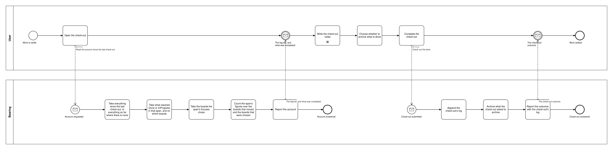
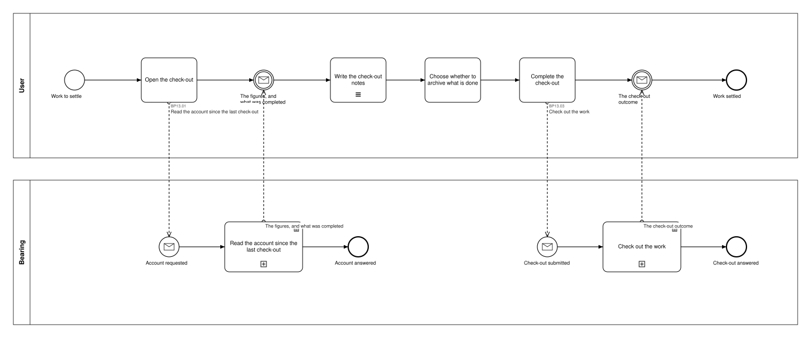

# BP13 — Check out the work done

**Stage.** Discovery / Mockup — before the Intent gate. Nothing here is const.

| | |
|---|---|
| **Trigger** | **User**, whenever they choose to settle what they have done — typically at the end of a day, but nothing requires one a day and nothing forbids several. Days nobody settled are picked up by the next check-out (BR-33, BR-36, BR-45). |
| **Goal** | Everything since the last check-out has a log: the notes written while that span was open, its figures, and per day which boards its focus chose — with the work completed in that span archived unless the user turned that off. |
| **Actors** | **User** (the only human; also the stakeholder) · **Bearing** (the system). No external system takes part. |
| **Source** | `diagrams/BP13_CheckOutTheWork.bpd` — the one tagged source for both levels. |
| **Sources it traces to** | `funnel §Archive`, `wf §6.4` |
| **Rules it exercises** | BR-23, BR-33, BR-34, BR-35, BR-36, BR-37, BR-39, BR-41, BR-45, BR-61, BR-121, BR-124, BR-125, BR-126 |

## The flow in one paragraph

The check-out settles everything since the last one, however long ago that was, and everything up to now where there has never been one — so nothing is picked and nothing can be missed. The account is what that span's movements say, and the user reads it rather than editing it: there is nothing in it to change, so nothing is drawn for agreeing with it — what affirms it is the completing gesture, and the way out is leaving the check-out, which commits nothing and is drawn in no process (BR-129, DRW-30). Two figures read those movements, because no count of the board can see them — completed in the span and started in it — and two are counts of the boards as they stand at the moment of check-out, which is the end of the span: still in progress, and planned but never started, which is simply what sits in Todo — every card there by the user's own decision, since planning a day includes moving cards back out of it (BR-126), so the figure is unkept intentions and not a standing backlog. All four therefore describe one span and one moment. Because movements are what is read, nothing an earlier check-out settled appears, and the focus plays no part in what the account shows: the scope is every board a task moved on, whether or not a day's focus chose it, with Chores among them and no differently — while the two state figures count over those boards **together with the boards the span's focuses chose**, so a focused board nobody touched still contributes its Todo cards (BR-35). The log keeps no per-day focus standing: the adherence figure that read one is void, because only a card entering InProgress or Done is recorded and a task worked on over several days leaves nothing on the days between (~~BR-123~~, SA 2026-10-17). A span nothing moved in still has an account: the notes, and figures of zero. The notes are the check-out's and not a date's — one running journal kept while the span is open, so the draft is current at every moment, taken by the check-out, and the next span starts empty. When to check out is the user's decision alone: several in one day are legitimate, each settling its own span, and so is one with nothing in its span, which is accounted for with empty lists and figures at zero. One closing action follows: archive what the span completed, default ON — and nothing else, so a task finished before the last check-out and left unarchived then stays on its board, where the card's own menu, clearing a lane or being set aside with its activity is how it goes. **There is no reset of the still-open tasks** — a card's column is the only record that the work was started and how far it got, resetting it cannot be undone in the product, and the decision it expressed is expressed instead by setting the next day's focus, which selects without touching a card. One named gesture completes the check-out, which closes the span: started again straight away it has nothing to settle, and work done after it belongs to the next log.

## Level 1 — fully detailed (system chains inline-expanded)

## Level 2 — detailed (system chains collapsed, one box per call site)

## Call sites

Two, each one synchronous call into the system. **`BP13.02` *Draft the day notes* is retired**, and its id is never reused (ADR-066): every draftable field is kept by **`BP19.01`**, drawn once in `BP19 — Keep an edit as a draft`, and this process binds **BR-121** to the step that fills the field instead (SA 2026-10-11). The ids are **call sites of this process**
(`BP13.yy`, ADR-069) — which System Interaction each resolves to is a Design decision, recorded in
`si-binding.yaml`, never a rename. Variations of one request are permutations of one operation and
never a second call site; the `.bpd`'s header comment records which were collapsed and why.

| Call site | On the box | What it does | Steps |
|---|---|---|---|
| [`BP13.01`](../02_System-Interactions/BP13.01_ReadTheAccount.md) | Read the account since the last check-out | Takes everything since the last check-out — everything so far, where there is none — reads what reached Done or InProgress in that span and on which boards, reads the boards the span's focuses chose, and counts its four figures over both sets. The notes drafted so far come back with the account; picking a draft up is the drafting UX of every content edit and drawn once in `BP19` rather than modelled per edit (BR-121). | 5 |
| [`BP13.03`](../02_System-Interactions/BP13.03_CheckOutTheWork.md) | Check out the work | Appends the log, then archives what the closing action was left at. One log per check-out, never rewritten. | 3 |

**The closing action is not a request of its own.** It is a flag the one check-out carries, so
turning it on or off changes what that single write does. With the date gone there is no second
variation left to collapse: there is one check-out, and it takes no argument (SA 2026-10-13).

## Findings for the Software Architect

1. **The stale-Done consequence is narrowed to the other side of a check-out.** Because both lists
   read the span's movements, a task finished *before the last check-out* and left unarchived then
   never reappears in an account, and the check-out never archives it: it stays in its Done column
   until the user archives the card or clears the lane (BR-23, BR-34). Inside the span it is
   accounted for however long ago it was finished, which is what the span ruling bought over the
   date-keyed check-out (SA 2026-10-11, SA 2026-10-13).

2. **One Contract question is reopened by this process.** Whether the figures query the operation log
   or a denormalized per-task movement field earns its place is `QC-04`, reopened on 2026-10-11
   together with Blueprint `Q3`; the 2026-10-06 ruling that no movement data is needed is superseded
   (BR-124).
