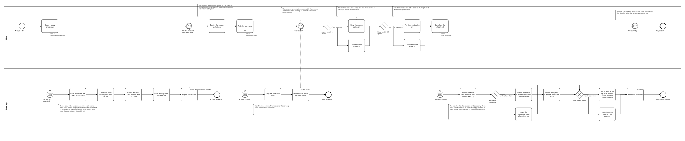
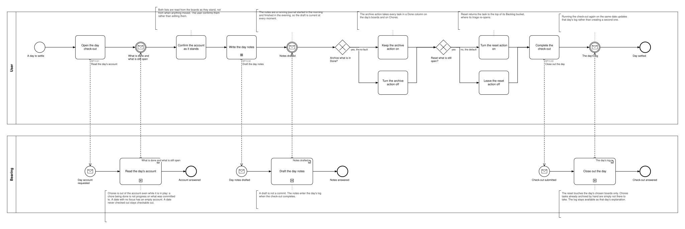

# BP13 — Close out the day

**Stage.** Discovery / Mockup — before the Intent gate. Nothing here is const.

| | |
|---|---|
| **Trigger** | **User**, at the end of a day — and any earlier day that was never checked out stays checkable out (BR-45). |
| **Goal** | The date has a log: the notes, what was completed and what was still open at the moment of check-out, with the completed work archived unless the user turned that off. |
| **Actors** | **User** (the only human; also the stakeholder) · **Bearing** (the system). No external system takes part. |
| **Source** | `diagrams/BP13_CloseOutTheDay.bpd` — the one tagged source for both levels. |
| **Sources it traces to** | `funnel §Archive`, `wf §6.4` |
| **Rules it exercises** | BR-23, BR-33, BR-34, BR-35, BR-36, BR-37, BR-38, BR-39, BR-45, BR-54, BR-121 |

## The flow in one paragraph

The account is what the system observed, and the user confirms it rather than edits it: completed is whatever sits in a Done column, still open is whatever is past Backlog and not Done, both read from the boards as they stand and scoped to the boards the date's focus chose. Chores is out of the account even while it is in play — a chore being done is not progress on what was committed to — and a date with no focus has an empty account, which is a log of notes and no tasks. The day notes are a running journal drafted from the morning on, so the draft is current at every moment. Two closing actions follow: archive what is in Done, default ON and reaching Chores as well as the day's boards, and reset what is still open, default OFF, which returns each task to the top of its Backlog bucket with the rightmost column landing highest and its triage re-opened. One named gesture completes it, and running it again on the same date updates that date's log rather than creating a second one.

## Level 1 — fully detailed (system chains inline-expanded)

## Level 2 — detailed (system chains collapsed, one box per call site)

## Call sites

Three, each one synchronous call into the system. The ids are **call sites of this process**
(`BP13.yy`, ADR-069) — which System Interaction each resolves to is a Design decision, recorded in
`si-binding.yaml`, never a rename. Variations of one request are permutations of one operation and
never a second call site; the `.bpd`'s header comment records which were collapsed and why.

| Call site | On the box | What it does | Steps |
|---|---|---|---|
| [`BP13.01`](../02_System-Interactions/BP13.01_ReadTheDaysAccount.md) | Read the day's account | Reads the date's chosen boards, collects what is in Done and what is past Backlog and not Done, and picks up the notes drafted so far. | 5 |
| [`BP13.02`](../02_System-Interactions/BP13.02_DraftTheDayNotes.md) | Draft the day notes | Keeps the running journal as a draft, out of version control. | 2 |
| [`BP13.03`](../02_System-Interactions/BP13.03_CloseOutTheDay.md) | Close out the day | Records the log, then does what the two closing actions were left at. Idempotent per date. | 5, two gateways |

**The two closing actions are not two requests.** Each is a flag the one close-out carries, so
turning either on or off changes what that single write does — which is also why the archive action
can reach Chores while the reset does not. Checking out today and checking out an earlier day are
the same request with a different date.

## Findings for the Software Architect

1. **BR-33's recorded consequence is visible in the drawing.** Because both lists read the boards as
   they stand, a task finished yesterday and left unarchived appears again today, and checking out an
   earlier day shows today's board rather than that day's. The archive action, default ON, is what
   keeps the list from accumulating. Flagged in BR-33 as revisitable when the screen is designed;
   nothing in the drawing hides it.
