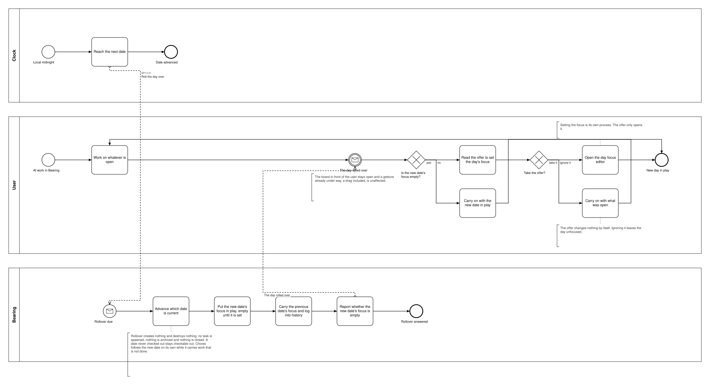
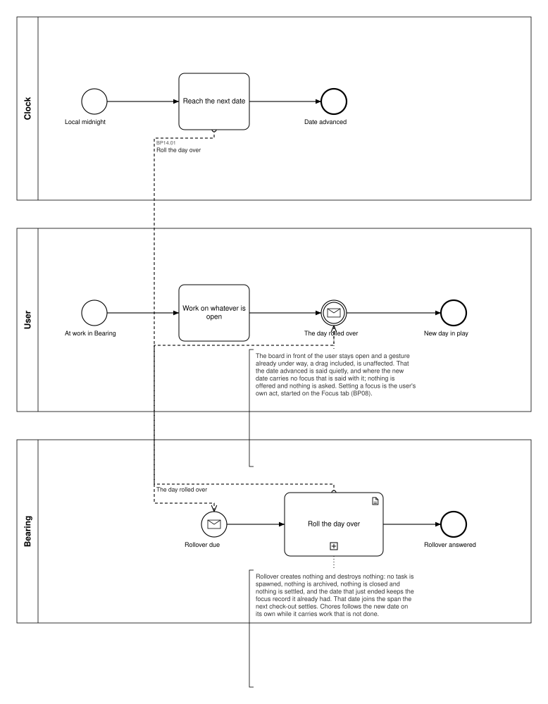

# BP14 — Roll the day over

**Stage.** Discovery / Mockup — before the Intent gate. Nothing here is const.

| | |
|---|---|
| **Trigger** | **Clock** — local midnight, and that is not configurable (BR-44). |
| **Goal** | The current date has advanced, so the day focus in play is the new date's, and the user is offered its editor where that focus is empty — without being interrupted. |
| **Actors** | **Clock** (a `scheduler pool`) · **Bearing** (the system) · **User**, who receives the offer and may ignore it. |
| **Source** | `diagrams/BP14_RollTheDayOver.bpd` — the one tagged source for both levels. |
| **Sources it traces to** | `funnel §Day rollover`, `arch §12 Q1` |
| **Rules it exercises** | BR-40, BR-41, BR-44, BR-45, BR-66 |

## The flow in one paragraph

At local midnight the clock reaches the next date and Bearing advances which date is current. That is the whole of it: the new date's focus comes into play empty until it is set, the previous date's focus and log become history reachable from the period views, and nothing is created, archived or closed — no task is spawned, because only selecting a routine does that. Where the new date's focus is empty, its day focus editor is offered. The offer never interrupts: the board in front of the user stays open, a gesture already under way including a drag is unaffected, and ignoring it leaves the day unfocused.

## Level 1 — fully detailed (system chains inline-expanded)

## Level 2 — detailed (system chains collapsed, one box per call site)

## Call sites

One synchronous call into the system. The id is a **call site of this process** (`BP14.yy`,
ADR-069) — which System Interaction it resolves to is a Design decision, recorded in
`si-binding.yaml`, never a rename.

| Call site | On the box | What it does | Steps |
|---|---|---|---|
| [`BP14.01`](../02_System-Interactions/BP14.01_RollTheDayOver.md) | Roll the day over | Advances the current date, puts the new date's focus in play empty, carries the previous date into history, and reports whether that focus is empty. | 4 |

**Advancing the date and offering the empty day's editor are one request.** The offer is what the
one write reports, not a second chain, and taking it opens BP08 rather than anything here.

## Findings for the Software Architect

1. **§5 says *no user lane*; this drawing has one.** BR-44's offer is made *to the user*, and
   ignoring it is a legitimate answer that nothing else in the drawing can represent. Without the
   lane the diagram would show a rollover that offers nothing, which is not what the rule says. §5's
   Pools column wants that one correction.
2. **The cut still has this as a process of its own, and §5 flags that it may read better as a start
   event inside BP08** — your call. Drawn standalone, which is the cut as it stands; folding it later
   moves one call site and one gateway into BP08 and retires `BP14`.
