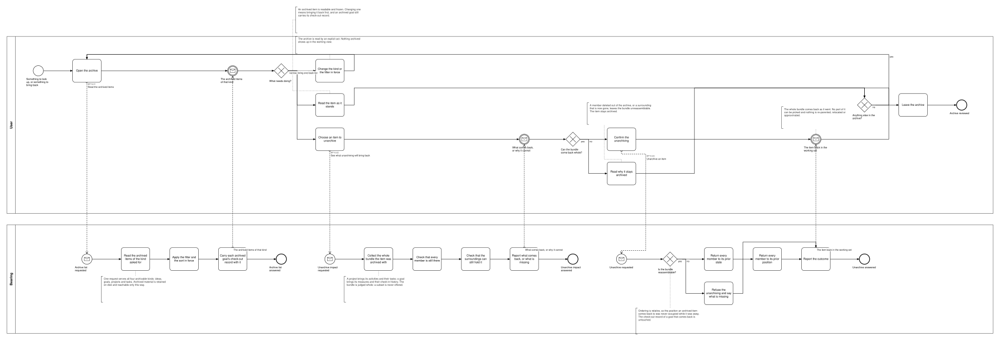
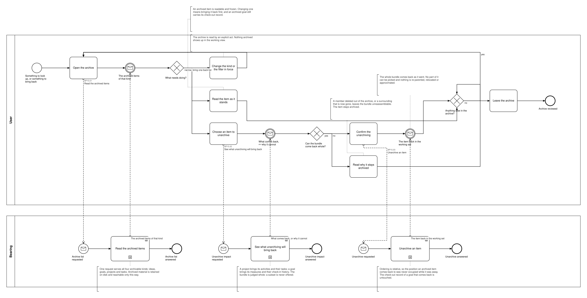

# BP15 — Review archived material

**Stage.** Discovery / Mockup — before the Intent gate. Nothing here is const.

| | |
|---|---|
| **Trigger** | **User**, occasionally — something to look up, or something to bring back. |
| **Goal** | Archived material is readable, and anything that can come back whole is back in the working set exactly as it left. |
| **Actors** | **User** (the only human; also the stakeholder) · **Bearing** (the system). No external system takes part. |
| **Source** | `diagrams/BP15_ReviewArchivedMaterial.bpd` — the one tagged source for both levels. |
| **Sources it traces to** | `wf §7.8` |
| **Rules it exercises** | BR-05, BR-23, BR-25, BR-26, BR-30, BR-88, BR-112 |

## The flow in one paragraph

The archive is reachable only by an explicit act, and what it holds is retained rather than removed. The list is read per kind — ideas, goals, projects, tasks — under the filter and sort in force, each archived goal carrying its check-out record. An item can be read as it stands and is frozen while it is there: changing one means bringing it back first. Bringing one back is disclosed before it is written, because unarchiving is judged over the item and its surroundings together: the whole bundle comes back as it went, in its prior state and prior position, and a partial unarchive can never be consistent, so no subset is ever offered in either direction. Where the bundle can no longer be reassembled — a member deleted out of the archive, a surrounding now gone — the item stays archived and the user is told what is missing.

## Level 1 — fully detailed (system chains inline-expanded)

## Level 2 — detailed (system chains collapsed, one box per call site)

## Call sites

Three, each one synchronous call into the system. The ids are **call sites of this process**
(`BP15.yy`, ADR-069) — which System Interaction each resolves to is a Design decision, recorded in
`si-binding.yaml`, never a rename. Variations of one request are permutations of one operation and
never a second call site; the `.bpd`'s header comment records which were collapsed and why.

| Call site | On the box | What it does | Steps |
|---|---|---|---|
| [`BP15.01`](../02_System-Interactions/BP15.01_ReadTheArchivedItems.md) | Read the archived items | Reads the archived items of the kind asked for, under the filter and sort in force, carrying each archived goal's check-out record. | 3 |
| [`BP15.02`](../02_System-Interactions/BP15.02_ReadTheUnarchiveImpact.md) | See what unarchiving will bring back | Collects the whole bundle the item was archived with, checks every member is still there and that the surroundings can still hold it, and reports what comes back or what is missing. | 4 |
| [`BP15.03`](../02_System-Interactions/BP15.03_UnarchiveItem.md) | Unarchive an item | Returns every member to its prior state and prior position, or refuses and says what is missing. | 3, one gateway |

**§6's eight candidates draw as three.** The four archivable kinds are **not four operations**:
reading them is one request with the kind and the filter as its payload, and unarchiving is one
request whose consequences differ by what the item carries — a project brings its activities and
their tasks, a goal brings its measures and their check-in history — rather than by which operation
is called. The third call site is the one §6 did not list: unarchiving must be **disclosed before it
is written**, the same two-call-site shape every reaching act has.

## Findings for the Software Architect

1. **An item can also leave the archive by being deleted out of it**, which is the owning entity's
   process and not this one — the archive is no shield from a deletion (BR-117). This drawing covers
   reading and bringing back only.
