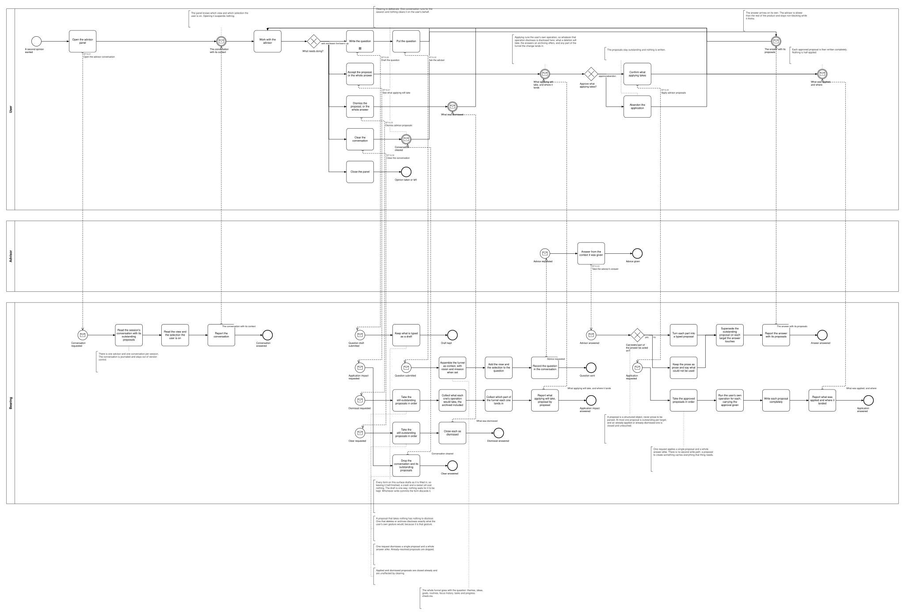
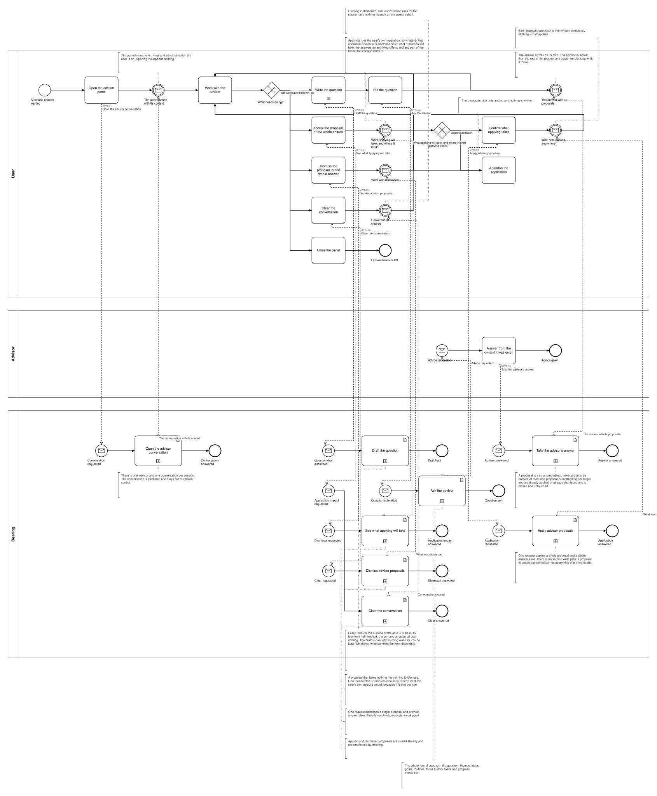

# BP16 — Consult the advisor

**Stage.** Discovery / Mockup — before the Intent gate. Nothing here is const.

| | |
|---|---|
| **Trigger** | **User**, opportunistically — a second opinion wanted, from anywhere in the product. |
| **Goal** | The user has structured, actionable proposals in the context they are working in, and whatever they accept is applied completely through their own operations. |
| **Actors** | **User** (the only human; also the stakeholder) · **Bearing** (the system) · **Advisor** — an external service, drawn as a black-box pool. |
| **Source** | `diagrams/BP16_ConsultTheAdvisor.bpd` — the one tagged source for both levels. |
| **Sources it traces to** | `wf §7.5`, `arch §5 Pivot 3` |
| **Rules it exercises** | BR-66, BR-67, BR-68, BR-69, BR-70, BR-71, BR-72, BR-74, BR-75, BR-118, BR-121 |

## The flow in one paragraph

One advisor, one conversation per session, cleared only deliberately, and never blocking: opening the panel suspends nothing. A question carries the whole funnel as context — themes, ideas, goals, routines, focus history, tasks, progress check-ins, plus vision and mission when set — along with the view and the selection the user is on. The answer comes back from the service and Bearing turns each part of it into a typed proposal, keeping prose as prose and saying plainly what could not be used, so the user is never handed something that looks like a proposal and is not one. At most one proposal is outstanding per target, and a revision supersedes its predecessor. Accepting runs the user's own operation — there is no second write path, deletions included — so what that operation would take is disclosed first and approved before anything is written, exactly as it would be if the user had started the gesture, and where a change lands somewhere the user is not working, saying so is part of applying it. The panel comes current on its own, with the advisor's higher latency accepted.

## Level 1 — fully detailed (system chains inline-expanded)

## Level 2 — detailed (system chains collapsed, one box per call site)

## Call sites

Eight, each one synchronous call into the system. The ids are **call sites of this process**
(`BP16.yy`, ADR-069) — which System Interaction each resolves to is a Design decision, recorded in
`si-binding.yaml`, never a rename. Variations of one request are permutations of one operation and
never a second call site; the `.bpd`'s header comment records which were collapsed and why.

| Call site | On the box | What it does | Steps |
|---|---|---|---|
| [`BP16.01`](../02_System-Interactions/BP16.01_OpenTheAdvisorConversation.md) | Open the advisor conversation | The session's conversation with its outstanding proposals, plus the view and selection the user is on. | 3 |
| [`BP16.02`](../02_System-Interactions/BP16.02_AskTheAdvisor.md) | Ask the advisor | Assembles the funnel as context, adds the view and selection, records the question, and sends the request to the service. | 3 |
| [`BP16.03`](../02_System-Interactions/BP16.03_TakeTheAdvisorsAnswer.md) | Take the advisor's answer | Turns each actionable part into a typed proposal, keeps the rest as prose and says what could not be used, and supersedes the outstanding proposal on every target the answer touches. | 3, one gateway |
| [`BP16.07`](../02_System-Interactions/BP16.07_ReadWhatApplyingWillTake.md) | See what applying will take | Takes the still-outstanding proposals in order and collects, per proposal, what its operation would take — the archived included — and which part of the funnel it lands in. | 4 |
| [`BP16.04`](../02_System-Interactions/BP16.04_ApplyAdvisorProposals.md) | Apply advisor proposals | Takes the approved proposals in order, runs the user's own operation for each carrying the approval given, writes each completely, and reports where each landed. | 4 |
| [`BP16.05`](../02_System-Interactions/BP16.05_DismissAdvisorProposals.md) | Dismiss advisor proposals | Takes the still-outstanding proposals in order and closes each as dismissed. | 2 |
| [`BP16.06`](../02_System-Interactions/BP16.06_ClearTheConversation.md) | Clear the conversation | Drops the conversation and its outstanding proposals. Applied and dismissed ones are closed already. | 1 |
| [`BP16.08`](../02_System-Interactions/BP16.08_DraftTheQuestion.md) | Draft the question | Keeps what is typed as a draft, out of version control. One-way: nothing waits for it, and the write that commits the form discards it. Every form on this surface drafts this way (BR-121). | 1 |

**Applying one proposal and applying a whole answer are one request**, and so are the two dismissals
(BR-71). The ten catalog types are the payload of a proposal, not ten operations. Two call sites §6 did not list. The **answer coming back** is one: the round trip to the service is
two chains because the call is asynchronous and the advisor is never blocking (BR-66), so the request
leaves in `BP16.02` and the answer is taken in `BP16.03`. The **disclosure before applying** is the
other: BR-72 has an applied deletion disclose what it will take and be approved or abandoned, and one
synchronous call cannot both ask and act, so applying is `BP16.07` then `BP16.04`.

## Findings for the Software Architect

1. **The writes a proposal causes are not redrawn here.** BR-72 makes applying a proposal run the
   user's own operation, so the delete, the archive and the create a proposal can trigger live in
   BP02, BP04, BP05, BP06, BP11, BP12, BP17 and BP18 — with their impact reads and their approvals intact.
   `BP16.04` is the fan-out, not a second write path, and at Design it binds to the same operations
   those processes call.
2. **The Advisor pool is drawn as a black box with one step.** What it does inside is not Bearing's
   business and the product is specified against what it returns (BR-68, BR-75), not against how it
   decided. Whether the service is hosted or local is a Contract-tier question and stays open there.
