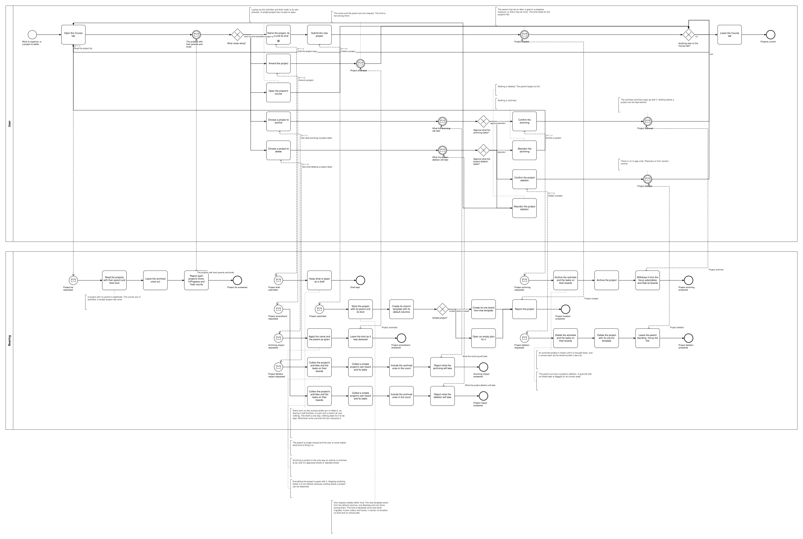
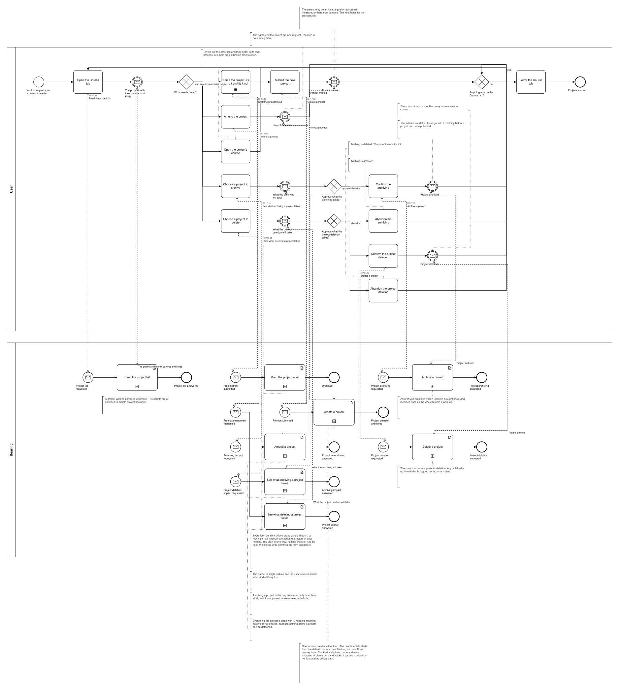

# BP17 — Maintain a project

**Stage.** Discovery / Mockup — before the Intent gate. Nothing here is const.

| | |
|---|---|
| **Trigger** | **User**, when work begins or ends — work to organize, or a project to settle. |
| **Goal** | Every project exists with its parent and its kind, and leaves the working set only by being archived or deleted, with everything it carries disclosed first. |
| **Actors** | **User** (the only human; also the stakeholder) · **Bearing** (the system). No external system takes part. |
| **Source** | `diagrams/BP17_MaintainAProject.bpd` — the one tagged source for both levels. |
| **Sources it traces to** | `act §1`, `act §12` |
| **Rules it exercises** | BR-12, BR-19, BR-23, BR-26, BR-43, BR-96, BR-97, BR-101, BR-108, BR-109, BR-111, BR-112, BR-113, BR-114, BR-117, BR-118, BR-121 |

## The flow in one paragraph

The Course tab works from the live projects with their parent and their kind and each one's Done / InProgress / Todo counts. A project is created with its parent — an idea, a goal, a progress measure, or none, single-valued and never asked about by kind — and with its own kind, declared once and held for the project's life, since there is no migration either way. A simple project gets its one board from its column template; an activity-based one gets an empty plan, which is BP18's to lay out. One editor serves a project just started and one being changed alike (UX-04), and the kind it declares is not amendable; the one request ensures the template and the board rather than creating them, so it serves both. Setting a project aside discloses what the archiving takes — its activities and the tasks on their boards, archived ones counted — and the user approves the whole thing or nothing, because nothing below a project can be kept behind; this is the only way an activity is archived at all. Deleting one is the same shape, and the parent survives it minus the link.

## Level 1 — fully detailed (system chains inline-expanded)

## Level 2 — detailed (system chains collapsed, one box per call site)

## Call sites

Five, each one synchronous call into the system. **`BP17.01` *Read the project list* is retired on 2026-10-17**, its id never reused (ADR-066): what a surface shows is loaded and derived at start-up, so opening it asks the system for nothing — the derived-data inventory carries each value with the rule that governs it. **`BP17.03` *Amend a project* is retired**, and its id is never reused (ADR-066): starting a project and changing one are the same act, so one editor, one submit and one request serve both — `BP17.02` is that request, and it ensures the template and the board rather than creating them (UX-04, DRW-11, SA 2026-10-14). **`BP17.16` *Draft the project input* is retired**, and its id is never reused (ADR-066): every draftable field is kept by **`BP19.01`**, drawn once in `BP19 — Keep an edit as a draft`, and this process binds **BR-121** to the step that fills the field instead (SA 2026-10-11). The ids are **call sites of this process**
(`BP17.yy`, ADR-069) — which System Interaction each resolves to is a Design decision, recorded in
`si-binding.yaml`, never a rename. Variations of one request are permutations of one operation and
never a second call site; the `.bpd`'s header comment records which were collapsed and why.

**`BP17.06` to `BP17.13` are retired** — the plan moved to **BP18** on 2026-10-10, so one process
holds the project and the other its course. A retired number is never reused, which is why the ids
below run `.01`–`.05` and then `.14`–`.15`: an id is an identifier, not a position.

| Call site | On the box | What it does | Steps |
|---|---|---|---|
| [`BP17.02`](../02_System-Interactions/BP17.02_CreateProject.md) | Edit a project | One request stores what the editor was filled in with, whether the project is new or not. A new project gets a column template of its own — created with it, starting from four lanes one per role, since there is no library to pick from (BR-108) — and what its kind brings: one board where it is simple, an empty plan where it is activity-based, a plan's boards arriving with its activities (BR-97, BR-101, BP18). The kind is not amendable — declared once, for life — so an edit that would change an existing project's kind is refused with its reason and the rest of it is stored, no surface being trusted to have checked that (BR-97, BR-128). | 5, one gateway |
| [`BP17.04`](../02_System-Interactions/BP17.04_ReadTheProjectDeletionImpact.md) | See what deleting a project takes | The activities and their tasks, or a simple project's own board and tasks, archived ones counted. | 1 |
| [`BP17.05`](../02_System-Interactions/BP17.05_DeleteProject.md) | Delete a project | Deletes everything the project is, leaving the parent standing minus the link. | 3 |
| [`BP17.14`](../02_System-Interactions/BP17.14_ReadTheProjectArchivingImpact.md) | See what archiving a project takes | The activities and their tasks, and what of it can be declined — nothing below a project can be left behind, so that combination is the only legal one. | 1 |
| [`BP17.15`](../02_System-Interactions/BP17.15_ArchiveProject.md) | Archive a project | Archives the activities and their tasks, then the project, withdrawing it from the focus selectables. | 3 |

**Creating either kind is one request, and the drawing does not dispatch on the kind** — the board of a simple project and the empty plan of an activity-based one are two permutations of one step, which is the call SA made on BP06's measure type (ADR-069). Archiving and deleting are each a disclosure and a write
(BR-112, BR-113, BR-114, BR-117). **Archiving a project was missing from §6's candidate list
altogether** although BR-23 makes it an act and BR-112 its rule — it belongs here, since archiving a
project is the only way an activity is archived.

## Findings for the Software Architect

1. **The project list leaves archived projects out (BR-26), so an archived project comes back only
   through BP15** — which this drawing now reaches as a seam of its own, beside *plan its work*,
   since the Course tab is where a project would most naturally be brought back from.
