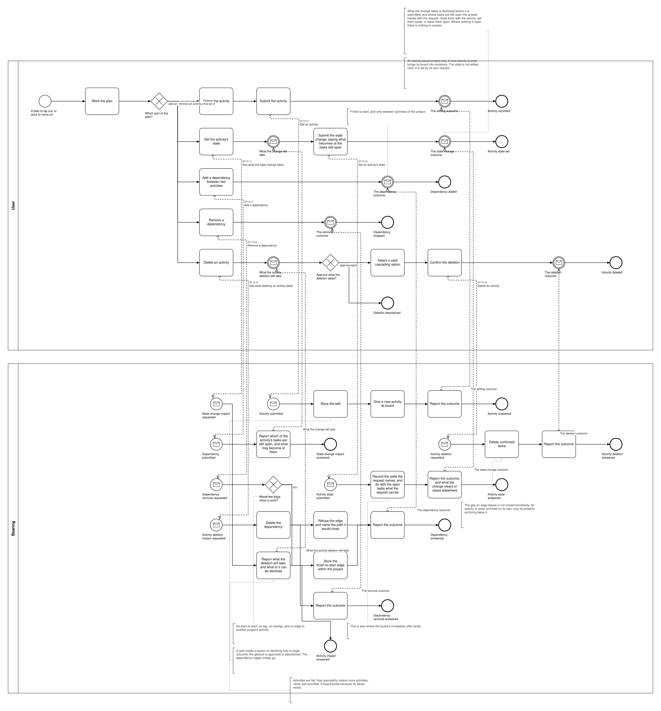
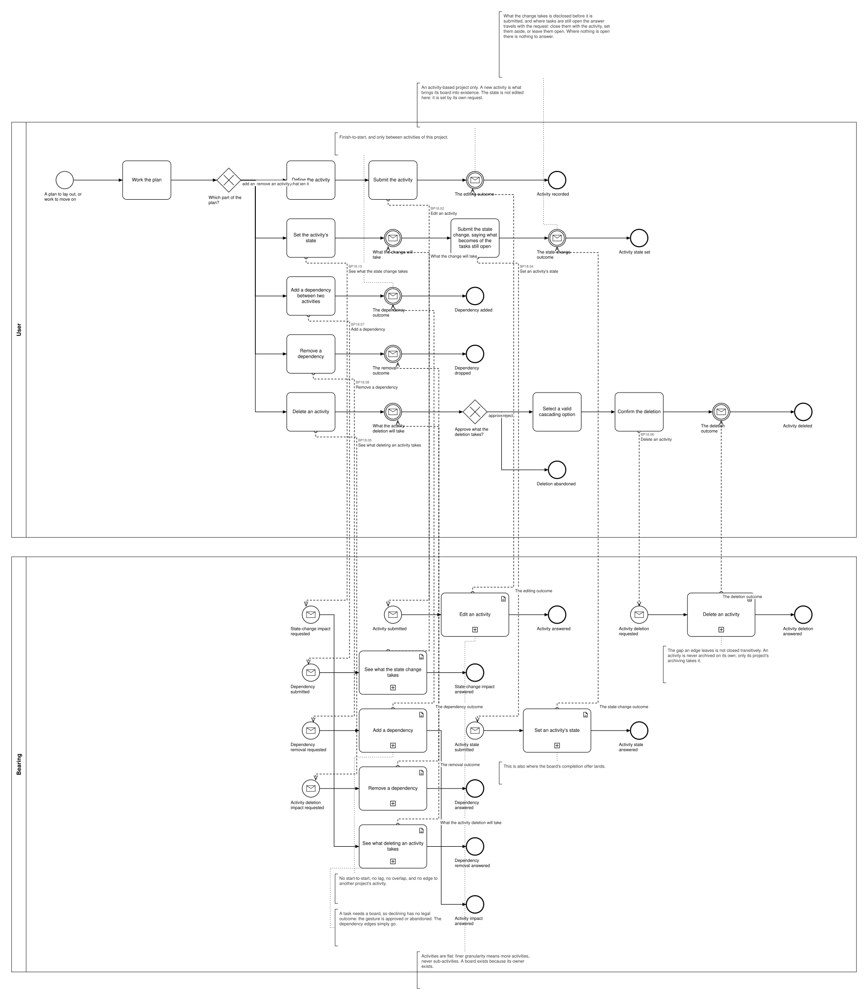

# BP18 — Plan a project's course

**Stage.** Discovery / Mockup — before the Intent gate. Nothing here is const.

| | |
|---|---|
| **Trigger** | **User**, weekly to monthly — a plan to lay out, or work to move on. |
| **Goal** | An activity-based project's work is broken into activities, ordered by what waits for what, and each activity's state says how far the project has got. |
| **Actors** | **User** (the only human; also the stakeholder) · **Bearing** (the system). No external system takes part. |
| **Source** | `diagrams/BP18_PlanAProjectsCourse.bpd` — the one tagged source for both levels. |
| **Sources it traces to** | `act §5`, `act §7`, `act §9`, `act §12` |
| **Rules it exercises** | BR-12, BR-19, BR-23, BR-61, BR-65, BR-97, BR-98, BR-99, BR-100, BR-101, BR-104, BR-105, BR-108, BR-109, BR-110, BR-112, BR-113, BR-117, BR-118, BR-119, BR-121, BR-127 |

## The flow in one paragraph

A project's course works from its activities with their state and notes, the dependencies between them, ordered by dependency and then by name, with a quiet flag on any activity whose predecessor is unfinished, plus the Done / InProgress / Todo counts. Then one act at a time, repeatable: define an activity — one editor serving a new activity and a changed one alike (UX-04), a new one being what brings its board into existence, and the state not among what it reaches; set its state, the same request closing an activity and reopening a Done one — and where closing it would leave cards open on its board, those cards are disclosed first and the user says what becomes of them — close them with the activity, set them aside, or leave them open — the answer travelling with the state change as part of the one request, since the state is the planner's judgement and not a claim about every card (BR-127); add a dependency, finish-to-start and only between this project's activities, refused by name if it would close a cycle; drop one, leaving the gap open rather than closing it transitively; or delete an activity, which discloses the tasks on its board first and is approved or abandoned, since a task cannot be left without a board. The result is a graph, not a chain — several activities may be ready at once — and the plan orders and tracks without ever scheduling: no duration, no float, no critical path.

## Level 1 — fully detailed (system chains inline-expanded)

## Level 2 — detailed (system chains collapsed, one box per call site)

## Call sites

Seven, each one synchronous call into the system. **`BP18.01` *Read a project's course* is retired on 2026-10-17**, its id never reused (ADR-066): what a surface shows is loaded and derived at start-up, so opening it asks the system for nothing — the derived-data inventory carries each value with the rule that governs it. **`BP18.03` *Amend an activity* is retired**, and its id is never reused (ADR-066): adding an activity and changing one are the same act, so one editor, one submit and one request serve both — `BP18.02` is that request, and it ensures the board rather than creating it (UX-04, DRW-11, SA 2026-10-14). **`BP18.09` *Draft the activity input* is retired**, and its id is never reused (ADR-066): every draftable field is kept by **`BP19.01`**, drawn once in `BP19 — Keep an edit as a draft`, and this process binds **BR-121** to the step that fills the field instead (SA 2026-10-11). The ids are **call sites of this process**
(`BP18.yy`, ADR-069) — which System Interaction each resolves to is a Design decision, recorded in
`si-binding.yaml`, never a rename. Variations of one request are permutations of one operation and
never a second call site; the `.bpd`'s header comment records which were collapsed and why.

**`BP18.01` to `BP18.08` were drawn in BP17 until 2026-10-10** and moved here on the Software
Architect's ruling, so that the project and its plan are one process each. They are minted here as
new call sites; `BP17.06`–`BP17.13` are retired there and never reused.

| Call site | On the box | What it does | Steps |
|---|---|---|---|
| [`BP18.02`](../02_System-Interactions/BP18.02_CreateActivity.md) | Edit an activity | One request stores what the editor was filled in with, whether the activity is new or not, and gives a new activity the board its project's template governs (BR-101, BR-108). The state is not edited here: it is set by its own request. | 3 |
| [`BP18.10`](../02_System-Interactions/BP18.10_ReadTheStateChangeImpact.md) | See what the state change takes | Reports which of the activity's tasks are still open and what may become of them; empty when none are. | 1 |
| [`BP18.04`](../02_System-Interactions/BP18.04_SetAnActivitysState.md) | Set an activity's state | Records Todo, InProgress or Done, reopening included, and reports what the change clears or raises. | 2 |
| [`BP18.05`](../02_System-Interactions/BP18.05_ReadTheActivityDeletionImpact.md) | See what deleting an activity takes | The tasks on its board, archived ones counted; approve-or-abandon. | 1 |
| [`BP18.06`](../02_System-Interactions/BP18.06_DeleteActivity.md) | Delete an activity | Deletes its tasks, the activity with its board, and its dependency edges. | 2 |
| [`BP18.07`](../02_System-Interactions/BP18.07_AddDependency.md) | Add a dependency | Stores the finish-to-start edge, or refuses it naming the path it would close. | 3, one gateway |
| [`BP18.08`](../02_System-Interactions/BP18.08_RemoveDependency.md) | Remove a dependency | Deletes the edge and leaves the gap open. | 2 |

**Every activity state is one request**, reopening a Done one included — which is also the operation
BP11's completion offer calls, bound to one System Interaction at Design rather than named across
drawings here.

## Findings for the Software Architect

1. **An activity is never archived on its own.** It goes only with its project (BR-23, BR-112), which
   is BP17's act, so this process can delete an activity but not archive one. The asymmetry is the
   rule's, not the drawing's.
2. **A simple project has no course to open at all (BR-97).** This process exists only for
   activity-based projects; BP17's hand-over step says so, and nothing here degrades gracefully for
   a project without a plan — there is nothing to degrade to.
