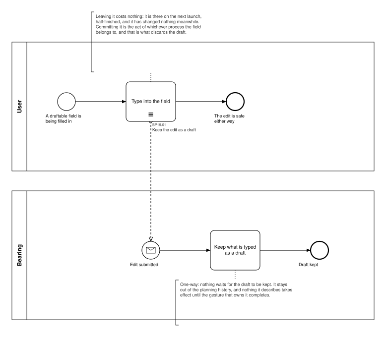
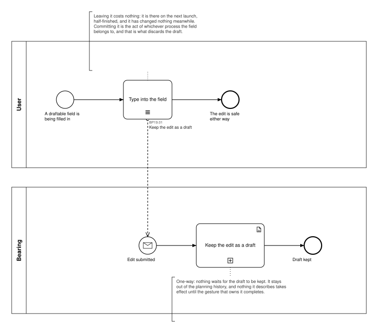

# BP19 — Keep an edit as a draft

**Stage.** Discovery / Mockup — before the Intent gate. Nothing here is const.

| | |
|---|---|
| **Trigger** | **User**, constantly — a draftable field is being filled in and has no commit yet. |
| **Goal** | Nothing the user has typed is ever lost by walking away from it, and nothing they have typed takes effect before they commit it. |
| **Actors** | **User** (the only human; also the stakeholder) · **Bearing** (the system). No external system takes part. |
| **Source** | `diagrams/BP19_KeepAnEditAsADraft.bpd` — the one tagged source for both levels. |
| **Sources it traces to** | `wf §3.2`, `wf §6.4`, SA 2026-10-10 (BR-121), SA 2026-10-11 |
| **Rules it exercises** | BR-63, BR-92, BR-121 |

## The flow in one paragraph

This is every draftable field in the product, drawn once. While the user types into one, what they
have typed is kept as a draft: it survives abandoning the gesture, a crash and an app restart, it
changes nothing until the gesture completes, and it stays out of the planning history (BR-121).
Keeping it is one-way — nothing waits for the draft to be stored, so typing never pauses — and the
draft is discarded by whichever write finally commits the input, which is the committing process's
own act and is drawn there. **Which** fields are draftable is the owning process's business, not
this drawing's; this process says what happens to any of them while it is being filled in. Where a
draft is kept is deliberately not a business concern: it lives with the user's data and outside
version control, like the remembered interface state (BR-92), and the shape of that belongs to the
Blueprint gate.

## Level 1 — fully detailed (system chains inline-expanded)

## Level 2 — detailed (system chains collapsed, one box per call site)

## Call sites

One, a single synchronous call into the system. The id is a **call site of this process**
(`BP19.yy`, ADR-069) — which System Interaction it resolves to is a Design decision, recorded in
`si-binding.yaml`, never a rename.

| Call site | On the box | What it does | Steps |
|---|---|---|---|
| [`BP19.01`](../02_System-Interactions/BP19.01_KeepTheEditAsADraft.md) | Keep the edit as a draft | Keeps what is typed as a draft, out of version control and out of the planning history. One-way: nothing waits for it. | 1 |

## Why this process exists at all

Until 2026-10-11 **eleven** processes each drew a draft chain of their own — `BP03.08`, `BP04.04`,
`BP05.16`, `BP06.09`, `BP07.02`, `BP11.10`, `BP12.09`, `BP13.02`, `BP16.08`, `BP17.16` and
`BP18.09` — eleven call sites realizing one operation, in drawings that are about something else
entirely. The Software Architect ruled that out: *"it would complicate editing text fields qualified
for drafting in BPs"*, and *"whenever I edit a draftable text field incl. a goal check-out field or
a day note field, I want to apply the drafting BP"*. Storing a draft **is** a System Interaction, so
it has to be drawn — once, here. Every editing process now binds **BR-121** to the step that fills
the field, which is where a reader of that drawing needs it, and draws no chain. All eleven ids are
retired and never reused (ADR-066).

Two drafts are **not** this process, each for its own reason:

- **A staged task batch** (`BP10`, BR-63). It is a draft in BR-121's sense, but the user picks it up,
  amends it, reorders it and commits it as a batch — work of its own, with its own surface.
  *"Draft tasks are completely different beast and are excluded here"* (SA 2026-10-11).
- **Anything the UI alone holds.** A fold, a collapsed section, a view mode — the product may
  remember it (BR-92), but it is not input awaiting a commit, so it is neither a draft nor a step in
  any business process.
