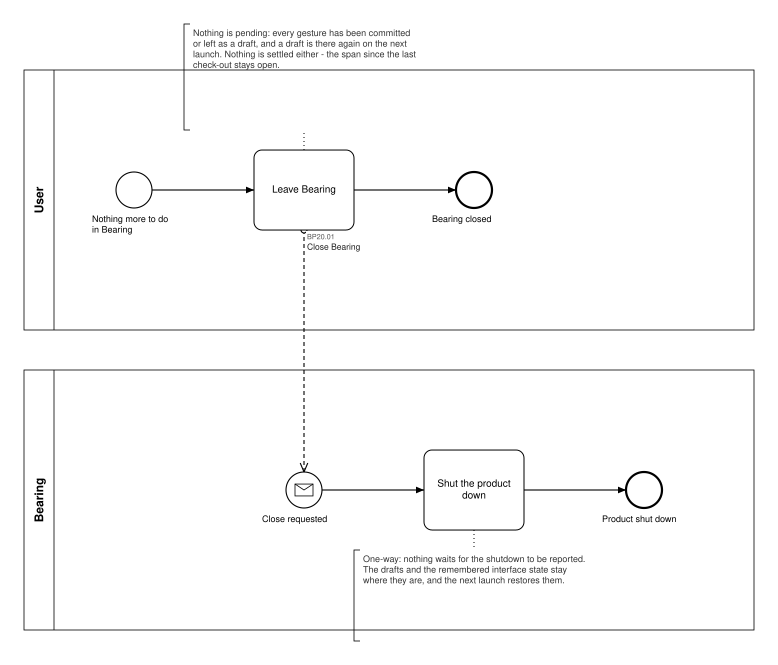
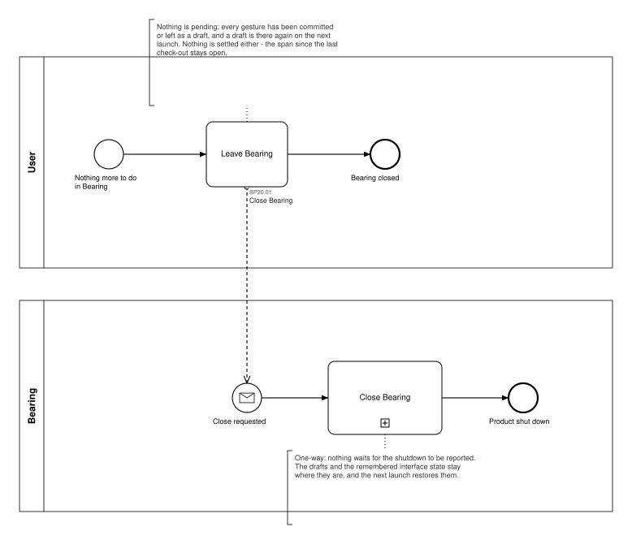

# BP20 — Close Bearing

**Stage.** Discovery / Mockup — before the Intent gate. Nothing here is const.

| | |
|---|---|
| **Trigger** | **User**, once a session — nothing more to do in Bearing. |
| **Goal** | The session ends without costing the user anything: nothing is lost, nothing is settled behind their back, and the next launch picks up where this one left off. |
| **Actors** | **User** (the only human; also the stakeholder) · **Bearing** (the system). No external system takes part. |
| **Source** | `diagrams/BP20_CloseBearing.bpd` — the one tagged source for both levels. |
| **Sources it traces to** | SA 2026-10-17 |
| **Rules it exercises** | BR-32, BR-33, BR-44, BR-92, BR-121 |

## The flow in one paragraph

The user leaves and the product shuts down. Nothing is asked first: a confirmation guards against
losing work, and there is no work to lose — every gesture has either been committed, which answered
at the time, or left half-written, which is a draft by then and is there again on the next launch
(BR-121, BP19). Nothing is settled either. Closing makes no check-out, archives nothing, touches no
task and does not advance the date in play: the span since the last check-out stays open and the
next check-out takes it, exactly as it does across a rollover (BR-33, BR-44). The remembered
interface state stays where it is and the next launch onto usable data restores it (BR-92, BP01).
The request is one-way — nothing waits for the shutdown to be reported — which is the one shape a
closing act can have. This is not the start-up refusal: there, closing the product is the only way
on from a launch that cannot continue, and that path is BP01's and keeps its own call site.

## Level 1 — fully detailed (system chains inline-expanded)

## Level 2 — detailed (system chains collapsed, one box per call site)

## Call sites

One synchronous call into the system, answered by nothing. The id is a **call site of this process**
(`BP20.yy`, ADR-069) — which System Interaction it resolves to is a Design decision, recorded in
`si-binding.yaml`, never a rename.

| Call site | On the box | What it does | Steps |
|---|---|---|---|
| [`BP20.01`](../02_System-Interactions/BP20.01_CloseBearing.md) | Close Bearing | Shuts the product down, leaving the drafts and the remembered interface state where they are (BR-92, BR-121). It writes nothing of the user's: everything that had to be stored was stored by the gesture that made it. | 1 |

**Closing is one operation drawn by two processes.** `BP01.09` draws it on the refusal path of a
launch that cannot continue; this process draws the ordinary quit. Two call sites, one operation —
which is what the call-site scheme is for (ADR-069), and never a rename.

## Findings for the Software Architect

1. **The close offers nothing on the way out.** No check-out reminder, no "you have unsettled work
   since Tuesday", no prompt to set tomorrow's focus. That follows from the drafts and from the
   span staying open, but it is a product decision rather than a consequence of a rule, and this
   drawing is where it would be drawn if you want one.
