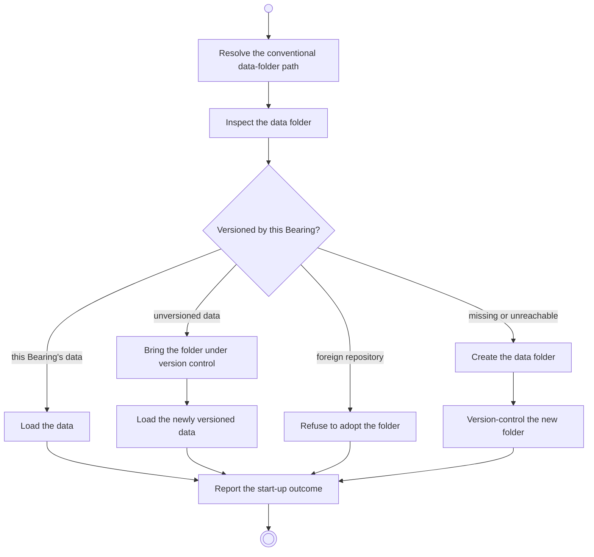

# BP01.01 — Start up

> GENERATED by `bpmn-dsl si-export` — do not edit; the source is the `call` block in the
> `.bpd` (#1182/ADR-068, keyed by call site per ADR-069).
>
> hash: `sha256:7185b0bdf1a360626c821ac850683dabf179092716c6bbce44c476f5259c4118`

## BP01_StartBearing — Activity diagram

### Bound rules

| Where | Rule |
|---|---|
| "Versioned by this Bearing?" | `BR-80` |
| "Present but not versioned?" → unversioned data | `BR-80` |
| "Versioned by something else?" → foreign repository | `BR-80` |
| Report the start-up outcome | `BR-81` |

### Messages

| Where | Message | To | Payload |
|---|---|---|---|
| Start up | Start-up outcome | User | — |

### Notes

- **Start up**: One synchronous call per launch. The four folder states are variations of one operation, not four operations. An unreachable symlink target counts as missing.
