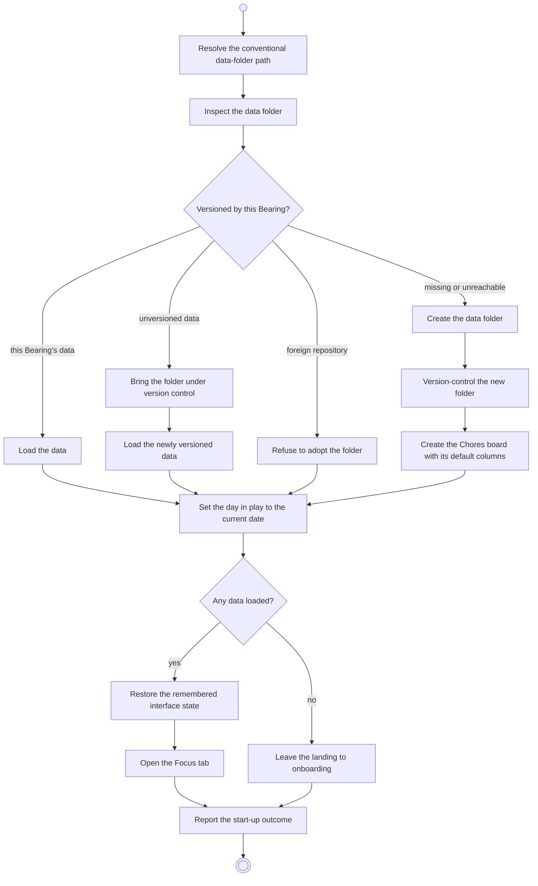

# BP01.01 — Start up

> GENERATED by `bpmn-dsl si-export` — do not edit; the source is the `call` block in the
> `.bpd` (#1182/ADR-068, keyed by call site per ADR-069).
>
> hash: `sha256:9859bf8ed10d5963c7ca22ce21e10e56d88ebaa668afaa9994e9e2c7723d4f77`

## BP01_StartBearing — Activity diagram

### Bound rules

| Where | Rule |
|---|---|
| "Versioned by this Bearing?" | `BR-80` |
| "Present but not versioned?" → unversioned data | `BR-80` |
| "Versioned by something else?" → foreign repository | `BR-80` |
| Create the Chores board with its default columns | `BR-102` |
| Set the day in play to the current date | `BR-44` |
| "Any data loaded?" | `BR-48` |
| Restore the remembered interface state | `BR-92` |
| Report the start-up outcome | `BR-81` |

### Messages

| Where | Message | To | Payload |
|---|---|---|---|
| Start up | Start-up outcome | User | — |

### Notes

- **Start up**: One synchronous call per launch. The four folder states are variations of one operation, not four operations. An unreachable symlink target counts as missing. Creating the folder is what brings the Chores board into existence. The day in play is set to the current date here, from no day rather than from a previous one. A launch onto usable data lands on Focus; a first run lands there when onboarding completes.
