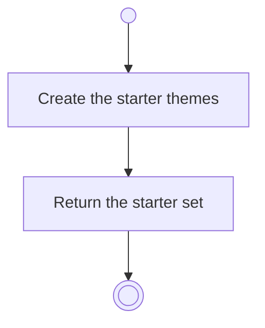

# BP01.02 — Seed the starter themes

> GENERATED by `bpmn-dsl si-export` — do not edit; the source is the `call` block in the
> `.bpd` (#1182/ADR-068, keyed by call site per ADR-069).
>
> hash: `sha256:8a0f8125256202ec72ed4bdf757f672f6d520c40727ef69b7bc6331ffa871181`

## BP01_StartBearing — Activity diagram

### Bound rules

| Where | Rule |
|---|---|
| Create the starter themes | `BR-82` |

### Messages

| Where | Message | To | Payload |
|---|---|---|---|
| Seed the starter themes | Starter themes | User | — |

### Notes

- **Seed the starter themes**: Health, Career, Learning, Relationships, Personal — five, enough to start with. The chain runs only when the user asks for a starter set.
