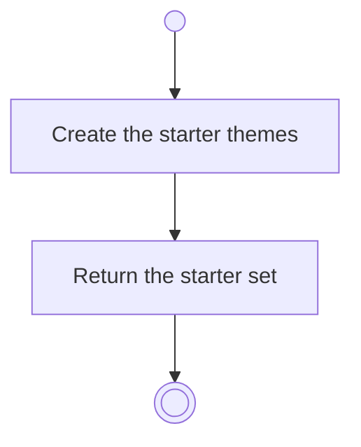

# BP01.02 — Start onboarding

> GENERATED by `bpmn-dsl si-export` — do not edit; the source is the `call` block in the
> `.bpd` (#1182/ADR-068, keyed by call site per ADR-069).
>
> hash: `sha256:9a3fda2e30b26d63df0a190064bd6ccf6684a00eee8dade1f8204538bd690010`

## BP01_StartBearing — Activity diagram

### Bound rules

| Where | Rule |
|---|---|
| Create the starter themes | `BR-82` |

### Messages

| Where | Message | To | Payload |
|---|---|---|---|
| Start onboarding | Starter themes | User | — |

### Notes

- **Start onboarding**: Health, Career, Learning, Relationships, Personal — five, so the product is never empty.
